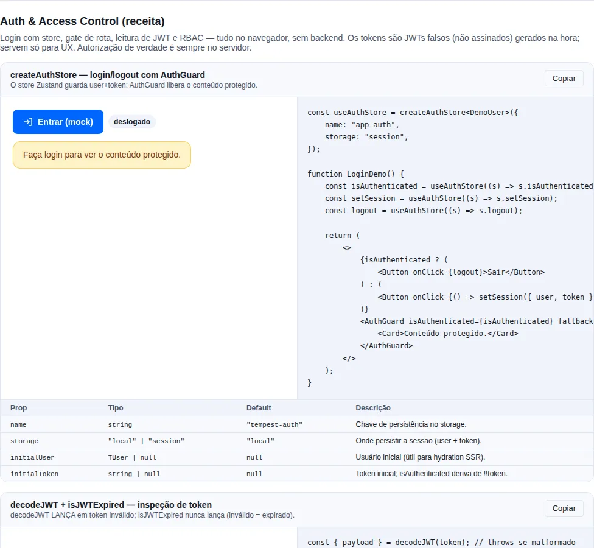

# Auth

Front-end authentication is always the same handful of problems: where to keep the session, how to protect a route, how to read what's inside the token, and what to do when it expires mid-deploy. The `auth` module of `tempest-react-sdk` solves each one with a small, independent piece — you take only what you need, without inheriting a whole auth framework.

Five pieces, all decoupled from one another:

1. `createAuthStore` — builds a Zustand store typed by the app's `TUser`.
2. `AuthGuard` — router-agnostic route gate.
3. `decodeJWT` / `isJWTExpired` — defensive JWT reading (no cryptographic validation).
4. `lazyWithRetry` — `React.lazy` with chunk retry + reload on final failure.
5. `createRefreshQueue` — coalesces concurrent refresh calls.

!!! info "Why loose pieces instead of one monolithic `<AuthProvider>`"
    Every Tempest app has a different user model, a different login flow, and a
    different backend. A monolithic provider would force everyone into a single
    shape. Five primitives compose freely: you can use the store without the
    guard, the guard without the JWT decoder, and so on.

<!-- gallery:recipe-auth -->
[](gallery.md)

*Section `recipe-auth` of the [gallery](gallery.md) — run it locally to interact.*
<!-- /gallery -->

## Store — `createAuthStore<TUser>`

The SDK **does not own your user model**. You pass the `TUser` and get a typed Zustand store, already wired with `persist`.

```tsx
import { createAuthStore } from "tempest-react-sdk";

type SessionUser = { id: string; name: string; is_admin: boolean };

export const useAuthStore = createAuthStore<SessionUser>({
  name: "tempest-app-auth",
  storage: "local",
});

// inside a component: read state (re-renders on change)
function Header() {
  const { user, isAuthenticated, logout } = useAuthStore();
  return isAuthenticated ? <button onClick={logout}>Sign out {user?.name}</button> : null;
}

// outside React: write through getState()
useAuthStore.getState().setSession({
  user: { id: "u1", name: "Ana", is_admin: false },
  token: "eyJhbGciOi…",
});
useAuthStore.getState().logout();
```

Persists to `localStorage` (default) or `sessionStorage` (`storage: "session"`). Only `user` and `token` are persisted (`partialize`); after hydration, `isAuthenticated` is re-derived from `!!token` in `onRehydrateStorage`.

Extra options: `initialUser`, `initialToken` (useful for SSR hydration).

!!! tip "Select only what you need"
    `const isAuth = useAuthStore((s) => s.isAuthenticated)` re-renders only when
    `isAuthenticated` changes. Destructuring the whole store
    (`const { ... } = useAuthStore()`) subscribes to **every** slice and
    re-renders on any change — prefer the selector in hot components.

## Guard — `AuthGuard`

Router-agnostic: it's a pure if/else. You decide what to render in each branch — typically `<Outlet />` when authenticated and `<Navigate />` for the redirect.

```tsx
import { Navigate, Outlet } from "react-router";
import { AuthGuard } from "tempest-react-sdk";

export function ProtectedLayout() {
  const isAuthenticated = useAuthStore((s) => s.isAuthenticated);
  return (
    <AuthGuard isAuthenticated={isAuthenticated} fallback={<Navigate to="/login" replace />}>
      <Outlet />
    </AuthGuard>
  );
}
```

`AuthGuard` takes `isAuthenticated`, `children`, and `fallback` — no opinion about the router. Compose with custom role guards by nesting a second guard inside `children`.

!!! note "Relationship with the routing module's `<RouteGuard>`"
    If you use the SDK's routing module, the declarative
    [`<RouteGuard>`](./routing.en.md) already covers the common case
    (`when` + `redirectTo`) right in the route tree. Use `AuthGuard` when you
    need imperative control over what renders in each branch, or when you're not
    using `<AppRouter>`.

## JWT — `decodeJWT` / `isJWTExpired`

A **payload-only** decoder — it does **not** validate the signature. Use it on the client for inspection/UX (show a name, hide an admin button, decide when to refresh). Real authorization always happens on the backend.

```ts
import { decodeJWT, isJWTExpired } from "tempest-react-sdk";

// decodeJWT THROWS when the token is malformed — wrap it in try/catch
try {
  const { header, payload, signature } = decodeJWT(token);
  console.log(payload.sub, payload.exp);
} catch {
  // token without 3 segments, or non-JSON header/payload
}

// isJWTExpired never throws — an invalid token counts as expired
const expired = isJWTExpired(token, 30); // 30s leeway → treated as expired 30s early
```

!!! warning "`decodeJWT` throws; it does not return `null`"
    On a malformed token, `decodeJWT` **throws** an `Error` — always wrap it in
    `try/catch`. `isJWTExpired`, on the other hand, is defensive: any decode
    error is treated as "expired" (`true`), so it's safe to call directly. The
    signature is `isJWTExpired(token, leewaySeconds = 0)`.

!!! danger "Never authorize on the client"
    A JWT payload is base64 — anyone can read and forge it. Use `decodeJWT` for
    UX only. Every real permission decision happens on the server, which
    validates the signature.

## Code-splitting — `lazyWithRetry`

`React.lazy` with chunk retry + a `window.location.reload()` fallback on final failure.

**Why it exists**: after a deploy, users with an open tab try to load chunks that have already been deleted (404). The retry with backoff usually picks up the new version; the reload resolves the case where the cached `index.html` is also stale.

```tsx
import { Suspense } from "react";
import { lazyWithRetry } from "tempest-react-sdk";
import { Spinner } from "tempest-react-sdk";

const Settings = lazyWithRetry(() => import("./Settings"), {
  retries: 3, // default
  initialDelay: 400, // default — exponential backoff: 400, 800, 1600ms
  reloadOnFinalFailure: true, // default
});

export function SettingsRoute() {
  return (
    <Suspense fallback={<Spinner />}>
      <Settings />
    </Suspense>
  );
}
```

### Pages that take props

The component does not lose its typing on the way through the wrapper. Its type is **inferred** from the module the factory resolves to, so a page with a required prop, one with an optional prop and one with no props at all all pass through — and the rendered element is still checked against the real props.

```tsx
import { Suspense } from "react";
import { lazyWithRetry } from "tempest-react-sdk";
import { Spinner } from "tempest-react-sdk";

interface EditorProps {
  mode: "edit" | "view";
}

function Editor({ mode }: EditorProps) {
  return <p>mode: {mode}</p>;
}

const LazyEditor = lazyWithRetry(() => Promise.resolve({ default: Editor }));

export function EditorRoute() {
  return (
    <Suspense fallback={<Spinner />}>
      <LazyEditor mode="edit" />
    </Suspense>
  );
}
```

!!! note "Prop checking still applies"
    Swapping `mode="edit"` for `mode="bogus"`, dropping the required prop or
    passing a prop that does not exist are all compile errors, exactly as on the
    component itself. The wrapper relaxes only the generic **constraint** —
    which used to demand a component with no props — never the inference.

!!! tip "Same for a route's `lazy`"
    A `TempestRouteObject`'s `lazy` field accepts the same set of components, so
    a route tree of typed pages goes through `defineRoutes` without a cast. See
    [Routing](./routing.en.md).

### Warming the chunk — `preload()`

The returned component carries a `preload()`. Call it when the route becomes **likely**, not when it is needed — hovering the link, opening the menu that holds it, finishing the step before it — and the chunk arrives before the user commits. The `Suspense` fallback simply never shows.

```tsx
<a href="/settings" onMouseEnter={() => void Settings.preload()}>
  Settings
</a>
```

The work is shared with the render path: whichever fires first performs the single fetch and the other awaits the same promise. Calling it repeatedly is safe.

!!! tip "Warming several routes at once"
    `preload()` returns the promise, so you can await a set of them:

    ```ts
    await Promise.all([Settings.preload(), Profile.preload()]);
    ```

    Or fire and forget — the rejection is already handled internally, so a speculative preload nobody awaits never becomes an `unhandledrejection`.

## Refresh queue — `createRefreshQueue`

Coalesces N concurrent refresh calls into **1** request. While one refresh is in flight, every extra call gets the **same** promise; when it resolves, they all resume together.

```ts
import { createRefreshQueue } from "tempest-react-sdk";

const refresh = createRefreshQueue(
  async () => {
    const { token } = await api.post<{ token: string }>("/auth/refresh");
    useAuthStore.getState().setToken(token);
  },
  { getToken: () => useAuthStore.getState().token },
);

// 5 simultaneous 401 requests → 1 single refresh, all resume:
await Promise.all([refresh(), refresh(), refresh(), refresh(), refresh()]);
```

!!! warning "Sharing the promise alone does not collapse a burst — pass `getToken`"
    A page that fires several requests at once gets several 401s back, but they **do not land inside one window**: the stragglers resolve after the first refresh already finished, find no promise to join, and each starts another one — rotating a token that is already fresh. Measured against a mock backend, five concurrent expired requests took **two** refreshes, not one.

    `getToken` closes that gap. Wired as `createApiClient`'s `refresh`, the queue is told, for each 401, which token that request was sent with: when it is no longer the current token, the rotation it was about to trigger already happened, so the call returns at once and the replay goes out with the new token. The same five requests then take exactly one refresh, and so do twenty.

    Called by hand, without that context, the queue falls back to the old mode: it remembers the token its last refresh installed and skips while that token is in place. That mode cannot tell "already refreshed" from "the refreshed token has expired" — both leave the same string in the store. Before 0.77.0 the client did not pass the context, and every token a refresh issued became unrefreshable once it expired: the 401 skipped the refresh, the replay failed, and `onUnauthorized` ended a healthy session.

!!! tip "Plug it straight into `createApiClient`"
    Pass the queue as `refresh` on the HTTP client — it calls it on every 401 and the coalescing happens for free, avoiding a storm of parallel refreshes hammering your auth endpoint.

Use it together with `createApiClient`:

```ts
const refresh = createRefreshQueue(async () => {
  await AuthService.refresh();
});

const api = createApiClient({
  baseURL: "...",
  refresh, // called on 401 — coalesces concurrent calls
  onUnauthorized: () => useAuthStore.getState().logout(),
});
```

## Ending the session — `createTempestAuth` and `onSessionEnd`

A session ends in three ways: the user clicks **Sign out** (`auth.logout()`); the client gives up on it — the refresh failed, or the replay after the refresh came back 401 again; or another account signs in on top of it (`auth.login()` with other credentials). In every case, every piece of state **derived from the user** has to go with it: this browser's push subscription, the persisted query cache, the background-sync queue, the user identified in telemetry. Otherwise the next account to sign in on this browser inherits what belonged to the previous one.

`createTempestAuth` has one place for that, and it runs on **all three** paths: `onSessionEnd`.

```ts
import { WebPushClient, WebPushUnsubscribeError, createTempestAuth } from "tempest-react-sdk";

interface User {
  id: string;
  name: string;
}

const ORPHANED_PUSH_KEY = "push-orphaned-subscriptions";

export const auth = createTempestAuth<User>({
  baseURL: "https://api.example.com",
  onSessionEnd: async (session) => {
    const push = new WebPushClient({
      vapidPublicKey: "BEl62iUYgUivxIkv69yViEuiBIa-Ib9-SkvMeAtA3LFgDzkrxZJjSgSnfckjBJuBkr3qBUYIHBQFLXYp5Nksh8U",
      onSubscribe: () => {},
      onUnsubscribe: (sub) =>
        session.api.delete("/webpush/subscribe", { body: { endpoint: sub.endpoint } }),
    });
    try {
      await push.unsubscribe();
    } catch (error) {
      if (!(error instanceof WebPushUnsubscribeError)) return;
      const pending: PushSubscriptionJSON[] = JSON.parse(
        localStorage.getItem(ORPHANED_PUSH_KEY) ?? "[]",
      );
      localStorage.setItem(ORPHANED_PUSH_KEY, JSON.stringify([...pending, error.subscription]));
    }
  },
});

await auth.logout();
```

Note `session.api`: by the time the hook runs, the store **has already been cleared**, so `auth.api` no longer sends any token. `session.api` is a client that still sends the ended session's access token — that is how the `DELETE` goes out authenticated. It never refreshes and never ends a session: a 401 there just rejects.

And the push `unsubscribe()` releases the browser subscription **even when the `DELETE` fails** (see [Push → Unsubscribing](./push.en.md#unsubscribing-what-almost-everybody-gets-wrong)). That is what closes the automatic path: when the session expires, the server already refuses the token, the `DELETE` comes back 401 — and the browser stops receiving the previous account's notifications all the same. `WebPushUnsubscribeError` carries the `subscription` with its `endpoint`: the example keeps it to resend the `DELETE` once there is a session again, instead of waiting for the next send's `404`/`410`.

!!! warning "Inside the hook, use only `session.api` — never `auth.login()`"
    When the hook runs the store is already empty: `auth.api` goes out with no token, and its 401 ends nothing (the automatic end and a `logout()` with no session do not wait on the hook in progress, precisely so a call from inside it does not wait on itself). `auth.login()`, though, **always** waits on the teardown in progress — that is what keeps the new account from starting while the previous one is still being cleared — so called from inside the hook it waits on the hook itself and never settles. The SDK cannot tell the hook from an outside caller (the browser has no async context), so this is a documented rule, not a runtime check. `session.api` is the client made for the hook.

!!! tip "Clear every per-user state here"
    The hook is the single teardown point: the push above, and next to it any other state that belongs to the account — the persisted query cache, the service worker's background-sync queue, the authenticated response caches, the telemetry user. Compose them all inside the same `onSessionEnd`, each independent step with its own `.catch`, so one failure does not skip the others.

### The order, exactly

On all three paths — `logout()`, the automatic end and the account switch — the sequence is the same:

| Step | What happens | Synchronous? |
| --- | --- | --- |
| 1 | Any refresh in flight is **superseded**: it can no longer reinstall the ending session's tokens | yes |
| 2 | The store and the stored refresh token are cleared — `isAuthenticated` is already `false` | yes |
| 3 | `onSessionEnd` runs with `{ reason, user, token, api }` | may be `async` |
| 4 | On the automatic end with `redirectTo`, the browser navigates; on an account switch, the new session is installed — both **after** the hook, even if it threw | — |

`reason` is `"logout"` for an explicit `logout()`, `"expired"` when the client ended it and `"switch"` when a `login()` replaced the session. On `"logout"` and `"switch"` the token is usually still valid; on `"expired"` the server has already refused it, so treat the authenticated call as best-effort and keep the local half of the teardown independent of it.

`logout()` returns `Promise<void>`: the store is cleared before the first `await`, so callers that ignore the promise see the signed-out state at once. The promise resolves when the hook finished and rejects with its error — and an un-awaited `logout()` whose hook throws becomes an `unhandledrejection` instead of losing the error. On the automatic path the hook's error is swallowed — the request that ended the session already rejects with its own 401.

The hook runs **once per session**: a second `logout()`, or the other requests of a burst of 401s, find no session left to end. Only the call that ended the session navigates to `redirectTo`.

### Switching accounts — `reason: "switch"`

`auth.login()` with another account while a session is live ends the previous one through the same path, without you having to call `logout()` first:

1. the new credentials go to the backend — **nothing changes yet**. If the login fails, the previous account stays signed in, with its in-flight refresh intact;
2. once the credentials are accepted, the epoch moves and the store is cleared (steps 1 and 2 of the table);
3. `onSessionEnd` runs with `reason: "switch"`, the **previous** account's `user` and `token`, and a `session.api` that still sends its token;
4. only then are the new account's tokens installed, and `login()` resolves with the new user.

Why the hook runs **before** the new account is installed: the previous account's teardown — clearing the persisted cache, the background-sync queue — has to finish before the new account's requests start filling them; in the reverse order it would wipe (or race with) the new account's data. The cost is a window in which `isAuthenticated` is `false` while the hook runs — a route guard may react to it, so keep the hook short. A hook error here is swallowed: the login itself succeeded.

A `logout()` whose teardown is still running is awaited the same way: `logout()` followed by `login()` without `await` does not install the new account before the previous one's hook finished — the hook clearing account A's state never runs alongside account B.

A `login()` whose session moved while its request was in flight — a `logout()` in between, for example — rejects with `SessionSupersededError` and installs nothing.

### Refresh in flight and account switching — `SessionSupersededError`

A refresh is a network round trip, and the session can end in the middle of it. Every refresh is bound to a **session epoch**, which `logout()` and a `login()` whose credentials were accepted increment. A refresh that resolves after its epoch ended discards what it brought back and rejects with `SessionSupersededError` — and the client passes that error through **without** calling `onUnauthorized`, because the current session (maybe another account that just signed in) did nothing wrong. A request sent during an ended session that comes back 401 is refused the same way — the replay after a refresh included — instead of being replayed as whoever is signed in now or ending their session. And a request sent **without** a token that comes back 401 after an account signed in just rejects with the 401: it neither refreshes nor ends the new session.

Before 0.77.0, a refresh in flight during `logout()` reinstalled the old tokens and flipped `isAuthenticated` back to `true`; with `logout()` + `login(B)` in between, it replaced B's token with A's — the screen showed B, and every request went out as A.

Treat the error like an aborted request: drop the result and show nothing.

```ts
import { SessionSupersededError, createTempestAuth } from "tempest-react-sdk";

const auth = createTempestAuth({ baseURL: "https://api.example.com" });

export async function loadOrders(): Promise<unknown[] | null> {
  try {
    return await auth.api.get<unknown[]>("/api/orders");
  } catch (error) {
    if (error instanceof SessionSupersededError) return null;
    throw error;
  }
}
```

Refreshes also collapse per **rotation**, not just per overlap in time: a 401 whose request left with a token the same session has since replaced replays with the new token and refreshes nothing. Three expired requests take one refresh, whether their 401s arrive together or one after another.

## Complete example — login, guard, and refresh together

A real app stitches all five pieces together. This is the complete, copy-pasteable skeleton:

```ts
// auth-store.ts
import { createAuthStore } from "tempest-react-sdk";

export type SessionUser = { id: string; name: string; email: string };

export const useAuthStore = createAuthStore<SessionUser>({
  name: "tempest-app-auth",
  storage: "local",
});
```

```ts
// api.ts
import { createApiClient, createRefreshQueue } from "tempest-react-sdk";
import { useAuthStore } from "./auth-store";

const refresh = createRefreshQueue(async () => {
  const res = await fetch("/api/auth/refresh", { method: "POST", credentials: "include" });
  const { token } = (await res.json()) as { token: string };
  useAuthStore.getState().setToken(token);
});

export const api = createApiClient({
  baseURL: "/api",
  getToken: () => useAuthStore.getState().token,
  refresh, // called on 401 → coalesce → retry the original request
  onUnauthorized: () => useAuthStore.getState().logout(),
});
```

```tsx
// LoginPage.tsx
import { useNavigate } from "react-router";
import { useAuthStore, type SessionUser } from "./auth-store";
import { api } from "./api";

export function LoginPage() {
  const navigate = useNavigate();
  const setSession = useAuthStore((s) => s.setSession);

  async function handleSubmit(email: string, password: string) {
    const { user, token } = await api.post<{ user: SessionUser; token: string }>("/auth/login", {
      body: { email, password },
    });
    setSession({ user, token });
    navigate("/", { replace: true });
  }

  return <form onSubmit={(e) => e.preventDefault()}>{/* ...fields... */}</form>;
}
```

```tsx
// ProtectedLayout.tsx
import { Navigate, Outlet } from "react-router";
import { AuthGuard } from "tempest-react-sdk";
import { useAuthStore } from "./auth-store";

export function ProtectedLayout() {
  const isAuthenticated = useAuthStore((s) => s.isAuthenticated);
  return (
    <AuthGuard isAuthenticated={isAuthenticated} fallback={<Navigate to="/login" replace />}>
      <Outlet />
    </AuthGuard>
  );
}
```

The flow: login calls `setSession`, persisting `user` + `token`. `ProtectedLayout` reads `isAuthenticated` from the store. Every request injects the token via `getToken`; on a 401, `createApiClient` calls the (coalesced) refresh queue and retries the request. If the refresh fails, `onUnauthorized` fires `logout()` and the guard redirects to `/login`.

## Recap

- **`createAuthStore<TUser>`** — typed, persisted Zustand store; you own the `TUser`.
- **`AuthGuard`** — router-agnostic if/else; you choose `children` and `fallback`.
- **`decodeJWT`** throws on an invalid token; **`isJWTExpired`** is defensive and never throws. For UX only, never for authorization.
- **`lazyWithRetry`** — survives stale post-deploy chunks with backoff + reload.
- **`createRefreshQueue`** — N concurrent refreshes become 1.
- **`onSessionEnd`** — per-user teardown on `logout()` **and** on automatic expiry, with `session.api` still authenticated.
- **`SessionSupersededError`** — a refresh or request from a session that already ended; drop it, do not sign out.

### See also

- [Routing](./routing.en.md) — declarative `<RouteGuard>`, an alternative to `AuthGuard` in the route tree
- [HTTP](./http.en.md) — `getToken: () => useAuthStore.getState().token` + `refresh: queue`
- [Push](./push.en.md) — why `unsubscribe()` releases the browser even when the backend fails
- [Error Boundary](./error-boundary.en.md) — `lazyWithRetry`'s final failure becomes a `ChunkLoadError` that the boundary catches
