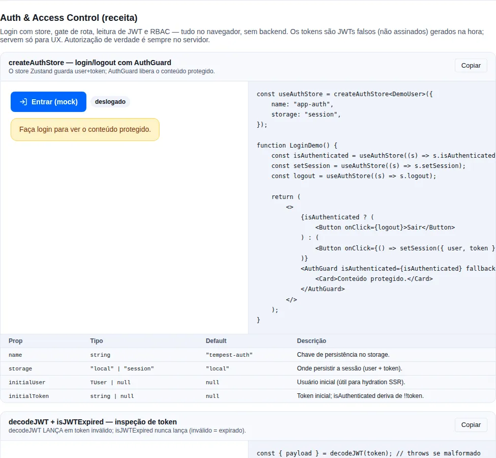

# Auth

Autenticação no front-end é sempre o mesmo punhado de problemas: onde guardar a sessão, como proteger uma rota, como ler o que tem dentro do token e o que fazer quando ele expira no meio de um deploy. O módulo `auth` do `tempest-react-sdk` resolve cada um desses problemas com uma peça pequena e independente — você pega só o que precisa, sem herdar um framework de auth inteiro.

São cinco peças, todas desacopladas entre si:

1. `createAuthStore` — fabrica um Zustand store tipado pelo `TUser` do app.
2. `AuthGuard` — gate de rota router-agnostic.
3. `decodeJWT` / `isJWTExpired` — leitura defensiva de JWTs (sem validação criptográfica).
4. `lazyWithRetry` — `React.lazy` com retry de chunk + reload na falha final.
5. `createRefreshQueue` — coalesce chamadas de refresh concorrentes.

!!! info "Por que peças soltas em vez de um `<AuthProvider>` monolítico"
    Cada app Tempest tem um modelo de usuário, um fluxo de login e um backend
    diferentes. Um provider monolítico forçaria todos a um único formato. Cinco
    primitivos compõem livremente: você usa o store sem o guard, o guard sem o
    JWT decoder, e por aí vai.

!!! tip "As telas de login e cadastro"
    Este módulo cuida da sessão. A tela em si — layout, formulário de login,
    cadastro, "esqueci a senha" — está em
    [Telas de autenticação](components/auth-screens.md): `AuthPage` + `LoginForm`.

<!-- gallery:recipe-auth -->
[](gallery.md)

*Seção `recipe-auth` da [gallery](gallery.md) — rode localmente para interagir.*
<!-- /gallery -->

## Store — `createAuthStore<TUser>`

O SDK **não é dono do seu modelo de usuário**. Você passa o `TUser` e ganha um store Zustand tipado, já com `persist` configurado.

```tsx
import { createAuthStore } from "tempest-react-sdk";

type SessionUser = { id: string; name: string; is_admin: boolean };

export const useAuthStore = createAuthStore<SessionUser>({
  name: "tempest-app-auth",
  storage: "local",
});

// dentro de um componente: leia o estado (re-renderiza quando muda)
function Header() {
  const { user, isAuthenticated, logout } = useAuthStore();
  return isAuthenticated ? <button onClick={logout}>Sair de {user?.name}</button> : null;
}

// fora do React: escreva pelo getState()
useAuthStore.getState().setSession({
  user: { id: "u1", name: "Ana", is_admin: false },
  token: "eyJhbGciOi…",
});
useAuthStore.getState().logout();
```

Persiste em `localStorage` (default) ou `sessionStorage` (`storage: "session"`). Apenas `user` e `token` são persistidos (`partialize`); após o hydrate, `isAuthenticated` é re-derivado de `!!token` no `onRehydrateStorage`.

Opções extras: `initialUser`, `initialToken` (úteis para hydration em SSR).

!!! tip "Selecione o mínimo necessário"
    `const isAuth = useAuthStore((s) => s.isAuthenticated)` re-renderiza só
    quando `isAuthenticated` muda. Desestruturar o store inteiro
    (`const { ... } = useAuthStore()`) assina **todas** as fatias e re-renderiza
    em qualquer mudança — prefira o seletor em componentes quentes.

## Guard — `AuthGuard`

Router-agnostic: é um if/else puro. Você decide o que renderizar em cada ramo — tipicamente `<Outlet />` quando autenticado e `<Navigate />` para o redirect.

```tsx
import { Navigate, Outlet } from "react-router";
import { AuthGuard } from "tempest-react-sdk";

export function ProtectedLayout() {
  const isAuthenticated = useAuthStore((s) => s.isAuthenticated);
  return (
    <AuthGuard isAuthenticated={isAuthenticated} fallback={<Navigate to="/login" replace />}>
      <Outlet />
    </AuthGuard>
  );
}
```

`AuthGuard` recebe `isAuthenticated`, `children` e `fallback` — sem opinião sobre router. Compõe com guards de role customizados: aninhe um segundo guard dentro do `children`.

!!! note "Relação com `<RouteGuard>` do módulo routing"
    Se você usa o módulo de roteamento do SDK, o [`<RouteGuard>`](./routing.md)
    declarativo já cobre o caso comum (`when` + `redirectTo`) direto na árvore de
    rotas. Use `AuthGuard` quando precisar de controle imperativo sobre o que
    renderiza em cada ramo, ou quando não estiver usando o `<AppRouter>`.

## JWT — `decodeJWT` / `isJWTExpired`

Decoder de **payload only** — **não** valida a assinatura. Use no client para inspeção/UX (mostrar nome, esconder botão de admin, decidir quando renovar). A autorização real é sempre no backend.

```ts
import { decodeJWT, isJWTExpired } from "tempest-react-sdk";

// decodeJWT LANÇA quando o token é malformado — envolva em try/catch
try {
  const { header, payload, signature } = decodeJWT(token);
  console.log(payload.sub, payload.exp);
} catch {
  // token sem 3 segmentos, ou header/payload não-JSON
}

// isJWTExpired nunca lança — token inválido conta como expirado
const expired = isJWTExpired(token, 30); // 30s de leeway → expirado 30s antes do exp
```

!!! warning "`decodeJWT` lança; não retorna `null`"
    Em um token malformado, `decodeJWT` **lança** `Error` — sempre envolva em
    `try/catch`. Já `isJWTExpired` é defensivo: qualquer erro de decode é tratado
    como "expirado" (`true`), então é seguro chamar direto. A assinatura é
    `isJWTExpired(token, leewaySeconds = 0)`.

!!! danger "Nunca autorize no client"
    O payload de um JWT é base64 — qualquer um pode lê-lo e forjá-lo. Use
    `decodeJWT` só para UX. Toda decisão de permissão de verdade acontece no
    servidor, que valida a assinatura.

## Code-splitting — `lazyWithRetry`

`React.lazy` com retry de chunk + fallback `window.location.reload()` na falha final.

**Por que existe**: após um deploy, usuários com a aba aberta tentam carregar chunks que já foram deletados (404). O retry com backoff geralmente pega a nova versão; o reload resolve quando o `index.html` em cache também está stale.

```tsx
import { Suspense } from "react";
import { lazyWithRetry } from "tempest-react-sdk";
import { Spinner } from "tempest-react-sdk";

const Settings = lazyWithRetry(() => import("./Settings"), {
  retries: 3, // default
  initialDelay: 400, // default — backoff exponencial: 400, 800, 1600ms
  reloadOnFinalFailure: true, // default
});

export function SettingsRoute() {
  return (
    <Suspense fallback={<Spinner />}>
      <Settings />
    </Suspense>
  );
}
```

### Páginas que recebem props

O componente não perde a tipagem ao passar pelo wrapper. O tipo dele é **inferido** do módulo que a factory resolve, então uma página com prop obrigatória, uma com prop opcional e uma sem prop nenhuma passam todas — e o elemento renderizado continua checado contra as props reais.

```tsx
import { Suspense } from "react";
import { lazyWithRetry } from "tempest-react-sdk";
import { Spinner } from "tempest-react-sdk";

interface EditorProps {
  mode: "edit" | "view";
}

function Editor({ mode }: EditorProps) {
  return <p>modo: {mode}</p>;
}

const LazyEditor = lazyWithRetry(() => Promise.resolve({ default: Editor }));

export function EditorRoute() {
  return (
    <Suspense fallback={<Spinner />}>
      <LazyEditor mode="edit" />
    </Suspense>
  );
}
```

!!! note "A checagem de props continua valendo"
    Trocar `mode="edit"` por `mode="bogus"`, esquecer a prop obrigatória ou
    passar uma prop que não existe são erros de compilação, exatamente como no
    componente direto. O wrapper relaxa só o **constraint** genérico — que antes
    exigia um componente sem props —, nunca a inferência.

!!! tip "Vale igual no `lazy` de rota"
    O campo `lazy` de um `TempestRouteObject` aceita o mesmo conjunto de
    componentes, então uma árvore de rotas com páginas tipadas passa por
    `defineRoutes` sem cast. Veja [Routing](./routing.md).

### Aquecendo o chunk — `preload()`

O componente devolvido carrega um `preload()`. Chame no momento em que a rota fica **provável**, não quando ela é necessária — o hover do link, a abertura do menu que contém ela, o fim do passo anterior — e o chunk chega antes do usuário decidir. O `Suspense` fallback simplesmente não aparece.

```tsx
<a href="/settings" onMouseEnter={() => void Settings.preload()}>
  Configurações
</a>
```

O trabalho é compartilhado com o caminho de render: quem disparar primeiro faz o único fetch, e o outro espera a mesma promise. Chamar várias vezes é seguro.

!!! tip "Aquecer várias rotas de uma vez"
    `preload()` devolve a promise, então dá para esperar por um conjunto:

    ```ts
    await Promise.all([Settings.preload(), Profile.preload()]);
    ```

    Ou dispare e esqueça — a rejeição já é tratada internamente, então um preload especulativo que ninguém aguarda nunca vira `unhandledrejection`.

## Refresh queue — `createRefreshQueue`

Coalesce N chamadas de refresh concorrentes em **1** request. Enquanto um refresh está em voo, toda chamada extra recebe a **mesma** promise; quando ela resolve, todas retomam juntas.

```ts
import { createRefreshQueue } from "tempest-react-sdk";

const refresh = createRefreshQueue(
  async () => {
    const { token } = await api.post<{ token: string }>("/auth/refresh");
    useAuthStore.getState().setToken(token);
  },
  { getToken: () => useAuthStore.getState().token },
);

// 5 requests com 401 simultâneos → 1 único refresh, todos retomam:
await Promise.all([refresh(), refresh(), refresh(), refresh(), refresh()]);
```

!!! warning "Compartilhar a promise sozinho não colapsa uma rajada — passe o `getToken`"
    Uma página que dispara várias requests de uma vez recebe vários 401 de volta, mas eles **não chegam na mesma janela**: os retardatários resolvem depois do primeiro refresh já ter terminado, não encontram promise nenhuma pra entrar, e cada um começa outra — rotacionando um token que já está novo. Medido contra um backend de mentira, cinco requests expiradas concorrentes gastaram **dois** refreshes, não um.

    O `getToken` fecha essa brecha. Plugada como `refresh` do `createApiClient`, a fila recebe de cada 401 o token com que aquela request saiu: se ele já não é o token atual, a rotação que ela ia disparar já aconteceu, então a chamada retorna na hora e a repetição sai com o token novo. Aí as mesmas cinco requests gastam exatamente um refresh — e vinte também.

    Chamada à mão, sem esse contexto, a fila cai no modo antigo: lembra o token que o último refresh instalou e pula enquanto ele estiver no lugar. Esse modo não distingue "já renovado" de "o token renovado expirou" — os dois deixam a mesma string no store. Antes da 0.77.0 o cliente não passava o contexto, e todo token emitido por um refresh ficava irrenovável quando expirava: o 401 pulava o refresh, a repetição falhava e o `onUnauthorized` derrubava uma sessão saudável.

!!! tip "Plugue direto no `createApiClient`"
    Passe a fila como `refresh` no cliente HTTP — ele a chama em todo 401 e a coalescência acontece de graça, evitando uma tempestade de refreshes paralelos derrubando seu endpoint de auth.

Use junto com `createApiClient`:

```ts
const refresh = createRefreshQueue(async () => {
  await AuthService.refresh();
});

const api = createApiClient({
  baseURL: "...",
  refresh, // chamado em 401 — coalesce concorrentes
  onUnauthorized: () => useAuthStore.getState().logout(),
});
```

## Fim de sessão — `createTempestAuth` e `onSessionEnd`

Uma sessão termina de três jeitos: o usuário clica em **Sair** (`auth.logout()`); o próprio cliente desiste dela — o refresh falhou, ou a repetição depois do refresh voltou 401 de novo; ou outra conta entra por cima (`auth.login()` com outras credenciais). Em todos os casos, todo estado que **deriva do usuário** precisa sair junto: a inscrição de push deste navegador, o cache de queries persistido, a fila de background sync, o usuário identificado na telemetria. Senão a próxima conta que entrar neste navegador herda o que era da anterior.

O `createTempestAuth` tem um lugar só para isso, que roda nos **três** caminhos: `onSessionEnd`.

```ts
import { WebPushClient, WebPushUnsubscribeError, createTempestAuth } from "tempest-react-sdk";

interface User {
  id: string;
  name: string;
}

const ORPHANED_PUSH_KEY = "push-orphaned-subscriptions";

export const auth = createTempestAuth<User>({
  baseURL: "https://api.exemplo.com",
  onSessionEnd: async (session) => {
    const push = new WebPushClient({
      vapidPublicKey: "BEl62iUYgUivxIkv69yViEuiBIa-Ib9-SkvMeAtA3LFgDzkrxZJjSgSnfckjBJuBkr3qBUYIHBQFLXYp5Nksh8U",
      onSubscribe: () => {},
      onUnsubscribe: (sub) =>
        session.api.delete("/webpush/subscribe", { body: { endpoint: sub.endpoint } }),
    });
    try {
      await push.unsubscribe();
    } catch (error) {
      if (!(error instanceof WebPushUnsubscribeError)) return;
      const pending: PushSubscriptionJSON[] = JSON.parse(
        localStorage.getItem(ORPHANED_PUSH_KEY) ?? "[]",
      );
      localStorage.setItem(ORPHANED_PUSH_KEY, JSON.stringify([...pending, error.subscription]));
    }
  },
});

await auth.logout();
```

Repare em `session.api`: quando o hook roda, o store **já foi limpo**, então `auth.api` não manda mais token nenhum. O `session.api` é um cliente que ainda manda o access token da sessão que acabou — é por ele que o `DELETE` sai autenticado. Ele nunca renova e nunca encerra sessão: um 401 ali só rejeita.

E o `unsubscribe()` do push libera a inscrição do navegador **mesmo quando o `DELETE` falha** (veja [Push → Desinscrever](./push.md#desinscrever-o-que-quase-todo-mundo-erra)). É isso que fecha o caminho automático: quando a sessão expira, o servidor já recusa o token, o `DELETE` volta 401 — e o navegador para de receber as notificações da conta anterior do mesmo jeito. O `WebPushUnsubscribeError` traz o `subscription` com o `endpoint`: o exemplo guarda para reenviar o `DELETE` quando houver sessão de novo, em vez de esperar o `404`/`410` do próximo envio.

!!! warning "Dentro do hook, use só `session.api` — nunca `auth.login()`"
    Quando o hook roda, o store já está vazio: `auth.api` sai sem token, e o 401 dele não encerra nada (o encerramento automático e um `logout()` sem sessão não esperam o hook em andamento, justamente para uma chamada de dentro dele não esperar a si mesma). Já o `auth.login()` **sempre** espera o teardown em andamento — é o que impede a conta nova de começar enquanto a anterior ainda está sendo limpa —, então chamado de dentro do hook ele espera o próprio hook e nunca termina. O SDK não tem como distinguir o hook de quem chama de fora (o navegador não tem contexto assíncrono), então é regra documentada, não checagem. `session.api` é o cliente feito para o hook.

!!! tip "Limpe aqui todo estado por usuário"
    O hook é o ponto único de teardown: o push acima, e ao lado dele qualquer outro estado que pertence à conta — o cache de queries persistido, a fila de background sync do service worker, os caches de resposta autenticada, o usuário da telemetria, os registros de upload resumível. Componha tudo dentro do mesmo `onSessionEnd`; cada passo independente com seu próprio `.catch`, para uma falha não pular os outros.

    Os registros de upload resumível guardam a URL de upload e a `Idempotency-Key` da conta que saiu, e só somem quando o upload completa ou num `abort({ discard: true })`. Limpe com `createLocalUploadStorage().clear()` (apaga tudo sob o prefixo `tempest-upload:`) e passe ao `createResumableUpload` o próprio `getToken: auth.getToken` (que amarra o registro à sessão, ver [`auth.sessionKey()`](#a-sessao-como-chave-authsessionkey)) ou `getPrincipal` — detalhes em [Upload resumível → Um registro por usuário](./resumable-upload.md#um-registro-por-usuario-getprincipal-e-clear):

    ```ts
    import { createLocalUploadStorage, createTempestAuth } from "tempest-react-sdk";

    export const auth = createTempestAuth({
      baseURL: "https://api.exemplo.com",
      onSessionEnd: () => {
        createLocalUploadStorage().clear();
      },
    });
    ```

### A ordem, exatamente

Nos três caminhos — `logout()`, o encerramento automático e a troca de conta — a sequência é a mesma:

| Passo | O que acontece | Síncrono? |
| --- | --- | --- |
| 1 | Todo refresh em voo é **superado**: não pode mais reinstalar os tokens da sessão que está acabando | sim |
| 2 | O store e o refresh token guardado são limpos — `isAuthenticated` já é `false` | sim |
| 3 | `onSessionEnd` roda com `{ reason, user, token, api, elsewhere }` — `elsewhere` é `false` nos três caminhos desta aba | pode ser `async` |
| 4 | No encerramento automático com `redirectTo`, o navegador navega; na troca de conta, a sessão nova é instalada — nos dois, **depois** do hook, mesmo que ele lance | — |

`reason` é `"logout"` no `logout()` explícito, `"expired"` quando o cliente encerrou e `"switch"` quando um `login()` substituiu a sessão. No `"logout"` e no `"switch"` o token normalmente ainda vale; no `"expired"` o servidor já o recusou, então trate a chamada autenticada como tentativa e deixe a parte local do teardown independente dela.

`logout()` devolve `Promise<void>`: o store é limpo antes do primeiro `await`, então quem ignora a promise vê o estado deslogado na hora. A promise resolve quando o hook terminou e rejeita com o erro dele — e um `logout()` sem `await` cujo hook lança vira `unhandledrejection`, em vez de o erro sumir. No caminho automático o erro do hook é engolido — a request que encerrou a sessão já rejeita com o 401 dela.

O hook roda **uma vez por sessão**: um segundo `logout()`, ou as outras requests de uma rajada de 401, não encontram sessão para encerrar. Só a chamada que encerrou a sessão navega para o `redirectTo`.

### Troca de conta — `reason: "switch"`

`auth.login()` com outra conta enquanto uma sessão está viva encerra a anterior pelo mesmo caminho, sem você precisar chamar `logout()` antes:

1. as credenciais novas vão ao backend — **nada muda ainda**. Se o login falhar, a conta anterior continua logada, com o refresh em voo dela intacto;
2. aceitas as credenciais, a época avança e o store é limpo (passos 1 e 2 da tabela);
3. `onSessionEnd` roda com `reason: "switch"`, o `user` e o `token` da conta **anterior**, e um `session.api` que ainda manda o token dela;
4. só então os tokens da conta nova são instalados, e o `login()` resolve com o usuário novo.

Por que o hook roda **antes** de instalar a conta nova: o teardown da conta anterior — limpar o cache persistido, a fila de background sync — precisa terminar antes que as requests da conta nova comecem a preenchê-los; na ordem inversa ele apagaria (ou disputaria) os dados da conta nova. O preço é um intervalo em que `isAuthenticated` é `false` enquanto o hook roda — um guard de rota pode reagir a ele, então mantenha o hook curto. Um erro do hook aqui é engolido: o login em si deu certo.

Um `logout()` cujo teardown ainda está em andamento é esperado do mesmo jeito: `logout()` seguido de `login()` sem `await` não instala a conta nova antes de o hook da anterior terminar — o hook que limpa o estado da conta A não corre junto com a conta B.

Um `login()` cuja sessão mudou enquanto a request dele estava em voo — um `logout()` no meio, por exemplo — rejeita com `SessionSupersededError` e não instala nada. Vale também para o `GET` do `mePath` que o `login()` faz depois de instalar o token: um perfil que chega depois de um `logout()` (ou de `logout()` + `login()` de outra conta) é descartado, em vez de ficar no store ao lado do token da conta seguinte.

### Refresh em voo e troca de conta — `SessionSupersededError`

Um refresh é uma ida e volta de rede, e a sessão pode acabar no meio dela. Cada refresh fica amarrado a uma **época de sessão**, que o `logout()` e um `login()` com credenciais aceitas incrementam. Um refresh que resolve depois que a época dele acabou descarta o que trouxe e rejeita com `SessionSupersededError` — e o cliente repassa esse erro **sem** chamar `onUnauthorized`, porque a sessão atual (talvez outra conta, que acabou de entrar) não fez nada de errado. Uma request que saiu durante uma sessão encerrada e volta 401 é recusada do mesmo jeito — inclusive a repetição depois de um refresh — em vez de ser repetida como a conta que está logada agora ou de encerrar a sessão dela. E uma request que saiu **sem** token e volta 401 depois que uma conta entrou só rejeita com o 401: não renova nem encerra a sessão nova.

Antes da 0.77.0, um refresh em voo durante o `logout()` reinstalava os tokens antigos e voltava `isAuthenticated` para `true`; com `logout()` + `login(B)` no meio, trocava o token de B pelo de A — a tela mostrava B, e toda request saía como A.

Trate o erro como uma request abortada: descarte o resultado e não mostre nada.

```ts
import { SessionSupersededError, createTempestAuth } from "tempest-react-sdk";

const auth = createTempestAuth({ baseURL: "https://api.exemplo.com" });

export async function loadOrders(): Promise<unknown[] | null> {
  try {
    return await auth.api.get<unknown[]>("/api/orders");
  } catch (error) {
    if (error instanceof SessionSupersededError) return null;
    throw error;
  }
}
```

Os refreshes também colapsam por **rotação**, não só por sobreposição no tempo: um 401 cuja request saiu com um token que a mesma sessão já trocou repete com o token novo e não renova nada. Três requests expiradas gastam um refresh, cheguem os 401 juntos ou um depois do outro.

### Várias abas — a sessão é da origem, não da aba

Com `storage: "local"` (o default), todas as abas do app leem e gravam as **mesmas** chaves: `tempest-auth` (o `{ user, token }`), `tempest-auth-refresh` e `tempest-auth-lineage`. Então a sessão é uma só para a origem inteira, e cada aba **segue** o que outra gravou — no evento `storage` do navegador e, antes de qualquer refresh, `logout()`, encerramento ou gravação do usuário do `mePath`, comparando a sessão guardada com a que ela tem em memória.

A comparação é pela **linhagem** da sessão: um identificador que o `login()` cria e que toda renovação mantém. Mesma linhagem é a mesma sessão, renovada; outra linhagem é outro login — de outra conta ou da mesma:

| Na outra aba | Nesta aba |
| --- | --- |
| renovou a mesma sessão | adota o token novo; a request que voltou 401 repete com ele, **sem** renovar de novo |
| `logout()` | a sessão acaba aqui também: store limpo, `onSessionEnd` com `reason: "logout"` e `elsewhere: true` |
| `login()` — de outra conta ou da mesma | a sessão desta aba acaba aqui (`reason: "switch"`, `elsewhere: true`) e a nova é adotada |

O que esta aba **nunca** faz é resgatar um refresh token que não é o da sessão dela, nem gravar por cima da sessão que outra aba instalou. Uma request em voo da sessão que acabou rejeita com `SessionSupersededError`, como na troca de conta da mesma aba — e um `login()` desta aba que ainda esperava o `mePath` também: o perfil que chega é descartado em vez de ser gravado ao lado do token de outra conta.

Duas abas que renovam juntas — o caso típico é o navegador reabrindo várias abas, cada uma chamando `auth.refresh()` no boot — **não** resgatam o mesmo refresh token duas vezes: o resgate roda sob um [Web Lock](https://developer.mozilla.org/docs/Web/API/Web_Locks_API) da origem, e a aba que esperou adota o token que a outra trouxe. Isso importa com backend que detecta reuso (o tempest-fastapi-sdk detecta): o segundo resgate do mesmo token revoga a família inteira e derruba a sessão em todas as abas. Sem a API (SSR, navegador antigo) ou depois de 10 segundos esperando, o resgate segue sem o lock, como antes.

```ts
import { createTempestAuth } from "tempest-react-sdk";
import { QueryClient } from "@tanstack/react-query";

interface User {
  id: string;
  name: string;
}

export const queryClient = new QueryClient();

export const auth = createTempestAuth<User>({
  baseURL: "https://api.exemplo.com",
  onSessionEnd: async (session) => {
    queryClient.clear();
    if (session.elsewhere) return;
    await session.api.post("/api/telemetry/session-end", { body: { reason: session.reason } });
  },
});
```

Repare no `elsewhere`. O cache em memória (`queryClient.clear()`) é desta aba, então sai em toda aba. Já o que é **compartilhado pela origem** — IndexedDB, Cache Storage, inscrição de push, uma chamada ao servidor — a outra aba já limpou quando rodou o hook dela. No `"switch"`, refazer aqui apagaria o que a conta nova já gravou: pule quando `session.elsewhere` for `true`.

!!! info "Por que antes era diferente"
    Até a 0.80.0 cada aba tinha a sessão só em memória e relia o refresh token guardado a cada refresh. Uma aba deixada aberta como A depois do logout, com B logando no mesmo navegador, resgatava no próximo 401 o refresh token de **B** e gravava `{ user: A, token: B }` — a tela mostrava A e toda request saía como B (#524). E uma renovação numa aba fazia a outra renovar de novo no próximo 401, derrubando o token da primeira.

    Até a 0.81.0 a continuidade era decidida comparando o **usuário**. Uma aba cujo `login()` ainda esperava o `mePath` tinha usuário `null`; se outra aba entrasse com outra conta nesse intervalo, o usuário guardado também era `null`, e `null === null` passava por "mesma conta": a aba adotava o token de B como renovação e o `/me` dela gravava `{ user: A, token: B }` (#544). Se o evento `storage` ainda não tinha chegado, era a aba de B que terminava mostrando A ao lado do refresh token de B. Uma sessão gravada antes da linhagem existir continua seguindo a regra antiga até o próximo login.

!!! tip "Com `sessionStorage`, nada muda"
    Com `storage: "session"`, cada aba tem o próprio `sessionStorage` e a própria sessão — nada disso se aplica.

Em teste, ou com hot reload, quando vários presets nascem na mesma janela, `auth.dispose()` remove o listener de `storage`. Um app tem um preset para a vida da página e não precisa chamar.

### A sessão como chave — `auth.sessionKey()`

Recurso que pertence a **uma** sessão — um stream SSE, um upload em andamento — precisa saber quando a sessão trocou, e não quando o token trocou: o token roda a cada refresh, a sessão não. `auth.sessionKey()` responde exatamente isso. É a linhagem da seção anterior quando há alguém logado, e `null` quando não há:

```ts
import { createTempestAuth } from "tempest-react-sdk";

export const auth = createTempestAuth({ baseURL: "https://api.exemplo.com" });

await auth.login({ email: "a@exemplo.com", password: "segredo" });
const sessaoDeA = auth.sessionKey();

await auth.refresh();
console.log(auth.sessionKey() === sessaoDeA);

await auth.login({ email: "b@exemplo.com", password: "segredo" });
console.log(auth.sessionKey() === sessaoDeA);

await auth.logout();
console.log(auth.sessionKey());
```

```text
true
false
null
```

Você quase nunca chama à mão — as peças que dependem dela leem sozinhas do que o preset devolveu (desde a 0.82.0):

| Você passa | Quem lê a sessão | O que muda |
| --- | --- | --- |
| `client: auth.api` em `useTicketEventStream` / `createTicketEventStream` | o stream SSE | fecha o stream de A no `login()` de B, não reabre na rotação, fica parado deslogado — ver [SSE → troca de conta](./sse.md#troca-de-conta-na-mesma-aba-sessionkey) |
| `getToken: auth.getToken` em `createResumableUpload` | o upload resumível | o registro sobrevive à rotação e a troca de conta para o upload — ver [Upload resumível](./resumable-upload.md#um-registro-por-usuario-getprincipal-e-clear) |

O vínculo é com o **objeto** que o preset devolveu: `auth.api` e `auth.getToken`. Um wrapper (`() => auth.getToken()`), um cliente seu ou uma cópia com spread não carregam a sessão e continuam com o comportamento de antes — para eles, passe `auth.sessionKey` como `sessionKey`/`getPrincipal`.

Uma sessão **restaurada** por `auth.refresh()` sem nenhuma instalada — o restore do boot por cookie, o callback de OAuth — é um login como outro qualquer e ganha linhagem própria, como o `login()`. Uma segunda aba que restaura ao mesmo tempo adota essa sessão, linhagem incluída, sem ver troca de conta nem rodar o `onSessionEnd`; e um reload na mesma sessão mantém a chave.

Uma sessão gravada **antes** da linhagem existir não tem linhagem no storage; a chave dela é criada pelo preset, em memória, e vale enquanto aquela sessão durar: sobrevive às rotações, muda quando ela termina ou é trocada, e nunca é a de outra sessão. Gravar uma linhagem para ela faria toda outra aba com a mesma sessão enxergar troca de conta, por isso fica em memória — o custo é que um reload cria outra chave, e um upload amarrado a essa sessão recomeça em vez de retomar. O próximo `login()` dá linhagem à sessão e o custo some.

!!! info "Até a 0.82.0: uma chave só para toda sessão sem linhagem (#561)"
    As duas sessões acima respondiam a mesma constante, `"unlineaged"`, qualquer que fosse a conta. A conta A restaurada do cookie deixava um upload pela metade com `getToken: auth.getToken`, saía, e a conta B restaurada do mesmo jeito tinha a **mesma** chave: o upload de B mandava `HEAD`/`PATCH` para a URL do upload de A com o Bearer de B e reaproveitava a `Idempotency-Key` de A. Reproduzido em `src/auth/create-tempest-auth.restore.test.ts` e `src/http/resumable-upload.session.test.ts` (`npx vitest run src/auth/create-tempest-auth.restore.test.ts src/http/resumable-upload.session.test.ts`).

### Login fora do `login()` — `auth.restore()`

O cookie de refresh é do **navegador**, não da sessão que o store guarda. Ele troca de dono sem passar pelo `login()`: o callback de OAuth ou de magic link grava o cookie da conta que acabou de entrar, e com `storage: "session"` outra aba que loga como B troca o cookie debaixo da aba que ainda mostra A. O próximo `refresh()` dessa aba resgata o cookie de **B** com a sessão de **A** ainda instalada.

Quando os dois access tokens são JWT com `sub` — o caso do tempest-fastapi-sdk —, o preset vê que o `sub` mudou e trata o resgate como **troca de conta**, igual a um `login()`: a sessão de A termina com `onSessionEnd` `"switch"`, B ganha linhagem e `sessionKey()` próprias, o usuário de B é carregado (`parseUser`, depois `mePath`), e o `refresh()` resolve com B instalado. A request de A que disparou o refresh **não** é repetida como B: rejeita com `SessionSupersededError`. A rotação da mesma conta (mesmo `sub`) continua sendo rotação — mesma chave, nenhum `onSessionEnd`, o upload retoma.

Com token **opaco** não há `sub` para comparar, e o cliente não distingue "A rodou o token" de "o cookie agora é de B". Comparar o usuário do `mePath` custaria uma request por rotação e reabriria o #544 (dois logins cujo usuário ainda não carregou parecem iguais). Por isso, aí o resgate continua contando como rotação, e quem sabe que houve um login fora do `login()` — o app, na rota de callback — diz isso com `auth.restore()`:

```ts
import { createTempestAuth } from "tempest-react-sdk";

interface User {
  id: string;
  name: string;
}

export const auth = createTempestAuth<User>({
  baseURL: "https://api.exemplo.com",
  mePath: "/api/auth/me",
  withCredentials: true,
  logoutPath: "/api/auth/logout",
});

export async function bootSession(): Promise<boolean> {
  try {
    await auth.refresh();
    return true;
  } catch {
    return false;
  }
}

export async function finishOAuthCallback(): Promise<User | null> {
  return auth.restore();
}
```

- `restore()` resgata o refresh credential (o cookie, ou o refresh token guardado no modo corpo) **como um login novo**: o que ele trouxer substitui a sessão instalada, com `onSessionEnd` `"switch"` se havia uma, linhagem nova e usuário carregado. Resolve com o usuário, como o `login()`.
- Resgate que falha deixa a sessão atual intacta. Um `logout()` ou `login()` durante o `restore()` o supera: rejeita com `SessionSupersededError` e o token novo é descartado.
- **No boot continua o `refresh()`**: um reload não pode encerrar a sessão. `restore()` onde não houve login custa uma troca à toa — o upload amarrado à sessão recomeça em vez de retomar.

!!! info "Até a 0.83.0: o cookie de outra conta contava como rotação (#579)"
    Com A ainda instalada, o `refresh()` que resgatava o cookie de B mantinha a linhagem de A: `sessionKey()` respondia a chave de A para B, o upload resumível de B mandava `HEAD`/`PATCH` para a URL do upload de A com o Bearer de B e a `Idempotency-Key` de A, o store guardava o usuário de A ao lado do token de B, e a request de A que disparou o refresh era repetida **como B**. Com o controle — A faz logout antes — B recebia outra chave. Reproduzido em `src/auth/create-tempest-auth.subject.test.ts` e `src/http/resumable-upload.session.test.ts` (`npx vitest run src/auth/create-tempest-auth.subject.test.ts src/http/resumable-upload.session.test.ts`).

### Refresh por cookie e logout no servidor — `logoutPath`

Com `withCredentials: true`, o refresh token mora num cookie HttpOnly, e o `logout()` não alcança esse cookie: ele limpa o store e o refresh token guardado, e o cookie continua no navegador, resgatável até o backend revogá-lo. Duas peças fecham isso.

A primeira é do próprio preset e não tem opção: **um 401 de uma request que saiu sem token, sem sessão instalada** (sem access token e sem refresh token guardado), **só rejeita com o 401** — não dispara refresh. Antes, esse 401 chegava depois do `logout()`, o refresh ia com o cookie de A, e o próximo usuário do navegador agia como A (#474).

Com um `login()` em curso, esse 401 **espera o login assentar**, ainda sem refresh: se o login instalou um token, a request é repetida com ele; se falhou, a request rejeita com o 401 e o cliente continua deslogado. Até a 0.77.0, o login em curso contava como "sessão chegando" e o 401 disparava refresh — que ia com o cookie que o navegador tivesse, o da conta que tinha saído. Login de B que falhava deixava o cliente logado como A; login de B que dava certo podia ter o cookie sobrescrito pelo `Set-Cookie` tardio desse refresh, e o refresh seguinte instalava o token de A com o store mostrando B (#496).

O que continua funcionando é restaurar a sessão pelo cookie quando o app recarrega: chame `auth.refresh()` no boot, explicitamente. É o caminho legítimo — o app decide restaurar —, e não um efeito colateral de qualquer request anônima. Uma request sem token que volta 401 **enquanto** esse refresh do boot está em voo entra nele e é repetida com o token restaurado; e um 401 sem sessão nenhuma não encerra nada — não roda o `onSessionEnd`, não navega para o `redirectTo` e não supera o refresh do boot.

!!! warning "Migração: app em modo cookie que restaurava a sessão por uma request anônima"
    Até a 0.77.0, com `withCredentials: true` e o store vazio — `storage: "session"` numa aba nova, o storage limpo, ou o primeiro carregamento depois de um logout —, a primeira request do app voltava 401, o preset renovava pelo cookie e a sessão "voltava sozinha". Isso acabou: é exatamente o caminho que relogava a conta que tinha saído. **Chame `auth.refresh()` no boot**, antes de renderizar a área protegida, e trate a rejeição como "não logado". Com o store persistido no `localStorage` (o default) e um access token guardado, nada muda.

A segunda peça é revogar no servidor: passe `logoutPath`, e o `logout()` explícito faz `POST` nessa rota com as credenciais da sessão que terminou — o access token dela, e o corpo que o `refreshBody` monta com o refresh token guardado (`{ refresh_token }` no modo corpo; sem corpo no modo cookie, em que o cookie vai junto).

```ts
import { createTempestAuth } from "tempest-react-sdk";

interface User {
  id: string;
  name: string;
}

export const auth = createTempestAuth<User>({
  baseURL: "https://api.exemplo.com",
  mePath: "/api/auth/me",
  withCredentials: true,
  csrf: true,
  logoutPath: "/api/auth/logout",
  onLogoutError: (error) => console.error("logout no servidor falhou", error),
});

export async function restoreSession(): Promise<boolean> {
  try {
    await auth.refresh();
    return true;
  } catch {
    return false;
  }
}

export async function signOut(): Promise<void> {
  await auth.logout();
  window.location.assign("/login");
}
```

- O store é limpo **antes** da revogação terminar: `isAuthenticated` já é `false` quando o `logout()` retorna, como sempre.
- A promise do `logout()` espera a revogação. Por isso o `await auth.logout()` antes de navegar importa: uma navegação dura aborta a request em voo.
- A revogação é **best-effort**: falha de rede, `4xx` ou `5xx` é engolida, e o usuário sai do mesmo jeito.
- Um `login()` que começa com a revogação em voo espera por ela, porque a resposta do logout apaga os cookies de auth e, chegando depois, apagaria os da conta nova.
- O `logout()` explícito revoga, e a troca de conta (`"switch"`) também — **só no modo corpo**: o refresh token da sessão substituída ainda está no cliente, e o tempest-fastapi-sdk revoga por família de rotação, então a sessão nova não é afetada nem quando é a mesma conta. No modo cookie a troca não revoga, porque o cookie no navegador já é o da conta nova. No `"expired"` o servidor já recusou a sessão.
- Dois `logout()` sobrepostos mandam cada um a sua revogação, e o `login()` espera **todas** — no máximo 10 segundos: uma revogação que nunca volta atrasa o login, não o trava.
- Um `logout()` durante um `login()` ou refresh em voo: no modo cookie, a revogação espera a resposta dele (no mesmo limite de 10 segundos), porque é ela que grava o cookie da sessão que está acabando; no modo corpo, o refresh token que essa resposta superada traz é revogado à parte.
- Uma revogação que falha chama `onLogoutError(error)` e, em build de dev, avisa no console — o `logout()` resolve do mesmo jeito.

!!! warning "Sem revogação no servidor, a conta que saiu continua restaurável pelo `refresh()` do boot"
    O preset não manda refresh por conta própria depois do `logout()`, mas o cookie HttpOnly de A continua no navegador e válido no servidor quando o `logoutPath` não está configurado (o default), quando a revogação falha (rede, `4xx`, `5xx`) ou quando ela passa dos 10 segundos. Nesse caso, o próximo carregamento que chamar `auth.refresh()` no boot restaura A para quem estiver no navegador — é o mesmo cookie, e nada no cliente distingue "A recarregou a página" de "A saiu e outra pessoa abriu o app". Só o servidor fecha isso: configure o `logoutPath` com a rota que revoga o cookie e trate o `onLogoutError`. Backend com refresh token stateless (JWT), que não tem como revogar, deixa essa janela aberta até o cookie expirar.

    Por isso, em build de dev, `withCredentials: true` sem `logoutPath` avisa no console uma vez por store. É aviso e não exigência: exigir o `logoutPath` quebraria o app cujo backend não tem como revogar — e não fecharia nada para ele, porque uma rota que responde `404` não revoga —, e recusar o `refresh()` do boot depois de um logout quebraria o login que grava o cookie fora do `login()`, como o callback de OAuth.

!!! info "A rota no tempest-fastapi-sdk"
    O `make_auth_router` monta `POST /auth/logout` (`204`, idempotente) quando o serviço guarda refresh token no banco (`refresh_token_model`): no modo corpo ele lê `{ refresh_token }`, no modo cookie lê o cookie e apaga os dois cookies de auth. Com `AUTH_TOKEN_DELIVERY=both`, a rota de cookie fica em `/auth/cookie/logout`. Refresh token stateless (JWT) não tem como ser revogado, e a rota não existe — ali o cookie só morre quando expira.

## Exemplo completo — login, guard e refresh juntos

Um app real costura as cinco peças. Este é o esqueleto completo e copiável:

```tsx
// auth-store.ts
import { createAuthStore } from "tempest-react-sdk";

export type SessionUser = { id: string; name: string; email: string };

export const useAuthStore = createAuthStore<SessionUser>({
  name: "tempest-app-auth",
  storage: "local",
});
```

```ts
// api.ts
import { createApiClient, createRefreshQueue } from "tempest-react-sdk";
import { useAuthStore } from "./auth-store";

const refresh = createRefreshQueue(async () => {
  const res = await fetch("/api/auth/refresh", { method: "POST", credentials: "include" });
  const { token } = (await res.json()) as { token: string };
  useAuthStore.getState().setToken(token);
});

export const api = createApiClient({
  baseURL: "/api",
  getToken: () => useAuthStore.getState().token,
  refresh, // chamado em 401 → coalesce → retry da request original
  onUnauthorized: () => useAuthStore.getState().logout(),
});
```

```tsx
// LoginPage.tsx
import { useNavigate } from "react-router";
import { useAuthStore, type SessionUser } from "./auth-store";
import { api } from "./api";

export function LoginPage() {
  const navigate = useNavigate();
  const setSession = useAuthStore((s) => s.setSession);

  async function handleSubmit(email: string, password: string) {
    const { user, token } = await api.post<{ user: SessionUser; token: string }>("/auth/login", {
      body: { email, password },
    });
    setSession({ user, token });
    navigate("/", { replace: true });
  }

  return <form onSubmit={(e) => e.preventDefault()}>{/* ...campos... */}</form>;
}
```

```tsx
// ProtectedLayout.tsx
import { Navigate, Outlet } from "react-router";
import { AuthGuard } from "tempest-react-sdk";
import { useAuthStore } from "./auth-store";

export function ProtectedLayout() {
  const isAuthenticated = useAuthStore((s) => s.isAuthenticated);
  return (
    <AuthGuard isAuthenticated={isAuthenticated} fallback={<Navigate to="/login" replace />}>
      <Outlet />
    </AuthGuard>
  );
}
```

O fluxo: o login chama `setSession`, persistindo `user` + `token`. O `ProtectedLayout` lê `isAuthenticated` do store. Cada request injeta o token via `getToken`; ao tomar 401, o `createApiClient` chama a fila de refresh (coalescida) e refaz a request. Se o refresh falhar, `onUnauthorized` dispara `logout()` e o guard redireciona para `/login`.

## Resumo

- **`createAuthStore<TUser>`** — store Zustand tipado e persistido; você é dono do `TUser`.
- **`AuthGuard`** — if/else router-agnostic; você escolhe `children` e `fallback`.
- **`decodeJWT`** lança em token inválido; **`isJWTExpired`** é defensivo e nunca lança. Só para UX, nunca para autorização.
- **`lazyWithRetry`** — sobrevive a chunks stale pós-deploy com backoff + reload.
- **`createRefreshQueue`** — N refreshes concorrentes viram 1.
- **`onSessionEnd`** — teardown por usuário no `logout()` **e** na expiração automática, com `session.api` ainda autenticado.
- **`SessionSupersededError`** — refresh ou request de uma sessão que já acabou; descarte, não deslogue.
- **Várias abas** — com `storage: "local"` a sessão é da origem: logout, troca de conta e renovação numa aba chegam nas outras, com `elsewhere: true` no hook.
- **`logoutPath`** — revoga o refresh token (ou o cookie) no servidor no `logout()`; restaure a sessão no boot com `auth.refresh()`.
- **`auth.sessionKey()`** — a sessão como chave: muda no `login()`, não muda na rotação; `auth.api` e `auth.getToken` a carregam para o SSE e o upload resumível.
- **`auth.restore()`** — login fora do `login()` (callback de OAuth): o refresh credential vira sessão nova. Com JWT, o `refresh()` que resgata outra conta (outro `sub`) já troca sozinho.

### Veja também

- [Routing](./routing.md) — `<RouteGuard>` declarativo, alternativa ao `AuthGuard` na árvore de rotas
- [HTTP](./http.md) — `getToken: () => useAuthStore.getState().token` + `refresh: queue`
- [Push](./push.md) — por que o `unsubscribe()` libera o navegador mesmo quando o backend falha
- [Error Boundary](./error-boundary.md) — a falha final do `lazyWithRetry` vira um `ChunkLoadError` que o boundary captura
