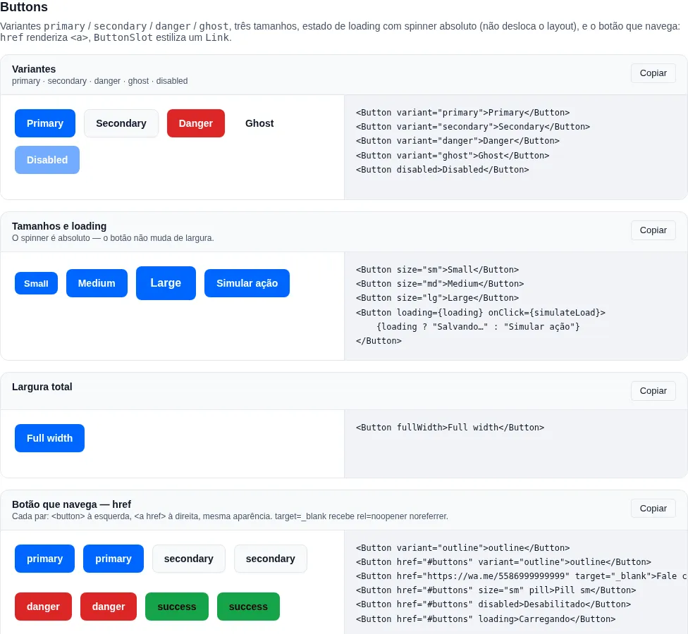
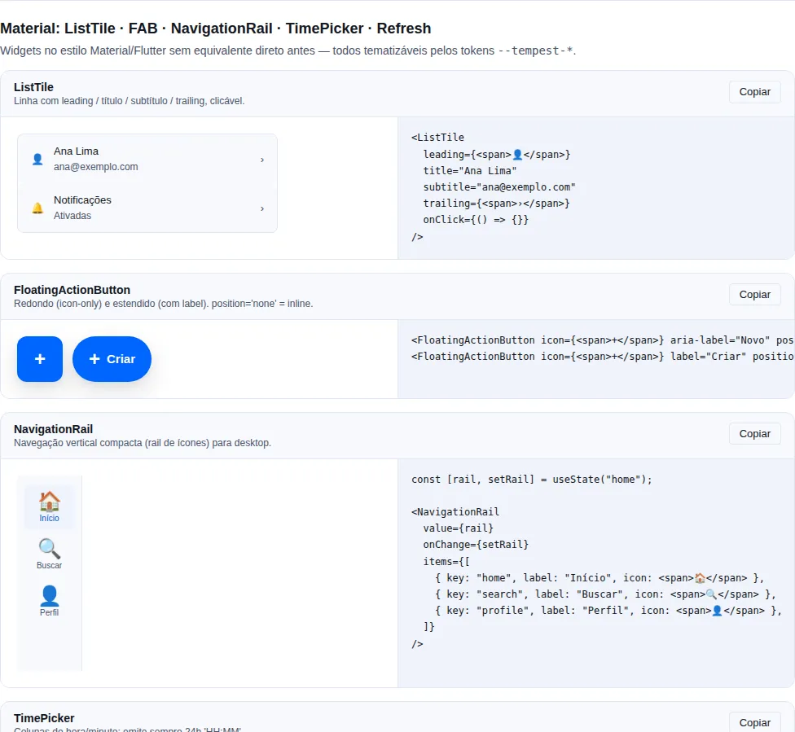
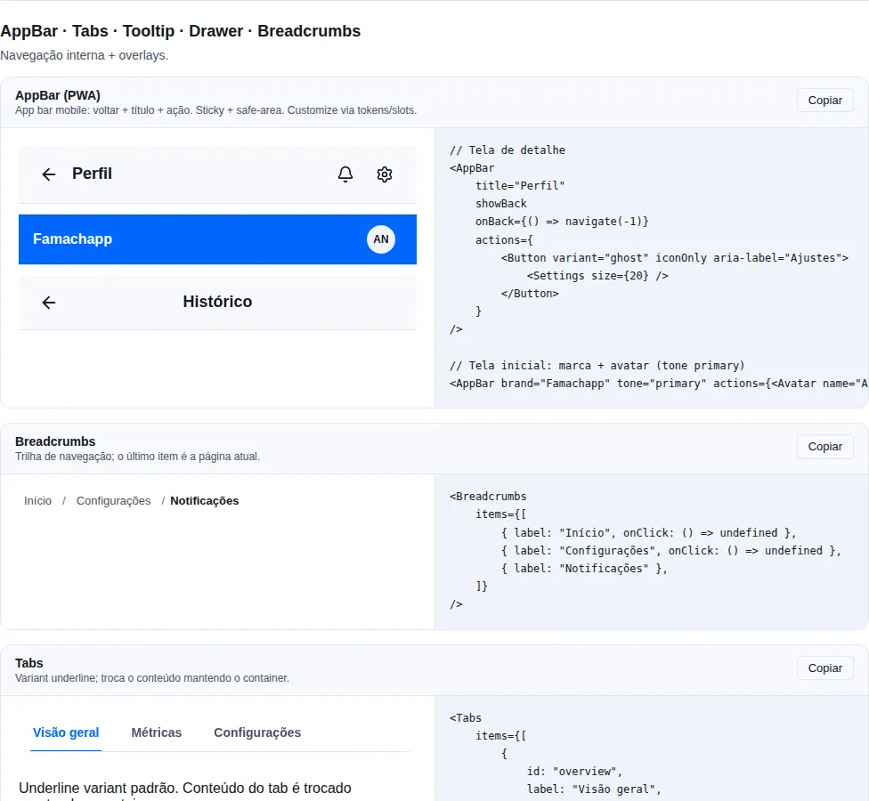
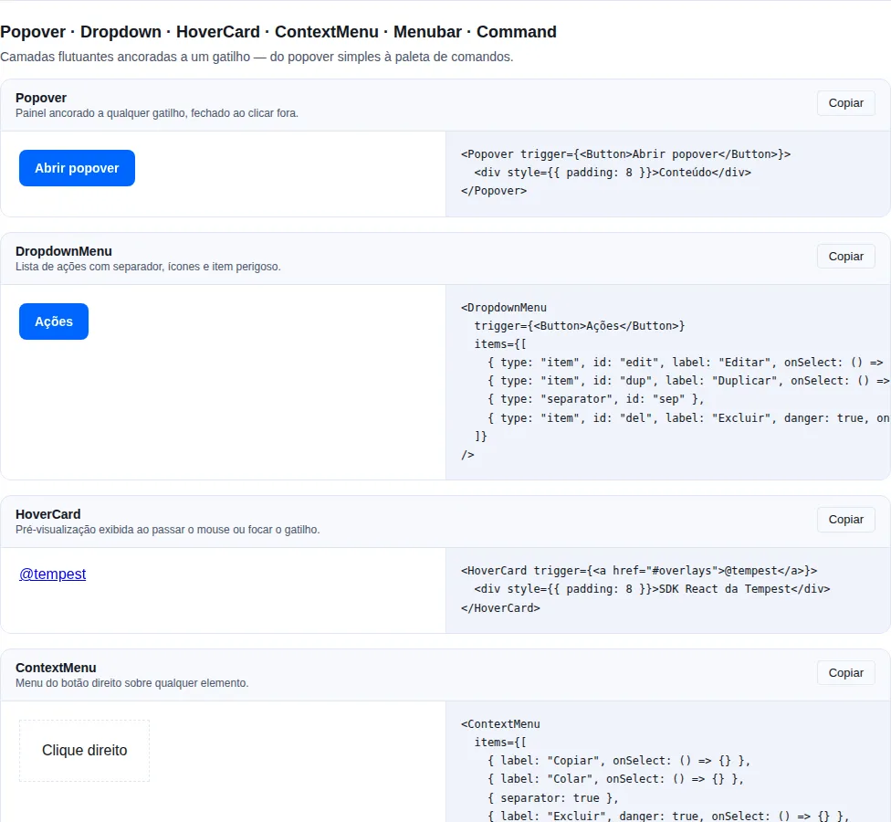
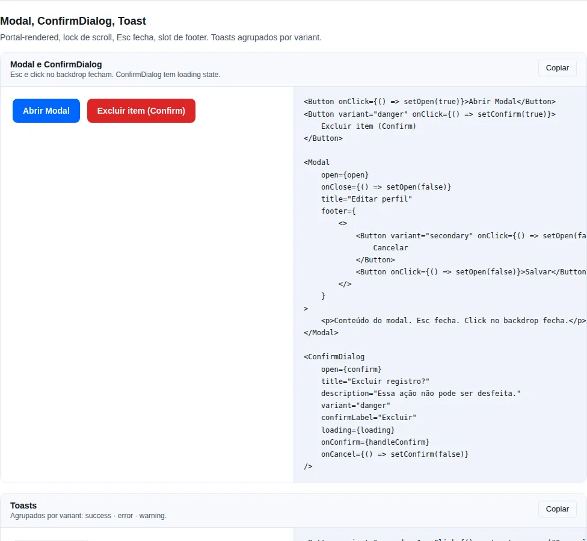
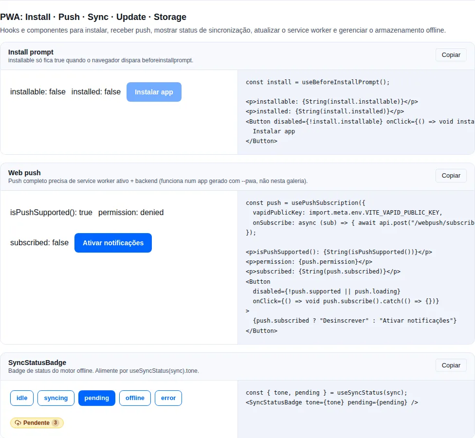
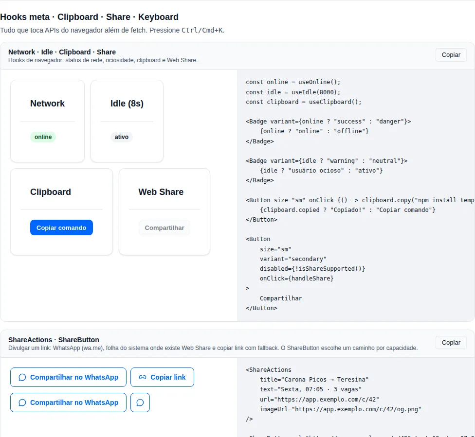

# Ação

Componentes de **ação** são o ponto onde o usuário dispara algo: clicar, escolher numa lista, confirmar. Eles carregam intenção — um clique muda dados, navega, ou inicia um fluxo. Por isso a categoria reúne tanto o gatilho direto (`Button`) quanto os elementos que cercam uma ação: dica contextual (`Tooltip`), conjunto de ações secundárias (`DropdownMenu`), painel ancorado (`Popover`) e a salvaguarda antes de algo destrutivo (`ConfirmDialog`).

Use esta página quando precisar que o usuário **faça** algo. Para entrada de dados (texto, seleção, datas) veja [inputs](./inputs.md); para apresentar coleções, veja [data](./data.md).

## `Button`

<!-- gallery:buttons -->
[](../gallery.md)

*Seção `buttons` da [gallery](../gallery.md) — rode localmente para interagir.*
<!-- /gallery -->

> **Quando usar**: a ação primária ou secundária de qualquer tela — submeter um form, abrir um modal, navegar. É o gatilho de ação por padrão.

Botão primário com variants, sizes, estado de loading.

```tsx
import { Button } from "tempest-react-sdk";
import { Plus, Trash } from "lucide-react";

<Button>Salvar</Button>;
<Button variant="danger" leftIcon={<Trash size={16} />}>
  Excluir
</Button>;
<Button variant="outline" loading>
  Carregando…
</Button>;
<Button variant="link" rightIcon={<ArrowRight size={14} />}>
  Ver mais
</Button>;
<Button iconOnly aria-label="Adicionar">
  <Plus size={16} />
</Button>;
<Button fullWidth pill>
  CTA
</Button>;
```

| Prop        | Tipo                                                                                            | Default     |
| ----------- | ----------------------------------------------------------------------------------------------- | ----------- |
| `variant`   | `"primary" \| "secondary" \| "success" \| "danger" \| "soft" \| "outline" \| "ghost" \| "link"` | `"primary"` |
| `size`      | `"xs" \| "sm" \| "md" \| "lg" \| "xl"`                                                          | `"md"`      |
| `loading`   | `boolean`                                                                                       | `false`     |
| `fullWidth` | `boolean`                                                                                       | `false`     |
| `iconOnly`  | `boolean` (square, requer `aria-label`)                                                         | `false`     |
| `pill`      | `boolean` (border-radius pílula)                                                                | `false`     |
| `leftIcon`  | `ReactNode`                                                                                     | —           |
| `rightIcon` | `ReactNode`                                                                                     | —           |
| `href`      | `string` — renderiza `<a>` em vez de `<button>`                                                 | —           |

!!! warning "iconOnly precisa de rótulo acessível"
    `iconOnly` remove o texto visível, então leitores de tela não têm o que anunciar. Sempre passe `aria-label` descrevendo a ação (`aria-label="Excluir"`). Sem isso o botão é um ícone mudo para tecnologia assistiva.

!!! tip "loading bloqueia duplo clique"
    `loading` desabilita o botão e seta `aria-busy="true"` — é o padrão para submits assíncronos. Ative-o assim que disparar a request para evitar requisições duplicadas por cliques repetidos.

    O rótulo continua sendo o nome acessível durante o loading: ele some só da pintura (o spinner o substitui na tela, na mesma largura), então o leitor de tela anuncia "Salvar, botão, indisponível" — e não um "botão" sem nome. O spinner é decorativo (`aria-hidden`) e não entra no nome; o estado vem de `aria-busy` e do `disabled`. Vale para `<button>`, `href` e `ButtonSlot`.

### Botão que navega: `href`

Um CTA que **leva a algum lugar** — "Fale conosco" no WhatsApp, `mailto:`, "Ver planos", "Baixar" — é um link, não um botão. Com `onClick={() => location.assign(url)}` ele perde o clique do meio, o Ctrl+clique, o "abrir em nova aba", a prévia da URL e o crawler; com `<a><Button /></a>` vira HTML inválido, com dois tab stops. Com `href`, o `Button` renderiza um `<a>` com a mesma aparência em todas as variants e sizes:

```tsx
import { Button } from "tempest-react-sdk";
import { MessageCircle } from "lucide-react";

export function Ctas() {
  return (
    <>
      <Button href="/planos" variant="outline">
        Ver planos
      </Button>
      <Button
        href="https://wa.me/5586999999999"
        target="_blank"
        leftIcon={<MessageCircle size={16} />}
      >
        Fale conosco
      </Button>
    </>
  );
}
```

- `target` e `rel` são repassados.
- O `ref` é tipado por modo: `HTMLButtonElement` sem `href`, `HTMLAnchorElement` com. `type` só existe no modo `<button>` — `<Button href="/x" type="submit">` não compila.

!!! check "`target=_blank` ganha `noopener noreferrer` sozinho"
    Sem `noopener`, a aba aberta recebe `window.opener` e pode redirecionar a sua. É regra mecânica com uma resposta certa, então mora no componente: os tokens que você passar em `rel` ficam, e os que faltam são acrescentados sem duplicar.

!!! info "Link desabilitado"
    `<a>` não tem `disabled`. Com `disabled` ou `loading`, o link recebe `aria-disabled="true"`, `role="link"` e `tabIndex={-1}`, perde o `href` e tem o clique e o clique do meio cancelados — não navega e é anunciado como indisponível.

!!! check "O esquema da URL é conferido"
    O `href` passa pela mesma lista do [`safeLinkUrl`](../utilities.md#url-que-veio-de-outra-pessoa-safelinkurl-safeimageurl-safeattachmenturl): `http:`, `https:`, `mailto:`, `tel:`, `sms:` e URL relativa. Qualquer outro esquema — `javascript:`, `data:`, e as variações com maiúscula ou tab no meio — vira o mesmo link inerte e `aria-disabled` do caso desabilitado. O React 19 bloqueia `javascript:` sozinho, mas o React 18, dentro do peer range, escreve o `href` como veio, e um CTA montado com dado de API viraria script clicável. Link para esquema próprio (`whatsapp:`, deep link de app) vai pelo [`ButtonSlot`](#buttonslot) com o seu `<a>`.

!!! note "Por que `InstallButton` não aceita `href`"
    O clique dele abre o prompt de instalação ou mostra a instrução — é ação, não navegação. Ele herda as props do modo `<button>`.

## `ButtonSlot`

> **Quando usar**: dar a aparência do `Button` a **outro** elemento — tipicamente o `Link` do react-router, para trocar de rota sem recarregar a página.

O `ButtonSlot` não renderiza elemento próprio: aplica as classes, as props e o `ref` do botão ao **único** filho (o padrão `asChild`/Slot). Ele aceita as mesmas props de aparência do `Button` (`variant`, `size`, `loading`, `disabled`, `fullWidth`, `iconOnly`, `pill`, `leftIcon`, `rightIcon`), e o `Button` nunca importa o router.

```tsx
import { ButtonSlot } from "tempest-react-sdk";
import { Link, NavLink } from "react-router";

export function Menu() {
  return (
    <>
      <ButtonSlot variant="soft">
        <Link to="/conta">Minha conta</Link>
      </ButtonSlot>
      <ButtonSlot variant="ghost">
        <NavLink to="/" className={({ isActive }) => (isActive ? "ativo" : "")}>
          Início
        </NavLink>
      </ButtonSlot>
    </>
  );
}
```

Como as props se combinam:

- **Classes são somadas.** Um `className` em função (o do `NavLink`) continua função.
- **As props do `ButtonSlot` vencem as do filho**, porque são elas que carregam a semântica de desabilitado.
- **Handlers rodam os dois**: o do `ButtonSlot` primeiro; se ele chamar `preventDefault()`, o do filho não roda.
- **Os dois `ref`** — o do filho e o do `ButtonSlot` — recebem o mesmo nó.
- Um filho com `target="_blank"` também ganha `noopener noreferrer`.

!!! info "Desabilitado em volta de um `Link`"
    Com `disabled` ou `loading`, o filho recebe `aria-disabled="true"` e `tabIndex={-1}`, e o clique e o clique do meio são cancelados — o `Link` pula a navegação porque o evento chega prevenido. Um `<a href>` comum ainda perde o `href`; o `href` de um `Link` é calculado por ele e continua no DOM.

!!! tip "Por que um componente e não uma prop `asChild`"
    O merge de props e a composição de refs custam ~0,6 kB brotli. Uma prop `asChild` é um desvio em tempo de execução que nenhum bundler remove, então todo app que usa `Button` pagaria por ele. Como export separado, o `ButtonSlot` sai do bundle de quem não o importa: a fatia `{ Button }` mede 1,21 kB com `href`, contra 1,71 kB com `asChild` dentro do `Button`.

## `FloatingActionButton`

<!-- gallery:material -->
[](../gallery.md)

*Seção `material` da [gallery](../gallery.md) — rode localmente para interagir.*
<!-- /gallery -->

> **Quando usar**: a ação primária e persistente de uma tela (criar, compor, adicionar) que deve ficar sempre acessível, flutuando sobre o conteúdo. Redondo quando só tem ícone, ou estendido (pílula) quando tem `label`.

Por padrão fica fixo no canto inferior direito; passe `position="none"` para posicioná-lo inline (ex.: dentro de um `NavigationRail`). Espalha todos os props nativos de `<button>` (`onClick`, `disabled`, etc.).

```tsx
import { FloatingActionButton } from "tempest-react-sdk";
import { Plus } from "lucide-react";

<FloatingActionButton icon={<Plus />} aria-label="Novo" position="none" onClick={create} />;
<FloatingActionButton icon={<Plus />} label="Novo pedido" onClick={create} />;
```

| Prop       | Tipo                                       | Default          |
| ---------- | ------------------------------------------ | ---------------- |
| `icon`     | `ReactNode`                                | —                |
| `label`    | `ReactNode` (presente → FAB estendido)     | —                |
| `position` | `"bottom-right" \| "bottom-left" \| "none"` | `"bottom-right"` |
| `size`     | `"sm" \| "md" \| "lg"`                     | `"md"`           |
| `variant`  | `"primary" \| "surface"`                   | `"primary"`      |
| ...        | Todos os atributos de `HTMLButtonElement`  | —                |

!!! warning "FAB só de ícone precisa de `aria-label`"
    Sem `label` visível, o FAB redondo não tem nome acessível. Sempre passe `aria-label` descrevendo a ação (`aria-label="Novo"`); quando há `label`, ele já serve de nome.

## `Tooltip`

<!-- gallery:navigation -->
[](../gallery.md)

*Seção `navigation` da [gallery](../gallery.md) — rode localmente para interagir.*
<!-- /gallery -->

> **Quando usar**: dar contexto extra a um controle cujo significado não é óbvio — tipicamente botões `iconOnly`. Nunca para informação crítica.

Hover tooltip em portal: escapa de ancestral com `overflow` (uma célula de `DataTable`, por exemplo) e vira para o lado oposto na borda da tela. Aparece no hover **e** no foco por teclado.

```tsx
import { Button, Tooltip } from "tempest-react-sdk";
import { Trash } from "lucide-react";

export function ExcluirComDica() {
    return (
        <Tooltip content="Excluir permanentemente" placement="bottom" openDelay={300}>
            <Button variant="danger" iconOnly aria-label="Excluir">
                <Trash size={16} />
            </Button>
        </Tooltip>
    );
}
```

| Prop        | Tipo                                     | Default |
| ----------- | ---------------------------------------- | ------- |
| `content`   | `ReactNode`                              | —       |
| `placement` | `"top" \| "right" \| "bottom" \| "left"` | `"top"` |
| `openDelay` | `number` (ms antes de aparecer)          | `150`   |
| `disabled`  | `boolean` (desliga sem mexer no trigger) | `false` |
| `portal`    | `boolean` (renderiza em `document.body`) | `true`  |

`Escape` esconde a dica sem mover o ponteiro nem o foco, como pede o WCAG 2.2
SC 1.4.13. Dentro de um `Modal`, o primeiro `Escape` esconde a dica e o segundo
fecha o modal.

!!! warning "Não esconda informação essencial num tooltip"
    Usuários de touch não têm hover — eles nunca verão o conteúdo. Tooltip é reforço, não a única fonte de uma informação necessária para concluir a tarefa.

## `DropdownMenu`

<!-- gallery:overlays -->
[](../gallery.md)

*Seção `overlays` da [gallery](../gallery.md) — rode localmente para interagir.*
<!-- /gallery -->

> **Quando usar**: agrupar ações secundárias atrás de um único gatilho ("Mais ações", menu de perfil) quando elas não cabem na barra principal.

Menu suspenso de ações. Navegação por teclado (↑↓ Home End Esc). Cada entrada precisa de um `id` estável (usado como key do React).

```tsx
import { Button, DropdownMenu } from "tempest-react-sdk";

export function MaisAcoes({
    navigate,
    logout,
}: {
    navigate: (to: string) => void;
    logout: () => void;
}) {
    return (
        <DropdownMenu
            trigger={<Button variant="ghost">Mais ações</Button>}
            items={[
                { type: "label", id: "h", label: "Conta" },
                {
                    type: "item",
                    id: "edit",
                    label: "Editar perfil",
                    onSelect: () => navigate("/profile"),
                },
                { type: "separator", id: "s1" },
                { type: "item", id: "logout", label: "Sair", onSelect: logout, danger: true },
            ]}
        />
    );
}
```

| Entry type    | Campos                                                                 |
| ------------- | ---------------------------------------------------------------------- |
| `"item"`      | `id`, `label`, `icon?`, `onSelect`, `disabled?`, `danger?`             |
| `"checkbox"`  | `id`, `label`, `icon?`, `checked`, `onSelect`, `disabled?`             |
| `"label"`     | `id`, `label`                                                          |
| `"separator"` | `id`                                                                   |

Props do componente: `trigger` (`ReactElement`), `items` (`DropdownMenuEntry[]`), `placement` (`"bottom-start" \| "bottom-end" \| "top-start" \| "top-end"`, default `"bottom-start"`), `portal` (`boolean`, default `true` — ver [Numa linha de tabela](#numa-linha-de-tabela)).

### Numa linha de tabela

O menu de ações por linha é o caso mais comum de painel administrativo, e é
exatamente onde um menu em fluxo quebra: o wrapper do `DataTable` rola na
horizontal (`overflow-x: auto`), e pela regra do CSS isso força `overflow-y` a
`auto` também. Por isso o menu é renderizado **em portal** por padrão, ancorado
no gatilho.

```tsx
import { Button, DataTable, DropdownMenu } from "tempest-react-sdk";

interface Usuario {
    id: string;
    nome: string;
}

export function TabelaDeUsuarios({
    usuarios,
    abrir,
    excluir,
}: {
    usuarios: Usuario[];
    abrir: (id: string) => void;
    excluir: (id: string) => void;
}) {
    return (
        <DataTable<Usuario>
            data={usuarios}
            rowKey={(usuario) => usuario.id}
            columns={[
                { key: "nome", header: "Nome" },
                {
                    key: "id",
                    header: "",
                    render: (usuario) => (
                        <DropdownMenu
                            placement="bottom-end"
                            trigger={
                                <Button variant="ghost" iconOnly aria-label="Ações">
                                    ⋮
                                </Button>
                            }
                            items={[
                                {
                                    type: "item",
                                    id: "ver",
                                    label: "Ver perfil",
                                    onSelect: () => abrir(usuario.id),
                                },
                                {
                                    type: "item",
                                    id: "excluir",
                                    label: "Excluir",
                                    danger: true,
                                    onSelect: () => excluir(usuario.id),
                                },
                            ]}
                        />
                    ),
                },
            ]}
        />
    );
}
```

O que o portal resolve, medido no Chrome a 1440 px com o menu de três entradas
na última linha:

| | Em fluxo (antes da 0.67.0) | Em portal |
| --- | --- | --- |
| Entradas visíveis | 1 de 3 | 3 de 3 |
| Sem espaço embaixo | abria abaixo do fim da tela | **vira para cima** do gatilho |
| Tabela rola com o menu aberto | — | o menu **acompanha** o gatilho |
| Dentro de um `Modal` | — | pinta **por cima** do modal |

!!! info "Por que o menu em portal fica acima do `Modal`"
    Em portal, o menu vive em `document.body`, ao lado do modal — já não herda o
    empilhamento dele. Ele usa `--tempest-z-popover` (1150), acima de
    `--tempest-z-modal` (1100). Com `--tempest-z-dropdown` (1000), medido, o menu
    aberto dentro de um modal ficava **atrás** dele.

!!! tip "`portal={false}` para voltar ao menu em fluxo"
    Use quando o contêiner precisa ser dono do corte ou do empilhamento do menu
    de propósito. O mesmo `portal` existe no `Popover` e no `Tooltip`.


### Item que liga e desliga

`type: "checkbox"` renderiza `role="menuitemcheckbox"` com `aria-checked` — que é como um leitor de tela anuncia "marcado" em vez de deixar o estado invisível.

```tsx
import { useState } from "react";
import { Button, DropdownMenu } from "tempest-react-sdk";

export function MenuDaChamada({ alternarTema }: { alternarTema: () => void }) {
    const [silencioso, setSilencioso] = useState(false);

    return (
        <DropdownMenu
            trigger={<Button variant="ghost">Mais opções</Button>}
            items={[
                {
                    type: "checkbox",
                    id: "quiet",
                    label: "Silenciar os sons da chamada",
                    checked: silencioso,
                    onSelect: () => setSilencioso((valor) => !valor),
                },
                { type: "separator", id: "s" },
                { type: "item", id: "tema", label: "Alternar tema", onSelect: alternarTema },
            ]}
        />
    );
}
```

!!! note "Item comum fecha, checkbox não"
    Selecionar um `"item"` dispara `onSelect` e fecha o menu. Um `"checkbox"`
    alterna e **deixa o menu aberto**, porque ajustar duas preferências seguidas é
    o caso comum e fechar após a primeira transformaria a segunda numa segunda
    viagem.

### Teclado

`role="menu"` é uma promessa sobre o teclado, e o componente a cumpre — o padrão
é o [APG Menu Button](https://www.w3.org/WAI/ARIA/apg/patterns/menu-button/):

| Tecla | No gatilho | No menu aberto |
| --- | --- | --- |
| `Enter` / `Space` | abre e foca o **primeiro** item | ativa o item focado |
| `↓` | abre e foca o **primeiro** item | próximo, com wrap |
| `↑` | abre e foca o **último** item | anterior, com wrap |
| `Home` / `End` | — | primeiro / último |
| `Esc` | — | fecha e **devolve o foco ao gatilho** |
| `Tab` | segue a página | fecha e segue a página **a partir do gatilho** |

!!! tip "Foco gerenciado — `Tab` não percorre o menu"
    As entradas têm `tabIndex={-1}` e só a ativa tem `0`. Sem isso, `Tab` andaria
    item a item e faria o papel que a seta deveria fazer — o que é pior que
    inacessível, porque o widget parece funcionar e contradiz o que o
    `role="menu"` anunciou. Entrada desabilitada, `label` e `separator` nunca são
    parada.

## `Popover`

> **Quando usar**: um painel flutuante com conteúdo arbitrário (filtros, mini-form, preview) ancorado a um gatilho — quando você precisa de mais que uma lista de ações.

Painel flutuante genérico (anchor + outside-click + Esc dismiss). Funciona controlado (`open` + `onOpenChange`) ou não-controlado (`defaultOpen`).

```tsx
import { useState } from "react";
import { Button, Checkbox, Popover, Stack } from "tempest-react-sdk";

export function Filtros() {
    const [open, setOpen] = useState(false);

    return (
        <Popover
            open={open}
            onOpenChange={setOpen}
            placement="bottom"
            trigger={<Button>Filtros</Button>}
        >
            <Stack gap={3}>
                <Checkbox label="Apenas ativos" />
                <Checkbox label="Pago" />
                <Button onClick={() => setOpen(false)}>Aplicar</Button>
            </Stack>
        </Popover>
    );
}
```

| Prop                  | Tipo                                     | Default        |
| --------------------- | ---------------------------------------- | -------------- |
| `trigger`             | `ReactElement` (clonado com handlers)    | —              |
| `open`                | `boolean`                                | — (controlled) |
| `onOpenChange`        | `(open: boolean) => void`                | —              |
| `defaultOpen`         | `boolean` (uso não-controlado)           | `false`        |
| `placement`           | `"top" \| "bottom" \| "left" \| "right"` | `"bottom"`     |
| `closeOnEsc`          | `boolean`                                | `true`         |
| `closeOnOutsideClick` | `boolean`                                | `true`         |
| `portal`              | `boolean` (renderiza em `document.body`) | `true`         |

!!! note "Vira na borda da tela"
    Em portal (o padrão), o painel vai para o lado oposto quando o `placement` pedido não cabe na viewport, e é mantido dentro dela com 8 px de margem. Rolar a página ou um contêiner com o painel aberto o leva junto com o gatilho.

!!! info "`Tab` entra no painel, mesmo em portal"
    Em portal, o painel mora no fim do `body`, e o browser o alcançaria por último.
    O `Popover` devolve a ordem de quando ele estava em fluxo: `Tab` a partir do
    gatilho aberto entra no primeiro campo do painel, `Tab` no último campo segue
    para o que vem depois do gatilho, e `Shift+Tab` faz o caminho inverso.

## `ConfirmDialog`

<!-- gallery:modal -->
[](../gallery.md)

*Seção `modal` da [gallery](../gallery.md) — rode localmente para interagir.*
<!-- /gallery -->

> **Quando usar**: a última barreira antes de uma ação irreversível ou cara (excluir, sobrescrever, cancelar). Sempre com `variant="danger"` quando destrutiva.

Prompt destrutivo pré-montado em cima do [`Modal`](./overlay.md) (texto + 2 botões).

```tsx
import { useState } from "react";
import { ConfirmDialog } from "tempest-react-sdk";

export function ExcluirUsuario({
    user,
    deleteUser,
}: {
    user: { id: string; name: string };
    deleteUser: (id: string) => Promise<void>;
}) {
    const [open, setOpen] = useState(false);
    const [deleting, setDeleting] = useState(false);

    return (
        <ConfirmDialog
            open={open}
            title="Excluir usuário"
            description={`Esta ação é permanente. Excluir ${user.name}?`}
            confirmLabel="Sim, excluir"
            cancelLabel="Cancelar"
            variant="danger"
            loading={deleting}
            onConfirm={async () => {
                setDeleting(true);
                await deleteUser(user.id);
                setDeleting(false);
                setOpen(false);
            }}
            onCancel={() => setOpen(false)}
        />
    );
}
```

| Prop           | Tipo                                                         | Default       |
| -------------- | ------------------------------------------------------------ | ------------- |
| `open`         | `boolean`                                                    | —             |
| `title`        | `ReactNode`                                                  | —             |
| `description`  | `ReactNode`                                                  | —             |
| `confirmLabel` | `string`                                                     | `"Confirmar"` |
| `cancelLabel`  | `string`                                                     | `"Cancelar"`  |
| `variant`      | `"primary" \| "danger"`                                      | `"primary"`   |
| `confirmIcon`  | `ReactNode` (vira o `leftIcon` do botão de confirmar)        | —             |
| `loading`      | `boolean` (spinner no confirmar + trava o diálogo, ver abaixo) | `false`     |
| `onConfirm`    | `() => void \| Promise<void>`                                | —             |
| `onCancel`     | `() => void`                                                 | —             |

!!! tip "Controle o loading durante a request"
    `onConfirm` aceita uma promise, mas o `ConfirmDialog` não gerencia o estado de loading sozinho — passe `loading={deleting}` controlado pelo seu estado enquanto a ação assíncrona corre.

### Com `loading`, o diálogo não fecha

Enquanto `loading` é `true`, **toda** saída fica fechada, não só o botão Cancelar: `Esc` e clique no backdrop não chamam `onCancel`, e o botão de fechar (×) some. Cancelar no meio da request deixaria a tela dizendo "cancelado" com a operação ainda em voo — num logout que revoga a sessão no servidor, o usuário sairia mesmo assim. A trava deriva de `loading`; não há outra prop para manter em sincronia. O `confirm()` do `useModals()` herda o mesmo comportamento.

Com `confirmIcon`, o botão de confirmar ganha um ícone à esquerda do rótulo — o nome acessível continua sendo o `confirmLabel`:

```tsx
import { useState } from "react";
import { LogOut } from "lucide-react";
import { ConfirmDialog } from "tempest-react-sdk";

export function SairDaConta({ signOut }: { signOut: () => Promise<void> }) {
    const [open, setOpen] = useState(false);
    const [leaving, setLeaving] = useState(false);

    return (
        <ConfirmDialog
            open={open}
            title="Sair da conta"
            description="Você vai precisar entrar de novo neste aparelho."
            confirmLabel="Sair"
            confirmIcon={<LogOut size={16} />}
            variant="danger"
            loading={leaving}
            onConfirm={async () => {
                setLeaving(true);
                try {
                    await signOut();
                    setOpen(false);
                } finally {
                    setLeaving(false);
                }
            }}
            onCancel={() => setOpen(false)}
        />
    );
}
```

## `InstallButton`

<!-- gallery:pwa -->
[](../gallery.md)

*Seção `pwa` da [gallery](../gallery.md) — rode localmente para interagir.*
<!-- /gallery -->

Botão de instalação do PWA, ligado a [`useInstallPrompt`](../hooks.md). Onde o navegador dispara `beforeinstallprompt`, o clique instala. Onde **não** dispara — iOS Safari, o navegador interno de apps (Instagram, WhatsApp, Facebook…) e os forks Chromium de Android (Mi Browser, UC, Opera Mini, Huawei) — o clique revela a instrução daquela plataforma em vez de o botão sumir. Herda todas as props do [`Button`](#button).

```tsx
import { InstallButton } from "tempest-react-sdk";
import { Download } from "lucide-react";

<InstallButton variant="primary" leftIcon={<Download size={18} />} />;
```

| Prop                    | Tipo                                                       | Default            |
| ----------------------- | ---------------------------------------------------------- | ------------------ |
| `label`                 | `ReactNode`                                                | `"Instalar app"`   |
| `hintLabel`             | `ReactNode`                                                | `"Como instalar"`  |
| `onResult`              | `(o: "accepted" \| "dismissed" \| "unsupported") => void`  | —                  |
| `renderHint`            | `(input: InstallHintInput) => ReactNode`                   | `defaultInstallHint` |
| `manualFallbackDelayMs` | `number`                                                   | `3000`             |
| `wrapperClassName`      | `string`                                                   | —                  |
| …                       | todas as props de `Button` (`variant`, `size`, `leftIcon`) | —                  |

!!! danger "Até a v0.65.0 os dois sumiam justamente onde o usuário precisa deles"
    `InstallButton` e `InstallBanner` eram construídos sobre `useBeforeInstallPrompt`, então renderizavam `null` em todo navegador que nunca dispara o evento. iOS Safari é exatamente esse caso — e é onde o caminho de instalação está escondido atrás do menu **Compartilhar**, que ninguém acha sem ser avisado. O resultado prático era cada app manter uma cópia local destes dois componentes só para acrescentar as trilhas `ios` e `manual`.

    `null` agora só sai quando não há nada a oferecer: app já instalado, rodando standalone, ou dentro do período de dispensa.

!!! tip "`renderHint` troca a cópia sem reescrever o componente"
    O default é PT-BR e nomeia as entradas reais de menu — no Android também oferece o link `intent://` que reabre a página no Chrome, que é o único caminho que chega a uma instalação de verdade num fork sem entrada de instalar.

    ```tsx
    import { InstallButton, defaultInstallHint } from "tempest-react-sdk";

    <InstallButton
        renderHint={(input) =>
            input.method === "ios" ? <MeuTutorialIOS /> : defaultInstallHint(input)
        }
    />;
    ```

    `InstallHintInput` traz `method` (`"native" | "ios" | "open-in-browser" | "manual" | "none"`) e `openInChromeIntent`.

### Dentro do navegador interno de um app

Link compartilhado no WhatsApp ou no Instagram abre **dentro** do app, num navegador interno. Ali não existe instalação: no iPhone só o Safari tem **Adicionar à Tela de Início**, e no Android o web view nunca dispara `beforeinstallprompt`. O `useInstallPrompt` reconhece esse caso e resolve `method: "open-in-browser"` — e o `InstallButton` e o `InstallBanner` passam a mostrar a saída certa sem mudança nenhuma no app:

| Onde | O que a instrução padrão mostra |
| ---- | ------------------------------- |
| iPhone (Instagram, WhatsApp, Facebook, TikTok…) | "Toque em **⋯** e escolha **Abrir no Safari** (ou **Abrir no navegador**)" + botão **Copiar link** |
| Android (os mesmos apps) | link **Abra no Chrome** (`intent://`) + botão **Copiar link** |

O botão **Copiar link** é o `InstallCopyLink`. Ele tenta `navigator.clipboard.writeText`, depois `execCommand("copy")` — o navegador interno costuma negar a Clipboard API — e, se nenhum dos dois funcionar, mostra o endereço num campo somente leitura **já selecionado**, para o usuário copiar segurando o dedo. É o caminho que funciona em todo app, seja qual for o nome que o menu dá a "abrir no navegador".

Para traduzir, use-o dentro do seu `renderHint`:

```tsx
import { InstallButton, InstallCopyLink, defaultInstallHint } from "tempest-react-sdk";

export function InstallCta() {
    return (
        <InstallButton
            hintLabel="How to install"
            renderHint={(input) =>
                input.method === "open-in-browser" ? (
                    <>
                        Tap <strong>⋯</strong> and choose <strong>Open in Safari</strong>.
                        <InstallCopyLink
                            labels={{
                                copy: "Copy link",
                                copied: "Link copied",
                                manual: "Long-press the link to copy it.",
                                field: "Page link",
                            }}
                        />
                    </>
                ) : (
                    defaultInstallHint(input)
                )
            }
        />
    );
}
```

| Prop     | Tipo                              | Default |
| -------- | --------------------------------- | ------- |
| `url`    | `string`                          | `window.location.href` no clique |
| `labels` | `Partial<InstallCopyLinkLabels>`  | `copy: "Copiar link"`, `copied: "Link copiado"`, `manual: "Toque e segure o link para copiar."`, `field: "Link da página"` |

!!! note "`renderHint` antigo continua funcionando"
    Um `renderHint` escrito só para `"ios"` e `"manual"` devolve `null` para `"open-in-browser"`. O componente trata `null` (ou `undefined`) como "use o padrão" e cai no `defaultInstallHint` — sem isso, o botão **Como instalar** não revelaria nada dentro do Instagram.

## `InstallBanner`

Banner inferior dispensável que convida a instalar o PWA, sobre o mesmo `useInstallPrompt`. Onde o navegador não pode ser promptado, o botão vira **"Como instalar"** e revela a instrução da plataforma dentro do próprio banner. `storageKey` lembra a dispensa entre recarregamentos.

```tsx
import { InstallBanner } from "tempest-react-sdk";

export function Instalar() {
    return (
        <InstallBanner
            title="Instale o app"
            description="Acesso offline e atalho na tela inicial."
            storageKey="meu-app:install-dismissed"
        />
    );
}
```

| Prop           | Tipo                  | Default        |
| -------------- | --------------------- | -------------- |
| `title`        | `ReactNode`           | `"Instale o app"` |
| `description`  | `ReactNode`           | —              |
| `installLabel` | `string`              | `"Instalar"`   |
| `dismissLabel` | `string`              | `"Dispensar"`  |
| `icon`         | `ReactNode`           | —              |
| `hintLabel`    | `string`              | `"Como instalar"` |
| `storageKey`   | `string`              | — (sessão)     |
| `declineCooldownMs` | `number`         | — (dispensa permanente) |
| `renderHint`   | `(input: InstallHintInput) => ReactNode` | `defaultInstallHint` |
| `manualFallbackDelayMs` | `number`     | `3000`         |
| `visible`      | `boolean`             | `true`         |
| `position`     | `"inline" \| "bottom"` | `"inline"`   |
| `guide`        | `ReactNode`           | —              |
| `onResult`     | `(o) => void`         | —              |

### Por rota, acima da bottom nav e com guia

Três decisões que todo app tomava em volta da própria cópia do banner, agora props:

```tsx
import { Link, useLocation } from "react-router";
import { InstallBanner } from "tempest-react-sdk";

const SEM_BANNER = ["/camera", "/login", "/instalar"];

export function BannerDeInstalacao() {
    const { pathname } = useLocation();

    return (
        <InstallBanner
            title="Instale o app"
            description="Acesso offline e atalho na tela inicial."
            storageKey="meu-app:install-dismissed"
            visible={!SEM_BANNER.some((rota) => pathname.startsWith(rota))}
            position="bottom"
            guide={<Link to="/instalar">Ver guia completo</Link>}
        />
    );
}
```

- **`visible`** esconde sem desmontar. Parece igual a `{mostrar && <InstallBanner />}`, mas não é: sem `storageKey` a dispensa vive no estado do componente, e desmontar a esquecia — o banner dispensado voltava na próxima rota que o mostrasse. O SDK não lê a rota sozinho de propósito: assim ele não exige contexto de router para renderizar, e a regra de quais rotas escondem continua do app.
- **`position="bottom"`** prende o banner ao rodapé da viewport (fixo, centralizado, até `32rem`), acima da safe area **e** acima de `--tempest-bottom-nav-height`. Dentro de um [`AppShell`](./layout.md#appshell) com `bottomNav`, essa variável é medida e publicada pelo próprio shell — o banner fica acima da barra sem configuração nenhuma. Com uma barra própria, publique a altura dela na mesma variável. O default `"inline"` mantém o comportamento de sempre: o banner fica onde você o renderiza.
- **`guide`** aparece logo depois da instrução da plataforma (`"ios"` e `"manual"`), quando o usuário abre **"Como instalar"**. É um nó, não um `href`, para você passar o `Link` do seu router e a página de guia abrir sem recarregar o app.

!!! check "Aceitar fecha o banner — e ele não volta"
    Até a v0.86.0 o banner sumia ao aceitar a instalação e **voltava 3 s depois** oferecendo "Como instalar": o evento guardado era descartado, a aba que instalou continua em `display-mode: browser`, e o fallback manual assumia. Medido com o próprio componente no jsdom: visível `false` logo após o `accepted`, `true` com o botão "Como instalar" aos 3,5 s, mesmo depois de `appinstalled`. Agora o `useInstallPrompt` lembra a instalação da sessão (`accepted` ou `appinstalled`) e resolve `method: "none"` até o navegador disparar um `beforeinstallprompt` novo — o que só acontece se o app for desinstalado. Vale também para o `InstallButton`.

!!! note "`declineCooldownMs` muda o que é gravado — e respeita o que já estava lá"
    Sem ele, a dispensa gravada em `storageKey` é **permanente**, que é o que o componente sempre fez (grava `"1"`). Com ele, grava um timestamp e o banner volta depois da janela.

    Uma chave que já contém `"1"` continua valendo como dispensa permanente mesmo com `declineCooldownMs` configurado: ela foi escrita sob o contrato antigo, e ressuscitar um banner que o usuário desligou é pior do que mantê-lo desligado.

## `PostInstallPrompt`

Overlay que aparece **na aba do navegador** depois que o app é instalado a partir dela. Sem ele, o usuário aceita a instalação, a aba continua igual e ele segue usando o site sem saber que o app já está na tela inicial.

```tsx
import { PostInstallPrompt } from "tempest-react-sdk";

export function Raiz() {
    return (
        <PostInstallPrompt
            title="FAMACHApp instalado"
            onContinue={() => console.info("seguiu no navegador")}
        />
    );
}
```

Monte-o uma vez, na raiz do app. Ele abre sozinho quando o `installed` de `useBeforeInstallPrompt` vira `true` — o usuário aceitou o prompt ou o navegador disparou `appinstalled` — e oferece duas saídas: **"Fechar esta aba"** e **"Continuar no navegador"** (`Escape` e clique fora contam como continuar).

| Prop                  | Tipo         | Default                    |
| --------------------- | ------------ | -------------------------- |
| `title`               | `ReactNode`  | `"App instalado"`          |
| `description`         | `ReactNode`  | cópia PT-BR apontando a tela inicial |
| `closeLabel`          | `string`     | `"Fechar esta aba"`        |
| `continueLabel`       | `string`     | `"Continuar no navegador"` |
| `closeBlockedMessage` | `ReactNode`  | cópia PT-BR pedindo para fechar a aba |
| `onContinue`          | `() => void` | —                          |
| `className`           | `string`     | —                          |

!!! warning "Não existe \"abrir o app instalado\" na web — e o componente não finge que existe"
    Nenhuma API web abre um PWA instalado a partir de uma aba do navegador; um link para a `start_url` abre na mesma aba na maioria dos navegadores. Por isso não há botão "Abrir agora": o que a aba consegue fazer é **se fechar**, e só quando o navegador deixa.

    Medido no Chromium 153 headless (15/11/2026): uma aba aberta pelo usuário direto na URL fecha com `window.close()` enquanto `history.length` é 1; **um único `pushState` e a chamada é ignorada** ("Scripts may close only the windows that were opened by them."). Aba aberta por `window.open` fecha mesmo depois de navegar. Um SPA que trocou de rota uma vez já passou desse ponto — então o componente prevê a regra e, quando ela não vai deixar, **não mostra o botão**: mostra `closeBlockedMessage`, pedindo que o usuário feche a aba e abra o app pelo ícone. Se o navegador ignorar o `close()` mesmo assim, o botão dá lugar à mesma mensagem.

!!! note "Só abre onde existe sinal de instalação"
    `appinstalled` é disparado pelos navegadores Chromium (Chrome, Edge, Samsung Internet), qualquer que tenha sido o caminho da instalação — prompt, ícone da barra de endereço ou menu. Safari (iOS e macOS) e Firefox não disparam o evento, então ali o overlay nunca abre: não há sinal em que se apoiar.

## `ShareActions`

<!-- gallery:meta -->
[](../gallery.md)

*Seção `meta` da [gallery](../gallery.md) — rode localmente para interagir.*
<!-- /gallery -->

> **Quando usar**: o usuário vai **divulgar** algo do app — uma carona, um produto, um evento — no WhatsApp ou em outra rede. Três botões prontos: WhatsApp, a folha de compartilhamento do sistema e "Copiar link".

```tsx
import { ShareActions } from "tempest-react-sdk";

export function ShareRide({ id }: { id: string }) {
  const url = `https://app.exemplo.com/s/${id}`;
  return (
    <ShareActions
      title="Carona Picos → Teresina"
      text="Sexta, 07:05 · R$ 25,00 por vaga · 3 vagas"
      url={url}
      imageUrl={`${url}/og.png`}
    />
  );
}
```

| Prop            | Tipo                                         | Default                           |
| --------------- | -------------------------------------------- | --------------------------------- |
| `url`           | `string` — o link divulgado                  | —                                 |
| `title`         | `string`                                     | —                                 |
| `text`          | `string` — o `url` é anexado no WhatsApp     | —                                 |
| `imageUrl`      | `string` — vai como arquivo onde o aparelho aceita | —                           |
| `imageFileName` | `string`                                     | nome do caminho, ou `preview.<ext>` |
| `actions`       | `("whatsapp" \| "native" \| "copy")[]`       | `["whatsapp", "native", "copy"]`  |
| `labels`        | `Partial<ShareActionsLabels>`                | `tempest.share.*`                 |
| `variant`       | `ButtonVariant`                              | `"outline"`                       |
| `size`          | `ButtonSize`                                 | `"md"`                            |
| `onShare`       | `(outcome: ShareOutcome) => void`            | —                                 |
| `onCopy`        | `(copied: boolean) => void`                  | —                                 |

O que cada botão faz:

- **WhatsApp** é um link de verdade para `https://wa.me/?text=…` (montado por [`whatsAppShareUrl`](../br-pagamentos.md#divulgar-sem-destinatario-whatsappshareurl)), com o texto e o link. Por ser `<a>`, não depende de permissão de popup e abre o app no celular. A imagem da prévia vem das tags Open Graph da página do link — veja a [receita](../recipes/share-whatsapp.md).
- **Compartilhar** abre a folha do sistema por [`useShare`](../share.md#useshare-compartilhar-com-imagem-e-fallback), com a imagem anexada onde o aparelho aceita arquivo. Só aparece onde existe `navigator.share`.
- **Copiar link** tenta a Clipboard API, depois `execCommand("copy")`; quando os dois são recusados (navegador interno de alguns apps), mostra o link num campo somente-leitura, **já selecionado**, com a dica de tocar e segurar. O sucesso é anunciado numa região `role="status"`.

!!! info "A escolha é por capacidade, não por user agent"
    O botão "Compartilhar" aparece onde `navigator.share` existe — não onde o user agent diz "mobile". O Chrome desktop no Windows e no macOS tem a folha do sistema e ganha o botão; o Firefox desktop e o Chrome no Linux não têm e não ganham. Farejar "celular" erra os dois lados.

!!! tip "Textos traduzíveis"
    Os defaults passam pelo [`I18nProvider`](../i18n.md#textos-padrao-dos-componentes) (`tempest.share.whatsapp`, `.native`, `.copy`, `.copied`, `.manual`, `.field`): app em inglês recebe "Share on WhatsApp" sem configurar nada. `labels` vence os dois.

## `ShareButton`

> **Quando usar**: só cabe **um** botão — o ícone de compartilhar num card de lista, por exemplo.

```tsx
import { ShareButton } from "tempest-react-sdk";

export function RideCardShare({ id }: { id: string }) {
  const url = `https://app.exemplo.com/s/${id}`;
  return <ShareButton iconOnly title="Carona Picos → Teresina" url={url} imageUrl={`${url}/og.png`} />;
}
```

Onde `navigator.share` existe, abre a folha do sistema (com a imagem, onde o aparelho aceita). Onde não existe, **o mesmo botão vira o link `wa.me`** e diz isso: "Compartilhar no WhatsApp". Um rótulo que promete a folha do sistema e abre o WhatsApp Web seria mentira no Firefox desktop.

| Prop       | Tipo                                    | Default      |
| ---------- | --------------------------------------- | ------------ |
| `url`      | `string`                                | —            |
| `title`, `text`, `imageUrl`, `imageFileName` | como em `ShareActions` | — |
| `labels`   | `Partial<{ native: string; whatsapp: string }>` | `tempest.share.*` |
| `iconOnly` | `boolean` — o rótulo vira o nome acessível | `false`   |
| `variant`, `size`, `fullWidth` | como em `Button`    | `"outline"`, `"md"` |
| `onShare`  | `(outcome: ShareOutcome) => void` — só no caminho da folha | — |

## Resumo

| Componente      | Use para                                       | Gatilho    |
| --------------- | ---------------------------------------------- | ---------- |
| `Button`        | Disparar a ação primária/secundária            | clique     |
| `FloatingActionButton` | Ação primária flutuante e persistente   | clique     |
| `InstallButton` | Instalar o PWA, ou ensinar como onde não há prompt | clique  |
| `InstallBanner` | Convite dispensável pra instalar o PWA         | clique     |
| `PostInstallPrompt` | Avisar, na aba, que o app já foi instalado  | `appinstalled` |
| `ShareActions`  | Divulgar um link: WhatsApp, folha do sistema, copiar | clique |
| `ShareButton`   | Um só botão de compartilhar, pelo caminho que o navegador tem | clique |
| `Tooltip`       | Contexto não-crítico num controle              | hover/foco |
| `DropdownMenu`  | Lista de ações secundárias (fecha ao escolher) | clique     |
| `Popover`       | Painel flutuante com conteúdo arbitrário       | clique     |
| `ConfirmDialog` | Confirmar ação destrutiva antes de executar    | —          |

Pontos-chave de acessibilidade:

- Ações destrutivas devem usar `variant="danger"`.
- `Button.loading` é o padrão para submits async — bloqueia duplos cliques.
- Tooltips não devem conter informação crítica (usuários de touch não veem hover).
- `iconOnly` **exige** `aria-label`.

Relacionados: [overlay](./overlay.md) (`ConfirmDialog` é construído sobre `Modal`) · [inputs](./inputs.md) (entrada de dados) · [feedback](./feedback.md) (toasts/alerts após a ação).
