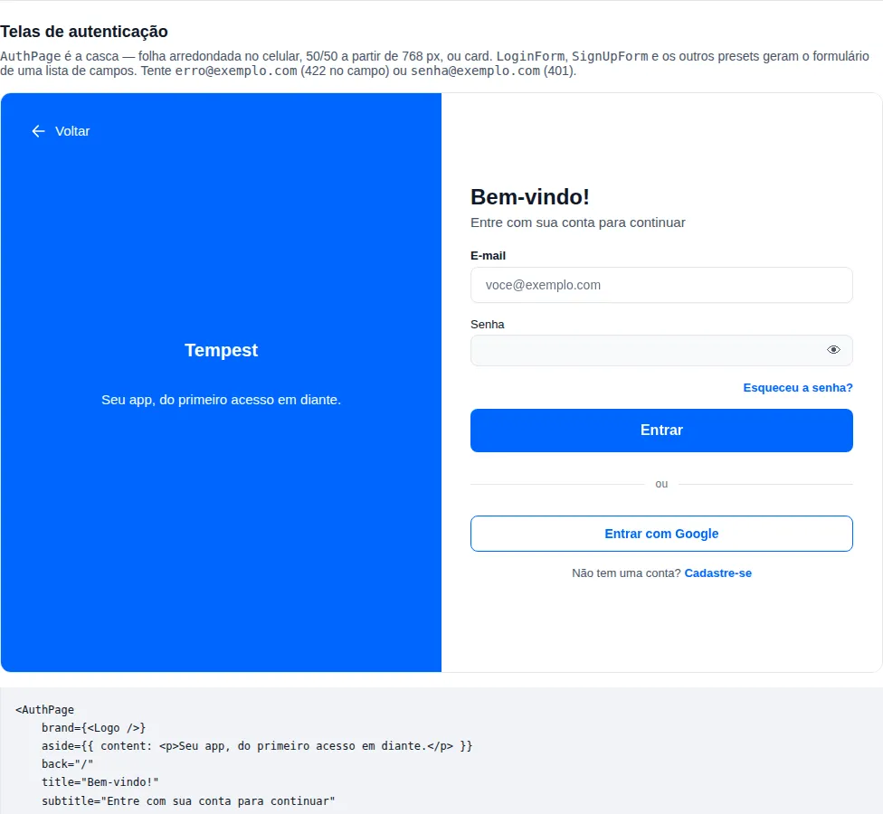

# Auth screens

Sign-in, sign-up, "forgot password" and "new password" are the first screens of
almost every app — and the ones most often copied from one project to the next.
Each app hand-builds the same `AuthWrapper` (a colored top with logo and back
button, a white sheet with rounded corners on mobile, half and half on desktop),
the same form with `useZodForm`, the same password eye and the same `catch` that
copies the 422's errors back onto the fields.

This page shows the two components that replace that work:

- **`AuthPage`** — the screen's shell: brand, title, back button and the
  responsive layout.
- **`AuthForm`** — the form generated from a **list of fields** and a zod schema,
  with four ready presets: `LoginForm`, `SignUpForm`, `ForgotPasswordForm` and
  `ResetPasswordForm`.

The app passes only what is its own: the brand, the fields and what happens on
submit. 🚀

!!! info "What stays in the app"
    Redirecting after login, storing the session, showing a toast, calling the API —
    all of it stays in the app's `onSubmit`. The components draw the screen and
    hand back the validated values; they know nothing about your backend.

## First step: a sign-in screen

A complete sign-in screen, with layout, validation, "forgot password" and sign-up
links:

```tsx
import { AuthPage, LoginForm, createApiClient, useNavigate } from "tempest-react-sdk";

const api = createApiClient({ baseURL: "/api" });

export function LoginScreen() {
    const navigate = useNavigate();

    return (
        <AuthPage
            brand={}
            back="/"
            title="Bem-vindo!"
            subtitle="Entre com sua conta para continuar"
        >
            <LoginForm
                onSubmit={async (values) => {
                    await api.post("/auth/login", { body: values });
                    navigate("/", { replace: true });
                }}
                links={{ forgotPassword: "/recuperar-senha", signUp: "/cadastro" }}
            />
        </AuthPage>
    );
}
```

Piece by piece:

- **`<AuthPage>`** draws the page. Below 768 px wide: a top in the primary color
  with the "Voltar" button and the brand, and a white sheet with large rounded top
  corners holding the form. From 768 px up: brand panel on the left, form on the
  right, half and half.
- **`back="/"`** becomes a router `Link` reading "Voltar" — the button's
  accessible name is its visible text.
- **`title`** is an `<h1>`; **`subtitle`** the line under it.
- **`<LoginForm>`** brings the e-mail and password fields, the schema
  (`loginSchema`), the "Entrar" button, the "Esqueceu a senha?" link above the
  button and the "Não tem uma conta? Cadastre-se" line below.
- **`onSubmit`** receives the values **already validated** — the e-mail arrives
  trimmed and lower-cased. While the promise runs, the button is `loading` and
  disabled.

!!! tip "The router is required"
    The links are `react-router` `Link`s, a mandatory peer of the SDK. The screen
    has to live inside a router (`AppRouter`, `BrowserRouter`, `MemoryRouter` in
    tests) — the same that already holds for any `Link`.

## `AuthPage` — the shell

<!-- gallery:auth-screens -->
[](../gallery.md)

*Section `auth-screens` of the [gallery](../gallery.md) — run it locally to interact.*
<!-- /gallery -->

```tsx
import { AuthPage, ForgotPasswordForm } from "tempest-react-sdk";

export function ForgotPasswordScreen() {
    return (
        <AuthPage
            brand={}
            aside={{
                background: "linear-gradient(160deg, #0b3d91, #1e88e5)",
                color: "#ffffff",
                content: <p>Seu app de viagens, do embarque ao destino.</p>,
            }}
            back={{ to: "/login", label: "Voltar ao login" }}
            title="Esqueceu a senha?"
            subtitle="A gente te ajuda a criar uma nova."
            footer={<small>Precisa de ajuda? suporte@acme.com</small>}
        >
            <ForgotPasswordForm
                onSubmit={async (values) => {
                    console.log("send link to", values.email);
                }}
                links={{ signIn: "/login" }}
            />
        </AuthPage>
    );
}
```

| Prop | Type | Default | What it does |
| --- | --- | --- | --- |
| `brand` | `ReactNode` | — | Logo and/or app name. On the panel (`split`) or at the top of the card (`card`). |
| `title` | `ReactNode` | — | Screen title, rendered as a heading. |
| `subtitle` | `ReactNode` | — | Line under the title. |
| `aside` | `{ background?, color?, content? }` | primary | Brand panel colors and extra content (tagline, illustration). |
| `variant` | `"split" \| "card"` | `"split"` | `split`: sheet on mobile, 50/50 on desktop. `card`: centered card at every width. |
| `breakpoint` | `number` (px) | `768` | Width from which `split` becomes two columns. |
| `back` | `string \| { to?, label?, onClick? }` | — | Back button. A string is the route; an object changes the text or uses `onClick` alone. |
| `footer` | `ReactNode` | — | Content under the form, inside the sheet/card. |
| `headingLevel` | `1`–`6` | `1` | Heading level of `title`. |
| `as` | `"main" \| "div"` | `"main"` | Root element. Use `"div"` inside a layout that already has a `<main>`. |

### `aside.background` takes any CSS

`background` goes straight into the CSS `background` property: a color, a token, a
gradient or an image. Without it, the panel uses `var(--tempest-primary)` — an app
with its own [theme](../theme.md) gets its brand color without passing anything.

!!! warning "A custom background needs a custom color"
    The panel's text uses `var(--tempest-text-on-primary)`, which is only the right
    color while the background is the primary. When you change `background`, pass
    `aside.color` too, with a color that keeps contrast (4.5:1 for text) — that is
    what keeps the "Voltar" button and the app name legible.

### The breakpoint is a prop

The 768 px default is the width at which the hand-built screens switched layout.
It is not the 1024 of [`useBreakpoint`](../hooks.md), which decides navigation
(sidebar or bottom bar), not whether a form fits beside a panel.

```tsx
import { AuthPage, LoginForm } from "tempest-react-sdk";

export function WideLoginScreen() {
    return (
        <AuthPage breakpoint={1024} title="Bem-vindo!">
            <LoginForm onSubmit={async () => undefined} />
        </AuthPage>
    );
}
```

??? info "Technical details: why the switch is in JavaScript"
    A CSS media query cannot read a custom property, so a configurable breakpoint
    does not fit in an `@media`. `AuthPage` uses `useMediaQuery`, which evaluates
    `matchMedia` synchronously on the first render — a client-rendered page has no
    frame with the wrong layout. The root exposes the current layout as
    `data-layout="stacked" | "split" | "card"`, handy in tests and in app CSS.

### The `card` variant

An admin panel has no brand taking half the screen: it is a centered card, at
every width. The brand moves to the top of the card and the title is centered.

```tsx
import { AuthPage, LoginForm } from "tempest-react-sdk";

export function AdminLoginScreen() {
    return (
        <AuthPage
            variant="card"
            brand={<strong>BusCar</strong>}
            title="Painel administrativo"
            subtitle="Acesso restrito"
        >
            <LoginForm onSubmit={async () => undefined} />
        </AuthPage>
    );
}
```

In `card`, `aside.background` becomes the page background (default:
`var(--tempest-surface)`).

## `AuthForm` — the form from a list

The presets cover the four common screens. For any other — confirm an e-mail with
a code, an invite, a second factor — use `AuthForm` directly: a zod schema and the
list of fields.

```tsx
import { AuthForm, AuthPage } from "tempest-react-sdk";
import { z } from "zod";

const verifySchema = z.object({
    code: z.string().length(6, "Digite os 6 dígitos"),
});

export function VerifyEmailScreen() {
    return (
        <AuthPage variant="card" title="Confirme seu e-mail" subtitle="Enviamos um código de 6 dígitos.">
            <AuthForm
                schema={verifySchema}
                fields={[{ name: "code", type: "pin", label: "Código", length: 6 }]}
                submitLabel="Confirmar"
                onSubmit={async (values) => {
                    console.log("verify", values.code);
                }}
            />
        </AuthPage>
    );
}
```

Each item of `fields` is an `AuthField`:

| Key | Type | What it does |
| --- | --- | --- |
| `name` | schema key | Name in the schema and in the submitted values. **Typed against the schema**: a typo does not compile. |
| `label` | `ReactNode` | Visible label. Rich content works on `checkbox` (a terms link); on `pin`, keep it text. |
| `type` | see below | Which SDK control renders the field. Default `"text"`. |
| `placeholder` | `string` | Example text. |
| `autoComplete` | `string` | `autocomplete` token. Default per type: `email` → `email`, `password` → `current-password`, `phone` → `tel`. |
| `helperText` | `ReactNode` | Help text, replaced by the error when there is one. |
| `required` | `boolean` | Visual hint + native attribute. |
| `showStrength` | `boolean` | `password` only: strength meter. |
| `length` | `number` | `pin` only: number of cells. Default `6`. |
| `render` | `(props) => ReactNode` | Render the control yourself, for what no type covers. |

And each `type` becomes a component you already know:

| `type` | Component |
| --- | --- |
| `text`, `email` | [`Input`](inputs.md#input) |
| `password` | [`PasswordInput`](inputs.md#passwordinput) — with the show/hide eye |
| `phone`, `cpf`, `cnpj` | `PhoneInput`, `CPFInput`, `CNPJInput` (BR masks, see [BR forms](../forms-br.md)) |
| `checkbox` | [`Checkbox`](inputs.md#checkbox) — the value is a `boolean` |
| `pin` | [`PinInput`](inputs.md#pininput) |

Underneath it is the SDK's [forms](../forms.md) layer: `useZodForm` +
`FormProvider` + `FormField`. Fields not given in `defaultValues` start at `""`
(`false` for `checkbox`).

### A field no type covers: `render`

```tsx
import { AuthForm, Input } from "tempest-react-sdk";
import { z } from "zod";

const inviteSchema = z.object({
    invite: z.string().regex(/^[A-Z0-9]{8}$/, "O convite tem 8 letras ou números"),
});

export function InviteForm() {
    return (
        <AuthForm
            schema={inviteSchema}
            fields={[
                {
                    name: "invite",
                    label: "Convite",
                    render: ({ field, error }) => (
                        <Input
                            ref={field.ref}
                            name={field.name}
                            label="Convite"
                            value={String(field.value)}
                            onChange={(event) => field.onChange(event.target.value.toUpperCase())}
                            onBlur={field.onBlur}
                            error={error}
                        />
                    ),
                },
            ]}
            submitLabel="Entrar com convite"
            onSubmit={async (values) => {
                console.log(values.invite);
            }}
        />
    );
}
```

`render` receives react-hook-form's `field` (`name`, `value`, `onChange`, `onBlur`,
`ref`), the `fieldState`, the resolved `error` and the `config` itself.

### Server errors

Throw inside `onSubmit` and the form shows it:

- **A `TempestApiError` with `fields`** (FastAPI's 422, already parsed by the
  [HTTP client](../http.md)): each message goes to the field of the same name, and
  the first marked field gets focus. **Only names declared in `fields`** are
  marked — the API can name a field the screen does not show, and marking a
  missing input would leave an error the user can never clear. Those field-less
  messages go to the alert.
- **Any other error**: an `Alert` above the fields, with the sentence from
  `describeApiError` (offline, the backend's `detail`, or `labels.error`).

```tsx
import { LoginForm, createApiClient } from "tempest-react-sdk";

const api = createApiClient({ baseURL: "/api" });

export function LoginWithErrors() {
    return (
        <LoginForm
            onSubmit={async (values) => {
                await api.post("/auth/login", { body: values });
            }}
            errorOptions={{ codes: { UNAUTHORIZED: "E-mail ou senha inválidos." } }}
            onError={(error) => console.error("login failed", error)}
        />
    );
}
```

`errorOptions` goes straight to `describeApiError` (`codes`, `statuses`,
`useDetail`). The form **does not rethrow** the error — a `throw` from a submit
handler is a rejection nobody owns. Use `onError` for logging and telemetry.

## The presets

Each preset is an `AuthForm` with schema, fields, copy and links ready in PT-BR.
`schema` and `fields` stay replaceable; the copy changes through `labels`.

### `LoginForm`

E-mail (trimmed and lower-cased **before** validation) and a password of at least
8 characters.

| Prop | Default |
| --- | --- |
| `links` | `{ forgotPassword?, signUp? }` — each link appears only with its route set |
| `submitLabel` | `"Entrar"` |
| `labels` | `forgotPassword: "Esqueceu a senha?"`, `signUpPrompt: "Não tem uma conta?"`, `signUp: "Cadastre-se"` |
| `social` | Social sign-in buttons, under an "ou" divider |

```tsx
import { GoogleSignIn, LoginForm } from "tempest-react-sdk";
import { GoogleLogin } from "@react-oauth/google";

export function LoginWithGoogle() {
    return (
        <LoginForm
            onSubmit={async () => undefined}
            links={{ forgotPassword: "/recuperar-senha", signUp: "/cadastro" }}
            social={
                <GoogleSignIn
                    component={GoogleLogin}
                    onSuccess={async (credential) => {
                        console.log(credential.idToken);
                    }}
                />
            }
        />
    );
}
```

The Google button is [`GoogleSignIn`](../oauth.md) from the `oauth` module.

### `SignUpForm`

Name, e-mail and password (with strength meter and `autocomplete="new-password"`,
which is what makes the password manager offer a strong one). It is the preset
that changes most between apps, so the usual path is to **extend** the default
schema and list:

```tsx
import { AuthPage, SIGN_UP_FIELDS, SignUpForm, createApiClient, signUpSchema } from "tempest-react-sdk";
import { z } from "zod";

const api = createApiClient({ baseURL: "/api" });

const registerSchema = signUpSchema.extend({
    phone: z.string().min(15, "Informe o celular com DDD"),
    terms: z.literal(true, "Aceite os termos para continuar"),
});

export function SignUpScreen() {
    return (
        <AuthPage
            brand={}
            aside={{ background: "var(--app-main-color)" }}
            back="/"
            title="Bem-vindo!"
            subtitle="Crie sua conta"
        >
            <SignUpForm
                schema={registerSchema}
                fields={[
                    ...SIGN_UP_FIELDS,
                    { name: "phone", type: "phone", label: "Celular" },
                    {
                        name: "terms",
                        type: "checkbox",
                        label: (
                            <>
                                Aceito os <a href="/termos">termos de uso</a>
                            </>
                        ),
                    },
                ]}
                onSubmit={async (values) => {
                    await api.post("/auth/register", { body: values });
                }}
                links={{ signIn: "/login" }}
            />
        </AuthPage>
    );
}
```

!!! note "Masked values arrive masked"
    `phone` arrives as `"(11) 99999-8888"`, the way `PhoneInput` shows it. If the
    API stores digits only, clean it in the schema
    (`.transform((value) => unmask(value))`) — the rule stays in one place.

The default fields of each preset are exported — `LOGIN_FIELDS`,
`SIGN_UP_FIELDS`, `FORGOT_PASSWORD_FIELDS`, `RESET_PASSWORD_FIELDS` — together with
the schemas `loginSchema`, `signUpSchema`, `forgotPasswordSchema`,
`resetPasswordSchema` and the pieces `authEmail()` and `authPassword()`. The fixed
sentences of `AuthForm` are in `DEFAULT_AUTH_FORM_LABELS`.

### `ForgotPasswordForm`

Just the e-mail, with the help text "Enviaremos um link para você criar uma nova
senha." and the "Enviar link" button. `links.signIn` shows "Lembrou a senha?
Entrar". The complete example is in the [`AuthPage`](#authpage-the-shell) section.

### `ResetPasswordForm`

New password (with strength meter) and confirmation. Different passwords show "As
senhas não coincidem" **under the confirmation field** — the schema's `refine`
uses `path: ["confirmPassword"]`.

```tsx
import { AuthPage, ResetPasswordForm, createApiClient, useSearchParams } from "tempest-react-sdk";

const api = createApiClient({ baseURL: "/api" });

export function ResetPasswordScreen() {
    const [params] = useSearchParams();

    return (
        <AuthPage title="Crie uma nova senha" back="/login">
            <ResetPasswordForm
                hints={["Pelo menos 8 caracteres", "Misture letras, números e símbolos"]}
                onSubmit={async (values) => {
                    await api.post("/auth/reset-password", {
                        body: { password: values.password, token: params.get("token") },
                    });
                }}
                links={{ signIn: "/login" }}
            />
        </AuthPage>
    );
}
```

The reset token stays out of the fields: it comes from the URL, and the app adds
it in `onSubmit`, where it also decides what an expired token looks like. `hints`
becomes a list above the button — the copy is yours, because only the backend
knows its rules.

## Migrating a hand-built screen

The pattern these components replace, as it shows up in the apps:

```tsx
import AuthWrapper from "@/components/AuthWrapper";
import BackButton from "@/components/BackButton";
import { useIsDesktop } from "@/hooks/useIsDesktop";
import { loginFormSchema, type LoginFormData } from "@/validations/auth";
import { errorFields, errorMessage } from "@/utils/apiError";
import { Link, useZodForm } from "tempest-react-sdk";

export default function Login() {
    const isDesktop = useIsDesktop();
    const { register, handleSubmit, setError, formState } = useZodForm(loginFormSchema, {
        defaultValues: { email: "", password: "" },
    });

    async function onSubmit(data: LoginFormData) {
        try {
            await AuthService.login(data);
        } catch (error) {
            for (const [field, message] of Object.entries(errorFields(error))) {
                if (field in loginFormSchema.shape) {
                    setError(field as "email" | "password", { message: String(message) });
                }
            }
            popupService.show({ text: errorMessage(error) });
        }
    }

    return (
        <AuthWrapper enabled={!isDesktop}>
            <form onSubmit={handleSubmit(onSubmit)} className="professionalForm">
                {isDesktop && <BackButton />}
                <fieldset className="formContainer">
                    <strong>Bem-Vindo!</strong>
                    <span>Entre com sua conta para continuar</span>
                    <label htmlFor="email">
                        Email
                        <input id="email" type="email" {...register("email")} />
                        {formState.errors.email && <small>{formState.errors.email.message}</small>}
                    </label>
                    <button type="submit" disabled={formState.isSubmitting}>
                        Entrar
                    </button>
                </fieldset>
            </form>
        </AuthWrapper>
    );
}
```

The same result, with the SDK:

```tsx
import { AuthPage, LoginForm, useNavigate } from "tempest-react-sdk";
import { AuthService } from "@/services/auth";
import { IMAGES } from "@/constants/images";

export default function Login() {
    const navigate = useNavigate();

    return (
        <AuthPage
            brand={}
            aside={{ background: "var(--main-linear)" }}
            back="/"
            title="Bem-vindo!"
            subtitle="Entre com sua conta para continuar"
        >
            <LoginForm
                onSubmit={async (values) => {
                    await AuthService.login(values);
                    navigate("/", { replace: true });
                }}
                errorOptions={{ codes: { UNAUTHORIZED: "E-mail ou senha inválidos." } }}
                links={{ forgotPassword: "/recuperar-senha", signUp: "/cadastro" }}
            />
        </AuthPage>
    );
}
```

What left the app, and where it went:

| Before (in the app) | Now |
| --- | --- |
| `AuthWrapper` + `styles.module.css` + `auth.css` | `AuthPage` |
| `useIsDesktop()` + `enabled={!isDesktop}` + a duplicated `BackButton` | `AuthPage` switches layout by itself at `breakpoint` |
| `<label>` + `<input>` + `<small>` per field | the `fields` list (or the preset) |
| password eye with `useState` | `PasswordInput` |
| `loginFormSchema` | `loginSchema` (or yours, in `schema`) |
| `setError` loop filtering `in schema.shape` | `AuthForm` marks only the declared fields |
| `popupService.show(errorMessage(...))` | `Alert` with `describeApiError` + `errorOptions` |

!!! check "What to check after migrating"
    Open the screen below and above 768 px, in the light and the dark theme, and
    submit the empty form once: every field should show its schema's message.

## Recap

- **`AuthPage`** is the shell: `brand`, `title`, `subtitle`, `back`, `footer`, the
  `aside` panel and the `split` layout (sheet on mobile, 50/50 on desktop) or
  `card`, switching at `breakpoint` (768 px by default).
- **`AuthForm`** generates the form from a zod `schema` and a `fields` list; each
  `type` becomes an SDK control, and `render` covers the rest.
- Errors from `onSubmit` show up by themselves: a 422 on the declared fields, the
  rest in an `Alert`.
- **`LoginForm`**, **`SignUpForm`**, **`ForgotPasswordForm`** and
  **`ResetPasswordForm`** are `AuthForm` with PT-BR defaults; extend the schema and
  the list instead of rewriting them.
- Session, redirect, toast and API call stay in the app's `onSubmit`.
