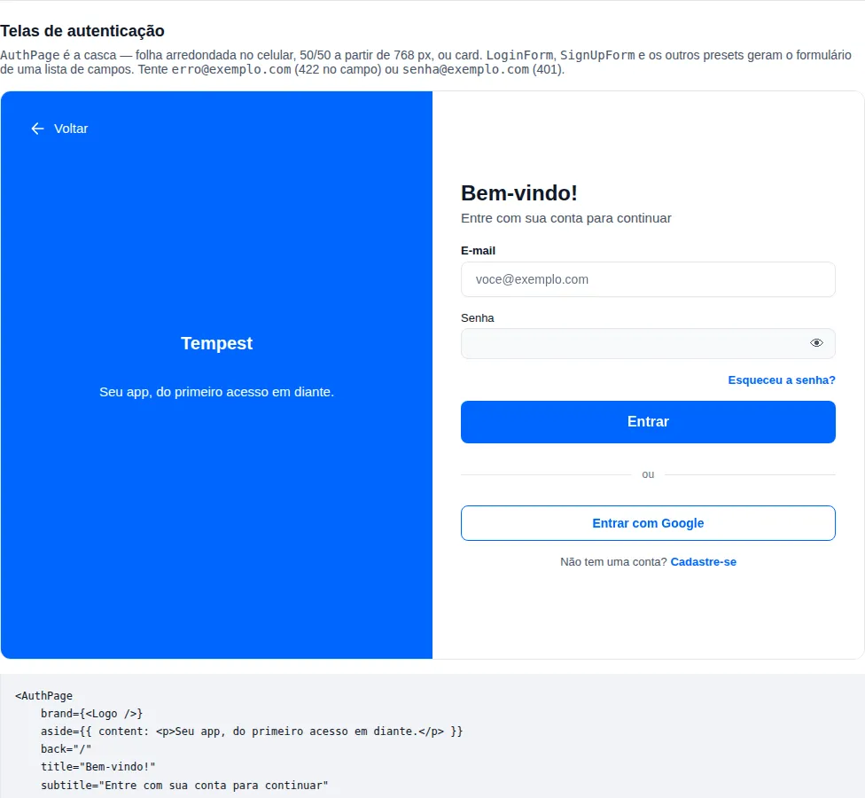

# Telas de autenticação

Login, cadastro, "esqueci a senha" e "nova senha" são as primeiras telas de quase
todo app — e as mais copiadas de um projeto para o outro. Cada app monta à mão o
mesmo `AuthWrapper` (topo colorido com logo e botão voltar, folha branca de cantos
arredondados no celular, metade/metade no desktop), o mesmo formulário com
`useZodForm`, o mesmo olho na senha e o mesmo `catch` que copia os erros do 422 de
volta para os campos.

Esta página mostra os dois componentes que substituem esse trabalho:

- **`AuthPage`** — a casca da tela: marca, título, botão voltar e o layout
  responsivo.
- **`AuthForm`** — o formulário gerado a partir de uma **lista de campos** e de um
  schema zod, com quatro presets prontos: `LoginForm`, `SignUpForm`,
  `ForgotPasswordForm` e `ResetPasswordForm`.

O app passa só o que é dele: a marca, os campos e o que acontece no envio. 🚀

!!! info "O que fica no app"
    Redirecionar depois do login, guardar a sessão, mostrar um toast, chamar a API —
    tudo isso continua no `onSubmit` do app. Os componentes desenham a tela e
    devolvem os valores validados; não sabem nada do seu backend.

## Primeiro passo: uma tela de login

Uma tela de login completa, com layout, validação, link de "esqueceu a senha" e de
cadastro:

```tsx
import { AuthPage, LoginForm, createApiClient, useNavigate } from "tempest-react-sdk";

const api = createApiClient({ baseURL: "/api" });

export function LoginScreen() {
    const navigate = useNavigate();

    return (
        <AuthPage
            brand={}
            back="/"
            title="Bem-vindo!"
            subtitle="Entre com sua conta para continuar"
        >
            <LoginForm
                onSubmit={async (values) => {
                    await api.post("/auth/login", { body: values });
                    navigate("/", { replace: true });
                }}
                links={{ forgotPassword: "/recuperar-senha", signUp: "/cadastro" }}
            />
        </AuthPage>
    );
}
```

Pedaço por pedaço:

- **`<AuthPage>`** desenha a página. Abaixo de 768 px de largura: topo na cor
  primária com o botão "Voltar" e a marca, e uma folha branca com cantos
  superiores bem arredondados segurando o formulário. A partir de 768 px: painel
  da marca à esquerda, formulário à direita, metade/metade.
- **`back="/"`** vira um `Link` do router com o texto "Voltar" — o nome acessível
  do botão é o texto visível.
- **`title`** é um `<h1>`; **`subtitle`** a linha embaixo dele.
- **`<LoginForm>`** traz os campos de e-mail e senha, o schema
  (`loginSchema`), o botão "Entrar", o link "Esqueceu a senha?" acima do botão e a
  linha "Não tem uma conta? Cadastre-se" embaixo.
- **`onSubmit`** recebe os valores **já validados** — o e-mail chega aparado e em
  minúsculas. Enquanto a promise roda, o botão fica em `loading` e desabilitado.

!!! tip "O router é obrigatório"
    Os links são `Link` do `react-router`, peer obrigatório do SDK. A tela precisa
    estar dentro de um router (`AppRouter`, `BrowserRouter`, `MemoryRouter` nos
    testes) — o mesmo que já vale para qualquer `Link`.

## `AuthPage` — a casca

<!-- gallery:auth-screens -->
[](../gallery.md)

*Seção `auth-screens` da [gallery](../gallery.md) — rode localmente para interagir.*
<!-- /gallery -->

```tsx
import { AuthPage, ForgotPasswordForm } from "tempest-react-sdk";

export function ForgotPasswordScreen() {
    return (
        <AuthPage
            brand={}
            aside={{
                background: "linear-gradient(160deg, #0b3d91, #1e88e5)",
                color: "#ffffff",
                content: <p>Seu app de viagens, do embarque ao destino.</p>,
            }}
            back={{ to: "/login", label: "Voltar ao login" }}
            title="Esqueceu a senha?"
            subtitle="A gente te ajuda a criar uma nova."
            footer={<small>Precisa de ajuda? suporte@acme.com</small>}
        >
            <ForgotPasswordForm
                onSubmit={async (values) => {
                    console.log("enviar link para", values.email);
                }}
                links={{ signIn: "/login" }}
            />
        </AuthPage>
    );
}
```

| Prop | Tipo | Padrão | O que faz |
| --- | --- | --- | --- |
| `brand` | `ReactNode` | — | Logo e/ou nome do app. No painel (`split`) ou no topo do card (`card`). |
| `title` | `ReactNode` | — | Título da tela, renderizado como heading. |
| `subtitle` | `ReactNode` | — | Linha sob o título. |
| `aside` | `{ background?, color?, content? }` | primária | Cores do painel da marca e conteúdo extra (frase, ilustração). |
| `variant` | `"split" \| "card"` | `"split"` | `split`: folha no celular, 50/50 no desktop. `card`: card centralizado em toda largura. |
| `breakpoint` | `number` (px) | `768` | Largura a partir da qual o `split` vira duas colunas. |
| `back` | `string \| { to?, label?, onClick? }` | — | Botão voltar. String é a rota; objeto troca o texto ou usa só `onClick`. |
| `footer` | `ReactNode` | — | Conteúdo abaixo do formulário, dentro da folha/card. |
| `headingLevel` | `1`–`6` | `1` | Nível do heading do `title`. |
| `as` | `"main" \| "div"` | `"main"` | Elemento raiz. Use `"div"` dentro de um layout que já tem `<main>`. |

### `aside.background` aceita qualquer CSS

`background` vai direto para a propriedade CSS `background`: cor, token, gradiente
ou imagem. Sem ele, o painel usa `var(--tempest-primary)` — um app com
[tema](../theme.md) próprio já sai com a cor da marca sem passar nada.

!!! warning "Fundo próprio pede cor própria"
    O texto do painel usa `var(--tempest-text-on-primary)`, que só é a cor certa
    enquanto o fundo é a primária. Ao trocar o `background`, passe também
    `aside.color` com uma cor que dê contraste (4,5:1 para texto) — é o que mantém
    o botão "Voltar" e o nome do app legíveis.

### O breakpoint é uma prop

O padrão de 768 px é a largura em que as telas feitas à mão trocavam de layout.
Não é o 1024 do [`useBreakpoint`](../hooks.md), que decide navegação (sidebar ou
menu inferior), não se um formulário cabe ao lado de um painel.

```tsx
import { AuthPage, LoginForm } from "tempest-react-sdk";

export function WideLoginScreen() {
    return (
        <AuthPage breakpoint={1024} title="Bem-vindo!">
            <LoginForm onSubmit={async () => undefined} />
        </AuthPage>
    );
}
```

??? info "Detalhes técnicos: por que a troca é em JavaScript"
    Uma media query CSS não lê custom property, então um breakpoint configurável
    não cabe num `@media`. O `AuthPage` usa `useMediaQuery`, que avalia o
    `matchMedia` de forma síncrona no primeiro render — numa página renderizada no
    cliente não há quadro com o layout errado. A raiz expõe o layout atual em
    `data-layout="stacked" | "split" | "card"`, útil em teste e em CSS do app.

### A variante `card`

Painel administrativo não tem marca ocupando meia tela: é um card centralizado,
em toda largura. A marca vai para o topo do card e o título fica centralizado.

```tsx
import { AuthPage, LoginForm } from "tempest-react-sdk";

export function AdminLoginScreen() {
    return (
        <AuthPage
            variant="card"
            brand={<strong>BusCar</strong>}
            title="Painel administrativo"
            subtitle="Acesso restrito"
        >
            <LoginForm onSubmit={async () => undefined} />
        </AuthPage>
    );
}
```

No `card`, `aside.background` vira o fundo da página (padrão:
`var(--tempest-surface)`).

## `AuthForm` — o formulário a partir de uma lista

Os presets cobrem as quatro telas comuns. Para qualquer outra — confirmar e-mail
com código, convite, segundo fator — use o `AuthForm` direto: um schema zod e a
lista de campos.

```tsx
import { AuthForm, AuthPage } from "tempest-react-sdk";
import { z } from "zod";

const verifySchema = z.object({
    code: z.string().length(6, "Digite os 6 dígitos"),
});

export function VerifyEmailScreen() {
    return (
        <AuthPage variant="card" title="Confirme seu e-mail" subtitle="Enviamos um código de 6 dígitos.">
            <AuthForm
                schema={verifySchema}
                fields={[{ name: "code", type: "pin", label: "Código", length: 6 }]}
                submitLabel="Confirmar"
                onSubmit={async (values) => {
                    console.log("verificar", values.code);
                }}
            />
        </AuthPage>
    );
}
```

Cada item de `fields` é um `AuthField`:

| Chave | Tipo | O que faz |
| --- | --- | --- |
| `name` | chave do schema | Nome no schema e nos valores enviados. **Tipado contra o schema**: um erro de digitação não compila. |
| `label` | `ReactNode` | Rótulo visível. Conteúdo rico funciona no `checkbox` (link para os termos); no `pin`, mantenha texto. |
| `type` | ver abaixo | Qual controle do SDK renderiza o campo. Padrão `"text"`. |
| `placeholder` | `string` | Texto de exemplo. |
| `autoComplete` | `string` | Token `autocomplete`. Padrão por tipo: `email` → `email`, `password` → `current-password`, `phone` → `tel`. |
| `helperText` | `ReactNode` | Texto de ajuda, trocado pelo erro quando há um. |
| `required` | `boolean` | Marca visual + atributo nativo. |
| `showStrength` | `boolean` | Só `password`: medidor de força. |
| `length` | `number` | Só `pin`: número de casas. Padrão `6`. |
| `render` | `(props) => ReactNode` | Renderiza o controle você mesmo, para o que nenhum tipo cobre. |

E cada `type` vira um componente que você já conhece:

| `type` | Componente |
| --- | --- |
| `text`, `email` | [`Input`](inputs.md#input) |
| `password` | [`PasswordInput`](inputs.md#passwordinput) — com o olho de mostrar/esconder |
| `phone`, `cpf`, `cnpj` | `PhoneInput`, `CPFInput`, `CNPJInput` (máscara BR, ver [Formulários BR](../forms-br.md)) |
| `checkbox` | [`Checkbox`](inputs.md#checkbox) — o valor é `boolean` |
| `pin` | [`PinInput`](inputs.md#pininput) |

Por baixo, é a camada de [formulários](../forms.md) do SDK: `useZodForm` +
`FormProvider` + `FormField`. Os campos não declarados em `defaultValues` começam
em `""` (`false` no `checkbox`).

### Um campo que nenhum tipo cobre: `render`

```tsx
import { AuthForm, Input } from "tempest-react-sdk";
import { z } from "zod";

const inviteSchema = z.object({
    invite: z.string().regex(/^[A-Z0-9]{8}$/, "O convite tem 8 letras ou números"),
});

export function InviteForm() {
    return (
        <AuthForm
            schema={inviteSchema}
            fields={[
                {
                    name: "invite",
                    label: "Convite",
                    render: ({ field, error }) => (
                        <Input
                            ref={field.ref}
                            name={field.name}
                            label="Convite"
                            value={String(field.value)}
                            onChange={(event) => field.onChange(event.target.value.toUpperCase())}
                            onBlur={field.onBlur}
                            error={error}
                        />
                    ),
                },
            ]}
            submitLabel="Entrar com convite"
            onSubmit={async (values) => {
                console.log(values.invite);
            }}
        />
    );
}
```

`render` recebe o `field` do react-hook-form (`name`, `value`, `onChange`,
`onBlur`, `ref`), o `fieldState`, o `error` já resolvido e o próprio `config`.

### Erros do servidor

Lance o erro dentro do `onSubmit` e o formulário mostra:

- **`TempestApiError` com `fields`** (o 422 do FastAPI, já parseado pelo
  [cliente HTTP](../http.md)): cada mensagem vai para o campo de mesmo nome, e o
  primeiro campo marcado recebe o foco. **Só nomes declarados em `fields`** são
  marcados — a API pode citar um campo que a tela não mostra, e marcar um input
  inexistente deixaria um erro que o usuário nunca consegue limpar. Essas
  mensagens sem campo vão para o alerta.
- **Qualquer outro erro**: um `Alert` acima dos campos, com a frase de
  `describeApiError` (sem conexão, `detail` do backend, ou `labels.error`).

```tsx
import { LoginForm, createApiClient } from "tempest-react-sdk";

const api = createApiClient({ baseURL: "/api" });

export function LoginWithErrors() {
    return (
        <LoginForm
            onSubmit={async (values) => {
                await api.post("/auth/login", { body: values });
            }}
            errorOptions={{ codes: { UNAUTHORIZED: "E-mail ou senha inválidos." } }}
            onError={(error) => console.error("login falhou", error)}
        />
    );
}
```

`errorOptions` vai direto para o `describeApiError` (`codes`, `statuses`,
`useDetail`). O formulário **não relança** o erro — um `throw` dentro do handler
de submit vira rejeição sem dono. Use `onError` para log e telemetria.

## Os presets

Cada preset é um `AuthForm` com schema, campos, textos e links prontos em PT-BR.
`schema` e `fields` continuam substituíveis; os textos mudam por `labels`.

### `LoginForm`

E-mail (aparado e em minúsculas **antes** da validação) e senha com no mínimo 8
caracteres.

| Prop | Padrão |
| --- | --- |
| `links` | `{ forgotPassword?, signUp? }` — cada link só aparece com a rota definida |
| `submitLabel` | `"Entrar"` |
| `labels` | `forgotPassword: "Esqueceu a senha?"`, `signUpPrompt: "Não tem uma conta?"`, `signUp: "Cadastre-se"` |
| `social` | Botões de login social, sob um divisor "ou" |

```tsx
import { GoogleSignIn, LoginForm } from "tempest-react-sdk";
import { GoogleLogin } from "@react-oauth/google";

export function LoginWithGoogle() {
    return (
        <LoginForm
            onSubmit={async () => undefined}
            links={{ forgotPassword: "/recuperar-senha", signUp: "/cadastro" }}
            social={
                <GoogleSignIn
                    component={GoogleLogin}
                    onSuccess={async (credential) => {
                        console.log(credential.idToken);
                    }}
                />
            }
        />
    );
}
```

O botão do Google é o [`GoogleSignIn`](../oauth.md) do módulo `oauth`.

### `SignUpForm`

Nome, e-mail e senha (com medidor de força e `autocomplete="new-password"`, que é
o que faz o gerenciador de senhas oferecer uma senha forte). É o preset que mais
muda de app para app, então o caminho comum é **estender** o schema e a lista
padrão:

```tsx
import { AuthPage, SIGN_UP_FIELDS, SignUpForm, createApiClient, signUpSchema } from "tempest-react-sdk";
import { z } from "zod";

const api = createApiClient({ baseURL: "/api" });

const registerSchema = signUpSchema.extend({
    phone: z.string().min(15, "Informe o celular com DDD"),
    terms: z.literal(true, "Aceite os termos para continuar"),
});

export function SignUpScreen() {
    return (
        <AuthPage
            brand={}
            aside={{ background: "var(--app-main-color)" }}
            back="/"
            title="Bem-vindo!"
            subtitle="Crie sua conta"
        >
            <SignUpForm
                schema={registerSchema}
                fields={[
                    ...SIGN_UP_FIELDS,
                    { name: "phone", type: "phone", label: "Celular" },
                    {
                        name: "terms",
                        type: "checkbox",
                        label: (
                            <>
                                Aceito os <a href="/termos">termos de uso</a>
                            </>
                        ),
                    },
                ]}
                onSubmit={async (values) => {
                    await api.post("/auth/register", { body: values });
                }}
                links={{ signIn: "/login" }}
            />
        </AuthPage>
    );
}
```

!!! note "Os valores mascarados chegam mascarados"
    `phone` chega como `"(11) 99999-8888"`, do jeito que o `PhoneInput` mostra. Se
    a API guarda só os dígitos, limpe no schema
    (`.transform((value) => unmask(value))`) — a regra fica num lugar só.

Os campos padrão de cada preset estão exportados — `LOGIN_FIELDS`,
`SIGN_UP_FIELDS`, `FORGOT_PASSWORD_FIELDS`, `RESET_PASSWORD_FIELDS` — junto dos
schemas `loginSchema`, `signUpSchema`, `forgotPasswordSchema`,
`resetPasswordSchema` e das peças `authEmail()` e `authPassword()`. Os textos fixos
do `AuthForm` estão em `DEFAULT_AUTH_FORM_LABELS`.

### `ForgotPasswordForm`

Só o e-mail, com o texto de ajuda "Enviaremos um link para você criar uma nova
senha." e o botão "Enviar link". `links.signIn` mostra "Lembrou a senha? Entrar".
O exemplo completo está na seção do [`AuthPage`](#authpage-a-casca).

### `ResetPasswordForm`

Nova senha (com medidor de força) e confirmação. Senhas diferentes mostram "As
senhas não coincidem" **sob o campo de confirmação** — o `refine` do schema usa
`path: ["confirmPassword"]`.

```tsx
import { AuthPage, ResetPasswordForm, createApiClient, useSearchParams } from "tempest-react-sdk";

const api = createApiClient({ baseURL: "/api" });

export function ResetPasswordScreen() {
    const [params] = useSearchParams();

    return (
        <AuthPage title="Crie uma nova senha" back="/login">
            <ResetPasswordForm
                hints={["Pelo menos 8 caracteres", "Misture letras, números e símbolos"]}
                onSubmit={async (values) => {
                    await api.post("/auth/reset-password", {
                        body: { password: values.password, token: params.get("token") },
                    });
                }}
                links={{ signIn: "/login" }}
            />
        </AuthPage>
    );
}
```

O token de redefinição fica fora dos campos: ele vem da URL, e o app o junta no
`onSubmit`, onde também decide como fica um token expirado. `hints` vira uma lista
acima do botão — o texto é seu, porque só o backend sabe as regras dele.

## Destinos dos links

Os `links` dos presets (`forgotPassword`, `signUp`, `signIn`) e o `back` do `AuthPage` vão para o `Link` do react-router, que escreve a string no `href`. Os dois passam antes pela lista do `safeLinkUrl` (`http:`, `https:`, `mailto:`, `tel:`, `sms:` e URL relativa):

| O que chegou | O que aparece |
| --- | --- |
| `"/cadastro"`, `"https://conta.exemplo.com"` | o link, como hoje |
| `"javascript:..."` num link do formulário | nada — como se a rota não tivesse sido passada |
| `"javascript:..."` no `back` com `onClick` | o botão, só com o `onClick` |
| `"javascript:..."` no `back` sem `onClick` | nada — botão de voltar que não faz nada é pior que nenhum |

!!! info "Por que a lib filtra em vez de pedir cuidado"
    Medido: no React 19 um `href` `javascript:` é trocado por um stub que lança; no React 18 — dentro do peer range — ele vai para o DOM como veio. Só é explorável se o app repassar dado não confiável (config de tenant, query string) para essas props, mas a resposta certa é sempre a mesma, então mora no componente.

## Migrando uma tela feita à mão

O padrão que estes componentes substituem, como ele aparece nos apps:

```tsx
import AuthWrapper from "@/components/AuthWrapper";
import BackButton from "@/components/BackButton";
import { useIsDesktop } from "@/hooks/useIsDesktop";
import { loginFormSchema, type LoginFormData } from "@/validations/auth";
import { errorFields, errorMessage } from "@/utils/apiError";
import { Link, useZodForm } from "tempest-react-sdk";

export default function Login() {
    const isDesktop = useIsDesktop();
    const { register, handleSubmit, setError, formState } = useZodForm(loginFormSchema, {
        defaultValues: { email: "", password: "" },
    });

    async function onSubmit(data: LoginFormData) {
        try {
            await AuthService.login(data);
        } catch (error) {
            for (const [field, message] of Object.entries(errorFields(error))) {
                if (field in loginFormSchema.shape) {
                    setError(field as "email" | "password", { message: String(message) });
                }
            }
            popupService.show({ text: errorMessage(error) });
        }
    }

    return (
        <AuthWrapper enabled={!isDesktop}>
            <form onSubmit={handleSubmit(onSubmit)} className="professionalForm">
                {isDesktop && <BackButton />}
                <fieldset className="formContainer">
                    <strong>Bem-Vindo!</strong>
                    <span>Entre com sua conta para continuar</span>
                    <label htmlFor="email">
                        Email
                        <input id="email" type="email" {...register("email")} />
                        {formState.errors.email && <small>{formState.errors.email.message}</small>}
                    </label>
                    <button type="submit" disabled={formState.isSubmitting}>
                        Entrar
                    </button>
                </fieldset>
            </form>
        </AuthWrapper>
    );
}
```

O mesmo resultado, com o SDK:

```tsx
import { AuthPage, LoginForm, useNavigate } from "tempest-react-sdk";
import { AuthService } from "@/services/auth";
import { IMAGES } from "@/constants/images";

export default function Login() {
    const navigate = useNavigate();

    return (
        <AuthPage
            brand={}
            aside={{ background: "var(--main-linear)" }}
            back="/"
            title="Bem-vindo!"
            subtitle="Entre com sua conta para continuar"
        >
            <LoginForm
                onSubmit={async (values) => {
                    await AuthService.login(values);
                    navigate("/", { replace: true });
                }}
                errorOptions={{ codes: { UNAUTHORIZED: "E-mail ou senha inválidos." } }}
                links={{ forgotPassword: "/recuperar-senha", signUp: "/cadastro" }}
            />
        </AuthPage>
    );
}
```

O que saiu do app, e para onde foi:

| Antes (no app) | Agora |
| --- | --- |
| `AuthWrapper` + `styles.module.css` + `auth.css` | `AuthPage` |
| `useIsDesktop()` + `enabled={!isDesktop}` + `BackButton` duplicado | `AuthPage` troca de layout sozinho no `breakpoint` |
| `<label>` + `<input>` + `<small>` por campo | a lista `fields` (ou o preset) |
| olho de senha com `useState` | `PasswordInput` |
| `loginFormSchema` | `loginSchema` (ou o seu, em `schema`) |
| laço de `setError` filtrando `in schema.shape` | `AuthForm` marca só os campos declarados |
| `popupService.show(errorMessage(...))` | `Alert` com `describeApiError` + `errorOptions` |

!!! check "O que conferir depois de migrar"
    Abra a tela abaixo e acima de 768 px, no tema claro e no escuro, e envie o
    formulário vazio uma vez: cada campo deve mostrar a mensagem do seu schema.

## Recap

- **`AuthPage`** é a casca: `brand`, `title`, `subtitle`, `back`, `footer`, o
  painel `aside` e o layout `split` (folha no celular, 50/50 no desktop) ou
  `card`, trocando no `breakpoint` (768 px por padrão).
- **`AuthForm`** gera o formulário de um `schema` zod e de uma lista `fields`; cada
  `type` vira um controle do SDK, e `render` cobre o resto.
- Erros do `onSubmit` aparecem sozinhos: 422 nos campos declarados, o resto num
  `Alert`.
- **`LoginForm`**, **`SignUpForm`**, **`ForgotPasswordForm`** e
  **`ResetPasswordForm`** são `AuthForm` com padrões em PT-BR; estenda o schema e
  a lista em vez de reescrever.
- Sessão, redirecionamento, toast e chamada à API continuam no `onSubmit` do app.
