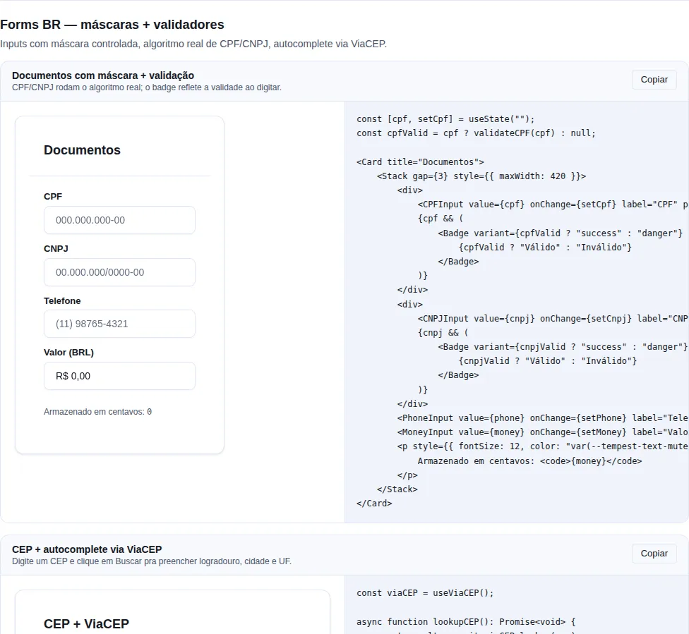

# Forms BR — masks, validators, ViaCEP

Everything Brazilian apps use daily: really validate CPF/CNPJ, mask input as the
user types, and fill an address from the ZIP code (CEP). Pairs with
[zod + react-hook-form](./forms.md) or a manual controlled form.

!!! info "Why not just check the length?"
    "It has 11 digits" does not mean the CPF exists. Brazilian documents carry
    **check digits** computed from the others — that is how the tax-authority
    backend rejects mistyped numbers. Checking only the length lets
    `123.456.789-00` and any repeated sequence through. The functions below run the
    full algorithm.

<!-- gallery:br-forms -->
[](gallery.md)

*Section `br-forms` of the [gallery](gallery.md) — run it locally to interact.*
<!-- /gallery -->

## Validators

```ts
import { validateCPF, validateCNPJ } from "tempest-react-sdk";

validateCPF("529.982.247-25"); // true
validateCPF("111.111.111-11"); // false (rejects all-equal)
validateCPF("12345678900"); // false (invalid check digit)
validateCNPJ("11.222.333/0001-81"); // true
```

Full algorithm (check digits), not just "11 digits". Accepts a string with or
without a mask.

!!! note "Why reject repeated digits"
    `111.111.111-11`, `000.000.000-00`, etc. **pass** the check-digit math by
    mathematical coincidence — the raw algorithm would accept them. Since none of
    those is a real document, both validators have an explicit short-circuit
    (`/^(\d)\1+$/`) that rejects any value with all-equal digits before computing.

!!! tip "They are pure — combine freely"
    `validateCPF` / `validateCNPJ` take a `string` and return a `boolean`, with no
    state and no React. Use them directly in an `onBlur`, in a zod `.refine()` (see
    the end of the page), or on the server — it is the same code on both sides.

## Masked inputs

| Component    | Mask                             | inputMode |
| ------------ | -------------------------------- | --------- |
| `CPFInput`   | `000.000.000-00`                 | numeric   |
| `CNPJInput`  | `00.000.000/0000-00`             | numeric   |
| `PhoneInput` | `(00) 00000-0000` (or 10 digits) | tel       |
| `CEPInput`   | `00000-000`                      | numeric   |
| `MoneyInput` | `R$ X.XXX,XX` (cents)            | numeric   |

Uniform API — they all take `value: string` (or `number` for `MoneyInput`) +
`onChange`:

```tsx
import { useState } from "react";
import { CPFInput } from "tempest-react-sdk";

function CPFExample() {
  const [cpf, setCpf] = useState("");
  return <CPFInput value={cpf} onChange={setCpf} label="CPF" required />;
}
```

!!! warning "`onChange` gives a string, not an event"
    The masked inputs are **controlled** and call `onChange(maskedValue)` with the
    already-formatted string — **not** with a `ChangeEvent`. Don't try
    `e.target.value`. To keep only the digits, use [`unmask`](#unmask-strip) at
    submit time.

`MoneyInput` works in **cents** (`number`) to avoid float errors, banking-app style: digits enter
from the right (`1` → `R$ 0,01`, `1234` → `R$ 12,34`), Backspace removes the last digit, a paste
keeps only its digits and the caret always stays at the end.

```tsx
import { useState } from "react";
import { MoneyInput } from "tempest-react-sdk";

function PriceExample() {
  const [cents, setCents] = useState(0);
  return <MoneyInput value={cents} onChange={setCents} label="Price" />;
  // cents=12990 → "R$ 129,90"
}
```

For other currencies: `<MoneyInput currency="USD" locale="en-US" />`.

!!! warning "MoneyInput is integer cents — never float"
    `value` and `onChange` deal in **integer cents** (`12990`), not currency units
    (`129.90`). Persisting the value as an integer avoids the classic
    `0.1 + 0.2 !== 0.3`. Divide by 100 only at the edge when displaying/computing — or
    format straight from the cents with [`formatCents`](./utilities.md#format-cents).

### Optional field: `nullable` {#money-nullable}

With `value: number` the field is **never empty**: clearing it goes back to `R$ 0,00`, the
placeholder disappears and "not informed" becomes zero. For an optional field (price per litre,
extra fee), pass `nullable`: `value` then accepts `null`, an empty field shows the placeholder,
and deleting every digit (or typing only zeros) calls `onChange(null)`.

```tsx
import { useState } from "react";
import { MoneyInput } from "tempest-react-sdk";

function OptionalPriceExample() {
  const [cents, setCents] = useState<number | null>(null);
  return (
    <MoneyInput
      nullable
      value={cents}
      onChange={setCents}
      label="Price per litre"
      placeholder="R$ 0,00"
      maxCents={99_999}
    />
  );
}
```

`maxCents` is the ceiling in cents: a digit that would pass it is **ignored** (the amount stays
where it was) instead of becoming a number nobody typed. Default: `Number.MAX_SAFE_INTEGER`.

!!! info "Why `nullable` is a prop, not just `value: number | null`"
    The type of `onChange` is what your `setState` has to match. Without `nullable` the contract is
    the old one — `onChange(cents: number)`, clearing reports `0` — and a `useState(0)` keeps
    compiling without ever receiving `null`. With `nullable` it is `onChange(cents: number | null)`.

### Uncontrolled forms: `name` {#money-name}

The visible text is formatted (`R$ 12,34`), so `FormData` read from it is useless to a backend.
With `name`, `MoneyInput` renders an `<input type="hidden">` holding the raw amount; the visible
field carries no `name`. `nameFormat` picks the format: `"cents"` (default, `"1234"`) or
`"decimal"` (major unit with a dot, `"12.34"`). Empty becomes `""`; a `disabled` field stays out of
`FormData`, like the visible one.

```tsx
import { useState } from "react";
import type { FormEvent } from "react";
import { MoneyInput } from "tempest-react-sdk";

function StopForm() {
  const [cents, setCents] = useState<number | null>(null);

  function submit(event: FormEvent<HTMLFormElement>): void {
    event.preventDefault();
    const data = new FormData(event.currentTarget);
    console.log(data.get("price")); // "12.34" — or "" when empty
  }

  return (
    <form onSubmit={submit}>
      <MoneyInput nullable value={cents} onChange={setCents} name="price" nameFormat="decimal" label="Price" />
      <button type="submit">Save</button>
    </form>
  );
}
```

### Frameless: `useMoneyMask` {#use-money-mask}

`MoneyInput` is the SDK's `<Input>` (label, border, error). When the app's field already has its
own box with an icon, spread the mask straight on your `<input>`: `useMoneyMask({ value, onChange,
maxCents })` returns `{ type, inputMode, value, onChange, onFocus, onClick, onSelect }`, with
`value: number | null` and `onChange(cents: number | null)`. It is exactly what `MoneyInput` uses
underneath.

```tsx
import { useState } from "react";
import { useMoneyMask } from "tempest-react-sdk";

function BankStyleField() {
  const [cents, setCents] = useState<number | null>(null);
  const mask = useMoneyMask({ value: cents, onChange: setCents, maxCents: 1_000_000 });
  return (
    <label className="my-field">
      <span aria-hidden="true">💰</span>
      <input {...mask} aria-label="Amount" placeholder="R$ 0,00" />
      <input type="hidden" name="amount" value={cents ?? ""} />
    </label>
  );
}
```

!!! tip "Caret always at the end"
    Click, arrow keys and focus put the caret back at the end of the text. Without it, measured in
    Chromium against 0.91.0: with `R$ 12,34` and the caret after the `1`, typing `5` gave
    `R$ 152,34` (instead of `R$ 123,45`) and Backspace deleted the `1`, giving `R$ 52,34`. A
    selection (select all and paste, or delete) still works — it replaces the whole amount.

The digit-reading rule is pure and exported, so the server or a `zod` schema can run the same
code: `centsFromDigits(text, maxCents?)` → cents or `null`.

```ts
import { centsFromDigits } from "tempest-react-sdk";

centsFromDigits("R$ 1.234,56 (à vista)"); // 123456
centsFromDigits("R$ 0,00");               // null
centsFromDigits("99999", 10_000);         // 9999
```

### `unmask` — digits only {#unmask-strip}

```ts
import { unmask } from "tempest-react-sdk";

unmask("529.982.247-25"); // "52998224725"
```

Use it before sending to the backend, which usually expects raw digits.
`formatCEP` and `formatCNPJ` are also exported if you need to mask a string
outside a controlled input.

### Mobile-only field — `formatPhone({ mobile: true })`

By default the grouping is decided by **length**, which is right for a field that takes both landlines and mobiles. In a mobile-only field it is wrong as you type: anything up to ten digits reads as a landline and the hyphen lands after the fourth subscriber digit.

```ts
import { formatPhone } from "tempest-react-sdk";

formatPhone("1191234");                      // "(11) 9123-4"     ← hyphen too early
formatPhone("1191234", { mobile: true });    // "(11) 91234"      ← separator in place
formatPhone("1112345678", { mobile: true }); // "(11) 91234-5678" ← inserts the 9
```

Both agree once all 11 digits are in; the difference shows **while** typing, where the default's hyphen jumps backwards as the eleventh digit lands. `mobile` also inserts the mandatory `9`, so a ten-digit number is corrected rather than masked as a landline.

## ViaCEP

`useViaCEP` queries the public ViaCEP service and returns the address fields — no
backend of your own.

```tsx
import { useState } from "react";
import { CEPInput, Input, useViaCEP } from "tempest-react-sdk";

function AddressForm() {
  const [cep, setCep] = useState("");
  const [street, setStreet] = useState("");
  const [city, setCity] = useState("");
  const [uf, setUf] = useState("");
  const viacep = useViaCEP();

  async function handleLookup() {
    const result = await viacep.lookup(cep);
    if (result) {
      setStreet(result.logradouro);
      setCity(result.localidade);
      setUf(result.uf);
    }
  }

  return (
    <>
      <CEPInput value={cep} onChange={setCep} onBlur={handleLookup} label="ZIP" />
      {viacep.loading && <span>Searching…</span>}
      {viacep.error && <span role="alert">{viacep.error}</span>}
      <Input value={street} onChange={(e) => setStreet(e.target.value)} label="Street" />
      <Input value={city} onChange={(e) => setCity(e.target.value)} label="City" />
      <Input value={uf} onChange={(e) => setUf(e.target.value)} label="State" />
    </>
  );
}
```

No backend — uses `https://viacep.com.br/ws/<cep>/json/`.

!!! note "Two kinds of failure"
    `viacep.error` is set both for an **invalid format** (≠ 8 digits, no network
    call) and for a **not-found CEP** (the API replied `{ erro: true }`). In both
    cases `lookup` resolves with `null` — always check the return value before
    using it.

!!! tip "Fire on `onBlur`, not on every keystroke"
    `lookup` makes an HTTP request. Call it when the field loses focus (`onBlur`)
    or once the 8 digits are complete — not on every keystroke, to avoid hammering
    the public service.

## Combining with react-hook-form

Because the validators are pure functions, they drop straight into a zod
`.refine()`, and the masked input is wired with a `<Controller>` (or with the
SDK's [`<FormField>`](./forms.md), which removes the boilerplate):

```tsx
import { Controller, useForm } from "react-hook-form";
import { CPFInput, validateCPF, zodResolver } from "tempest-react-sdk";
import { z } from "zod";

const schema = z.object({
  cpf: z.string().refine(validateCPF, "Invalid CPF"),
});

function CPFField() {
  const form = useForm({ resolver: zodResolver(schema), defaultValues: { cpf: "" } });
  return (
    <Controller
      control={form.control}
      name="cpf"
      render={({ field, fieldState }) => (
        <CPFInput
          value={field.value ?? ""}
          onChange={field.onChange}
          onBlur={field.onBlur}
          error={fieldState.error?.message}
          label="CPF"
        />
      )}
    />
  );
}
```

!!! tip "Less boilerplate with FormField"
    The `<Controller>` above can collapse to one line with the SDK's `<FormField>`
    inside a `<FormProvider>`: `<FormField name="cpf" label="CPF"><CPFInput /></FormField>`.
    See the [end-to-end example](./forms.md#end-to-end-example-schema-provider-fields-submit).

## Recap

- `validateCPF` / `validateCNPJ` run the full **check-digit algorithm** and reject repeated sequences — pure functions reusable on client and server.
- The masked inputs are **controlled** and call `onChange(string)` (not an event); `MoneyInput` works in **integer cents**.
- `unmask` strips the mask before sending to the backend.
- `useViaCEP` resolves `null` on any failure (invalid format or non-existent CEP) — always check the return; fire on `onBlur`.
- Plug the validators into zod via `.refine()` and wire the inputs with `<Controller>` or `<FormField>`.

## See also

- [Forms (zod)](./forms.md) — `useZodForm`, `FormField`, layout, and the end-to-end example
- [HTTP](./http.md) — `parseResponse` validates the API response
- [Hooks](./hooks.md) — `useDebounce` to defer the CEP lookup while typing
