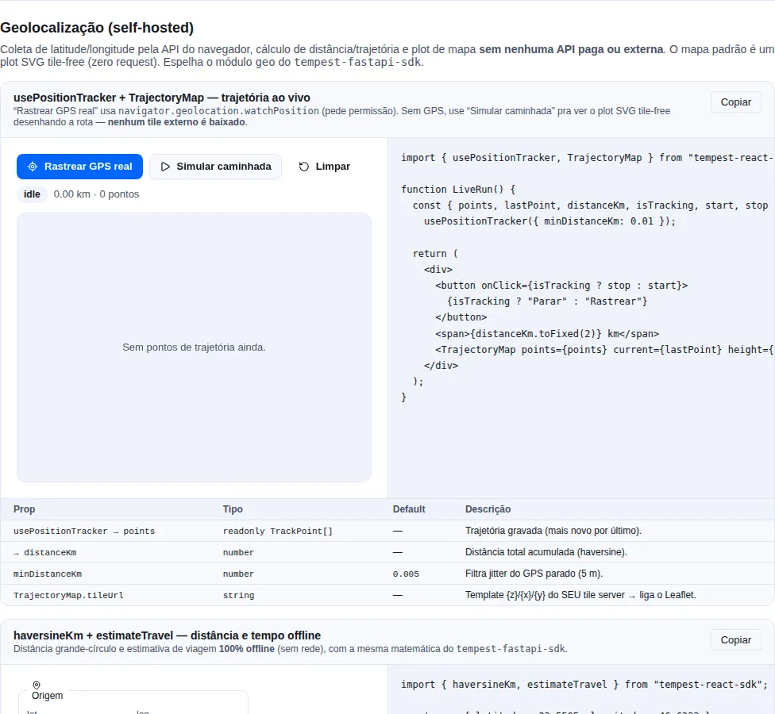

# Geolocation

A **100% self-hosted** geolocation module: capture latitude/longitude through the browser API, compute distance/trajectory, and plot maps — **with no paid or external API**. The default map is a **tile-free SVG** plot (no tile images, no requests). It mirrors the `geo` module of [`tempest-fastapi-sdk`](https://pypi.org/project/tempest-fastapi-sdk/), so types and math match between client and server.

!!! info "Why tile-free?"
    Any image map (OpenStreetMap, Mapbox, Google) downloads _tiles_ from an external server. That clashes with the "nothing external" requirement. So `TrajectoryMap` draws the projected trajectory in SVG (Web Mercator) with no background — zero requests. If you **host your own** tile server, you can enable the optional Leaflet layer by passing `tileUrl`.

<!-- gallery:geo -->
[](gallery.md)

*Section `geo` of the [gallery](gallery.md) — run it locally to interact.*
<!-- /gallery -->

## When to use

- Capture the user's position (once or continuously) via `navigator.geolocation`.
- Record and display a **trajectory** (run, delivery, trail).
- Compute distance between points or estimate travel time **offline**.
- Follow a trip **live**: planned route, trail, vehicle and pickup points.
- Plot everything without depending on a paid/external map.

## Types — `Coordinate`, `TrackPoint`, `TravelEstimate`

Types mirror the FastAPI SDK schemas (snake_case preserved on `TravelEstimate` so a response deserializes directly):

```ts
import type { Coordinate, TrackPoint, TravelEstimate, TravelMode } from "tempest-react-sdk";

const sp: Coordinate = { latitude: -23.5505, longitude: -46.6333 };

// TrackPoint = Coordinate + capture time (+ optional accuracy, speed and heading)
const point: TrackPoint = { ...sp, timestamp: Date.now(), accuracy: 12, speed: 8.3, heading: 90 };

// TravelMode = "car" | "motorcycle" | "bus"
const mode: TravelMode = "car";
```

Utility validators: `isValidLatitude`, `isValidLongitude`, `isCoordinate` (type guard), `clampLatitude`, `normalizeLongitude` (antimeridian wrap).

## Distance and trajectory — `haversineKm`, `pathLengthKm`, `bearingDeg`

Pure math, no network, identical to the server:

```ts
import { haversineKm, pathLengthKm, bearingDeg } from "tempest-react-sdk";

const sp = { latitude: -23.5505, longitude: -46.6333 };
const rio = { latitude: -22.9068, longitude: -43.1729 };

haversineKm(sp, rio); // ≈ 360.9 (km, great-circle)

// Total length of a trajectory (sum of legs):
pathLengthKm([sp, { latitude: -23.2, longitude: -45 }, rio]);

// Initial bearing (degrees, 0 = north, clockwise):
bearingDeg(sp, rio); // ≈ 65 (north-east)
```

### Framing a set of points — `boundingBox`, `boundsCenter`, `expandBounds`

To center a map on a track, or decide the zoom that covers it:

```ts
import { boundingBox, boundsCenter, expandBounds } from "tempest-react-sdk";

const bounds = boundingBox([sp, rio]); // { north, south, east, west } | null

if (bounds) {
  boundsCenter(bounds); // the midpoint, to center on
  expandBounds(bounds, 0.1); // 10% of slack, so the route does not touch the edge
}
```

`boundingBox` returns `null` for an empty list — there is no frame around no
points, and returning a zeroed box would put the map in the Atlantic.

`expandBounds` exists because framing exactly on the extremes puts the first and
last point against the frame — the margin is what makes the path fit visually.

### The raw math

`haversineKm` is the ready-made formula, but its two pieces come out on their
own for callers building a calculation of their own: `EARTH_RADIUS_KM` (6371,
the mean radius the formula assumes) and `toRadians(degrees)`. And
`unprojectMercator` is `projectMercator`'s counterpart — it converts screen
coordinates back to lat/long, which is what a click on the map needs.

```ts
import { EARTH_RADIUS_KM, projectMercator, toRadians, unprojectMercator } from "tempest-react-sdk";

const xy = projectMercator({ latitude: -23.55, longitude: -46.63 });
unprojectMercator(xy); // back to the lat/long pair

EARTH_RADIUS_KM * toRadians(1); // ≈ 111.2 km per degree of latitude
```

## Offline travel estimate — `estimateTravel`

No network: great-circle distance × circuity factor, duration from a mode-adjusted average speed. Mirrors `estimate_travel` from the FastAPI SDK.

```ts
import { estimateTravel } from "tempest-react-sdk";

const est = estimateTravel(sp, rio, "car");
// { mode: "car", distance_km: ~469, duration_minutes: ~562, source: "heuristic" }

// A bus is ~1.6× slower than a car over the same leg:
estimateTravel(sp, rio, "bus").duration_minutes;

// Tune the factors:
estimateTravel(sp, rio, "car", { circuityFactor: 1.4, carSpeedKmh: 60 });
```

!!! tip "Default factors"
    `circuityFactor = 1.3` (roads are ~30% longer than the straight line), `carSpeedKmh = 50`, duration multipliers `car: 1.0 · motorcycle: 0.95 · bus: 1.6`.

    They are exported too — `DEFAULT_CIRCUITY_FACTOR`, `DEFAULT_CAR_SPEED_KMH` and
    `DEFAULT_MODE_DURATION_FACTORS` — so a settings screen can show the value it
    is about to override instead of restating it and drifting.

## Real routing (opt-in) — `createOSRMBackend`

When you **host an OSRM** and want real street routing, build a backend injecting **your** server URL. It is the only piece that makes a request — and only when you create it.

```ts
import { createOSRMBackend } from "tempest-react-sdk";

const backend = createOSRMBackend({ baseUrl: "https://osrm.internal" });
const est = await backend.route(sp, rio, { mode: "car" });
// { …, source: "osrm" }
```

!!! warning "This makes a network request"
    The SDK ships no endpoint. Point `baseUrl` at a routing engine **you host**. For a zero-network estimate, use `estimateTravel`.

Any engine (Valhalla, GraphHopper) works: implement the `RoutingBackend` interface (`route(origin, destination, { mode }) => Promise<TravelEstimate>`).

## Live tracking — `usePositionTracker`

Records a trajectory from `watchPosition`, filtering jitter and accumulating distance. Lifecycle tied to the component (the watch is cleared on unmount).

```tsx
import { usePositionTracker, TrajectoryMap } from "tempest-react-sdk";

export function LiveRun() {
  const { points, lastPoint, distanceKm, isTracking, start, stop, clear } =
    usePositionTracker({ minDistanceKm: 0.01, positionOptions: { enableHighAccuracy: true } });

  return (
    <div>
      <button onClick={isTracking ? stop : start}>
        {isTracking ? "Stop" : "Track"}
      </button>
      <button onClick={clear}>Clear</button>
      <span>{distanceKm.toFixed(2)} km · {points.length} points</span>
      <TrajectoryMap points={points} current={lastPoint} height={360} />
    </div>
  );
}
```

- `minDistanceKm` (default `0.005` = 5 m) discards samples that are too close — filters GPS jitter while standing still.
- `maxPoints` caps the retained array (total distance keeps counting).
- `autoStart: true` starts tracking on mount.
- Each point carries `speed` (m/s, the browser's unit — `× 3.6` gives km/h) and `heading` (degrees from north), `null` when the device does not report them. The `NaN` heading some browsers send while the device is stationary becomes `null` too.

### Transient error, refusal and `lastError`

In a tunnel or an area without signal the browser sends `POSITION_UNAVAILABLE` (code `2`) or `TIMEOUT` (code `3`) and `status` becomes `"error"`, but the watch stays alive: **the next reading moves `status` back to `"tracking"`** — even one the jitter filter discards, because it already proves the signal is back. Repeated `TIMEOUT`s keep `"error"` and call `onError` each time.

`PERMISSION_DENIED` (code `1`) is terminal: the browser sends no further readings, so the watch is released and `status` stays `"error"` until a new `start()`. `lastError` (on the hook and on the tracker) tells the screen which of the two cases it is in; it goes back to `null` on recovery, on `start()`, on `stop()` and on `clear()`.

```tsx
import { usePositionTracker } from "tempest-react-sdk";

export function TrackingStatus() {
  const { status, lastError, lastPoint, start } = usePositionTracker({ autoStart: true });

  if (status === "error" && lastError?.code === 1) {
    return (
      <p>
        Allow location access. <button onClick={start}>Try again</button>
      </p>
    );
  }
  if (status === "error") return <p>No GPS signal — waiting for the next reading…</p>;

  const kmh = lastPoint?.speed != null ? (lastPoint.speed * 3.6).toFixed(0) : "—";
  const direction = lastPoint?.heading != null ? `${lastPoint.heading.toFixed(0)}°` : "—";
  return (
    <p>
      {kmh} km/h · heading {direction}
    </p>
  );
}
```

### Imperative version — `createPositionTracker`

Outside React (services), the controller exposes `start`/`stop`/`clear` + `points`/`distanceKm`/`status`/`lastError` getters:

```ts
import { createPositionTracker } from "tempest-react-sdk";

const tracker = createPositionTracker({
  minDistanceKm: 0.01,
  onUpdate: (pts) => console.log(pts.length),
});
tracker.start();
// …later
tracker.stop();
console.log(tracker.distanceKm);
```

## Map plot — `TrajectoryMap`

By default, a **tile-free SVG** plot: it projects the points (Web Mercator), auto-fits the bounds, and draws the polyline + markers (green start, pulsing current) + grid + a km scale bar. Zero dependency, zero network.

```tsx
import { TrajectoryMap } from "tempest-react-sdk";

<TrajectoryMap
  points={points}
  current={lastPoint}
  height={360}
  showGrid
  showScale
/>;
```

### Real tiles (opt-in) with Leaflet

If you **host your own tiles**, pass `tileUrl` — the component loads Leaflet on demand (dynamic import) and mounts a real tile layer. Requires `leaflet` installed in the app and its stylesheet imported once.

```tsx
// npm install leaflet
import "leaflet/dist/leaflet.css";
import { TrajectoryMap } from "tempest-react-sdk";

<TrajectoryMap
  points={points}
  tileUrl="https://tiles.YOUR-SERVER/{z}/{x}/{y}.png"
  tileAttribution="© Your map data"
  height={420}
/>;
```

!!! note "Leaflet is an optional peer"
    Without `tileUrl`, Leaflet **never** enters the bundle (the import is lazy). If `tileUrl` is passed and `leaflet` is not installed, the component shows a message instead of crashing.

| Prop | Type | Default | Description |
| --- | --- | --- | --- |
| `points` | `readonly Coordinate[]` | — | Trajectory to draw. |
| `current` | `Coordinate \| null` | — | Current-position marker (pulsing). |
| `height` | `number` | `320` | Viewport height in px. |
| `padding` | `number` | `24` | Inner padding in px. |
| `showGrid` / `showScale` | `boolean` | `true` | Grid and scale bar (SVG mode). |
| `strokeColor` | `string` | primary token | Path color. |
| `tileUrl` | `string` | — | `{z}/{x}/{y}` template of **your** tile server → enables Leaflet. |
| `tileAttribution` | `string` | — | Attribution over the tiles. |

## Live trip map — `LiveRouteMap`

`TrajectoryMap` plots a **recorded** trajectory and refits the map on every change. On a trip that is happening, that gets in the way: every new vehicle position (over SSE, every few seconds) would zoom out. `LiveRouteMap` is the map of a trip **in progress**:

- the **planned route** (`route`, e.g. the OSRM geometry) dashed, and the **traveled trail** (`trail`) solid on top;
- the **vehicle** with a **heading** arrow (`vehicle.heading`), gliding between two positions instead of jumping;
- the **trip points** (`markers`) by kind — origin, stop, destination —, with a numeric **badge** and **content** that opens by tap, click or keyboard;
- **follow** mode (`follow`): a new position **does not refit** the map; it only pans, at the same zoom, when the vehicle nears an edge. If the user drags the map, follow pauses and a recenter button shows up.

A complete example — route, trail, vehicle with heading and 3 pickup points with content:

```tsx
import { useEffect, useState } from "react";
import { LiveRouteMap, bearingDeg, type Coordinate, type LiveRouteMarker } from "tempest-react-sdk";

const ROUTE: Coordinate[] = [
  { latitude: -23.5505, longitude: -46.6333 },
  { latitude: -23.5535, longitude: -46.6301 },
  { latitude: -23.5571, longitude: -46.6268 },
  { latitude: -23.5612, longitude: -46.6239 },
  { latitude: -23.5648, longitude: -46.6197 },
];

const STOPS: LiveRouteMarker[] = [
  {
    id: "se",
    label: "Praça da Sé",
    kind: "origin",
    badge: 2,
    ...ROUTE[0],
    content: <p>Ana and Bruno board here.</p>,
  },
  {
    id: "liberdade",
    label: "Liberdade",
    kind: "stop",
    badge: 3,
    ...ROUTE[2],
    content: (
      <ul>
        <li>Carla</li>
        <li>Diego</li>
        <li>Elisa</li>
      </ul>
    ),
  },
  {
    id: "paraiso",
    label: "Paraíso",
    kind: "destination",
    ...ROUTE[4],
    content: <p>Expected arrival at 08:40.</p>,
  },
];

export function TripMap() {
  const [traveled, setTraveled] = useState<Coordinate[]>([ROUTE[0]]);

  useEffect(() => {
    const timer = window.setInterval(() => {
      setTraveled((prev) =>
        prev.length < ROUTE.length ? [...prev, ROUTE[prev.length]] : prev,
      );
    }, 3000);
    return () => window.clearInterval(timer);
  }, []);

  const position = traveled[traveled.length - 1];
  const previous = traveled[traveled.length - 2];
  const heading = previous ? bearingDeg(previous, position) : null;
  const minutes = (ROUTE.length - traveled.length) * 2;

  return (
    <LiveRouteMap
      route={ROUTE}
      trail={traveled}
      vehicle={{ position, heading, label: "Bus 42" }}
      markers={STOPS}
      follow
      etaLabel={`Estimated arrival in ${minutes} minutes`}
      label="Trip map"
      recenterLabel="Recenter"
      closeLabel="Close"
      kindLabels={{ origin: "origin", stop: "stop", destination: "destination" }}
      height={400}
    />
  );
}
```

Piece by piece:

- **`route` decides the initial framing**, together with the `markers`. The vehicle and the trail are **not** part of it — that is what prevents the zoom-out on every position.
- **`vehicle.heading`** is the bearing in degrees (0 = north, clockwise). Without it the vehicle is a dot. If your backend already sends the heading, pass it through; if not, `bearingDeg(previous, current)` computes it.
- **`markers[].content`** is any `ReactNode`. The marker is a button: it opens on click/tap, `Enter` or `Space`; focus moves into the panel and `Esc` closes it and returns focus to the marker.
- **`etaLabel`** is the text the screen reader announces (a polite `status` region). The map does **not** compute the ETA: it comes from the app, which already knows where to get it.
- The default texts are PT-BR; `label`, `recenterLabel`, `closeLabel` and `kindLabels` translate them.

!!! tip "Reduced motion"
    The vehicle glides for `animationMs` (600 ms by default) between two positions. With `prefers-reduced-motion: reduce` on the system it jumps straight there, with nothing for you to do. `animationMs={0}` turns it off for everyone.

!!! note "Offline by default, tiles if you host them"
    Without `tileUrl` it is pure SVG: zero requests, works offline and in tests. With `tileUrl` pointing at **your** tile server, the map draws the tiles under the lines, in the same projection — no Leaflet, no new dependency. There is no Google Maps path.

| Prop | Type | Default | Description |
| --- | --- | --- | --- |
| `route` | `readonly Coordinate[]` | — | Planned route, dashed. Frames the map. |
| `trail` | `readonly Coordinate[]` | — | Traveled path, solid. |
| `vehicle` | `LiveVehicle \| null` | — | `{ position, heading?, label? }`. |
| `markers` | `readonly LiveRouteMarker[]` | — | `{ id, label, latitude, longitude, kind?, badge?, content? }`. |
| `follow` | `boolean` | `false` | Keeps the vehicle in sight without changing the zoom. |
| `etaLabel` | `string` | — | Text announced to the screen reader. |
| `height` / `padding` | `number` | `360` / `32` | Height and framing margin, in px. |
| `animationMs` | `number` | `600` | Vehicle glide duration. `0` jumps. |
| `showScale` | `boolean` | `true` | Scale bar in m/km. |
| `tileUrl` / `tileAttribution` / `tileMaxZoom` | `string` / `string` / `number` | — / — / `19` | Tiles from **your** server. |
| `label` / `recenterLabel` / `closeLabel` | `string` | `"Mapa da viagem"` / `"Recentralizar"` / `"Fechar"` | Accessible texts. |
| `kindLabels` | `Partial<Record<LiveRouteMarkerKind, string>>` | `origem` / `parada` / `destino` | Spoken name of each kind. |
| `onMarkerOpenChange` | `(id: string \| null) => void` | — | A marker panel opened (`id`) or closed (`null`). |

## Recap

- **Capture**: `usePositionTracker` / `createPositionTracker` record a trajectory via `navigator.geolocation`, filtering jitter — all in the browser.
- **Math**: `haversineKm`, `pathLengthKm`, `bearingDeg`, `estimateTravel` — offline, mirroring `tempest-fastapi-sdk`.
- **Map**: `TrajectoryMap` plots tile-free SVG by default; `tileUrl` enables Leaflet only with a server **you host**.
- **Live trip**: `LiveRouteMap` shows planned route + trail + vehicle with heading, and follows the vehicle without refitting on every position.
- **Real routing**: `createOSRMBackend` is opt-in and points at **your** OSRM — the only piece that touches the network.

## See also

- [Utility hooks](./hooks.md) — `useGeolocation` (single fix / low-level watch)
- [HTTP](./http.md) — send the trajectory to the backend
- [Offline](./offline.md) — persist the trajectory locally
