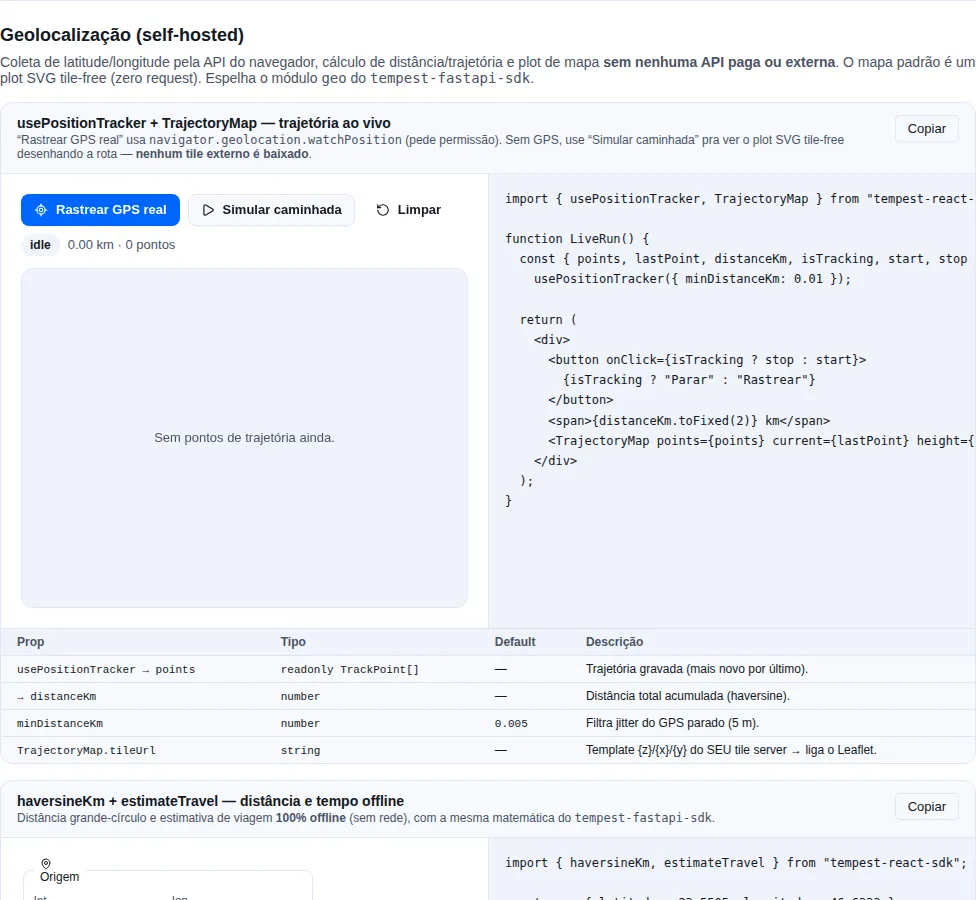

# Geolocalização

Módulo de geolocalização **100% self-hosted**: coleta de latitude/longitude pela API do navegador, cálculo de distância/trajetória e plot de mapas — **sem nenhuma API paga ou externa**. O mapa padrão é um plot **SVG tile-free** (sem imagens de tiles, sem requests). Espelha o módulo `geo` do [`tempest-fastapi-sdk`](https://pypi.org/project/tempest-fastapi-sdk/), então os tipos e a matemática batem entre cliente e servidor.

!!! info "Por que tile-free?"
    Qualquer mapa com imagem (OpenStreetMap, Mapbox, Google) baixa _tiles_ de um servidor externo. Isso colide com o requisito de "nada externo". Por isso o `TrajectoryMap` desenha a trajetória projetada em SVG (Web Mercator) sem fundo — zero request. Se você **hospeda seu próprio** servidor de tiles, dá pra ligar a camada Leaflet opcional passando `tileUrl`.

<!-- gallery:geo -->
[](gallery.md)

*Seção `geo` da [gallery](gallery.md) — rode localmente para interagir.*
<!-- /gallery -->

## Quando usar

- Coletar a posição do usuário (uma vez ou contínua) via `navigator.geolocation`.
- Gravar e exibir uma **trajetória** (corrida, entrega, trilha).
- Calcular distância entre pontos ou estimar tempo de viagem **offline**.
- Acompanhar uma viagem **ao vivo**: rota planejada, trilha, veículo e pontos de embarque.
- Plotar tudo sem depender de mapa pago/externo.

## Tipos — `Coordinate`, `TrackPoint`, `TravelEstimate`

Os tipos espelham os schemas do FastAPI SDK (snake_case preservado no `TravelEstimate` pra desserializar direto de uma resposta):

```ts
import type { Coordinate, TrackPoint, TravelEstimate, TravelMode } from "tempest-react-sdk";

const sp: Coordinate = { latitude: -23.5505, longitude: -46.6333 };

// TrackPoint = Coordinate + quando foi capturado (+ accuracy opcional)
const ponto: TrackPoint = { ...sp, timestamp: Date.now(), accuracy: 12 };

// TravelMode = "car" | "motorcycle" | "bus"
const modo: TravelMode = "car";
```

Validadores utilitários: `isValidLatitude`, `isValidLongitude`, `isCoordinate` (type guard), `clampLatitude`, `normalizeLongitude` (wrap no antimeridiano).

## Distância e trajetória — `haversineKm`, `pathLengthKm`, `bearingDeg`

Matemática pura, sem rede, idêntica ao servidor:

```ts
import { haversineKm, pathLengthKm, bearingDeg } from "tempest-react-sdk";

const sp = { latitude: -23.5505, longitude: -46.6333 };
const rio = { latitude: -22.9068, longitude: -43.1729 };

haversineKm(sp, rio); // ≈ 360.9 (km, grande-círculo)

// Comprimento total de uma trajetória (soma dos trechos):
pathLengthKm([sp, { latitude: -23.2, longitude: -45 }, rio]);

// Azimute inicial (graus, 0 = norte, sentido horário):
bearingDeg(sp, rio); // ≈ 65 (nordeste)
```

### Enquadrar um conjunto de pontos — `boundingBox`, `boundsCenter`, `expandBounds`

Para centralizar um mapa numa trajetória, ou decidir o zoom que a cobre:

```ts
import { boundingBox, boundsCenter, expandBounds } from "tempest-react-sdk";

const bounds = boundingBox([sp, rio]); // { north, south, east, west } | null

if (bounds) {
  boundsCenter(bounds); // o ponto médio, para centralizar
  expandBounds(bounds, 0.1); // 10% de folga, para a rota não colar na borda
}
```

O `boundingBox` devolve `null` para lista vazia — não existe moldura em volta
de ponto nenhum, e devolver uma caixa zerada jogaria o mapa no Atlântico.

`expandBounds` existe porque enquadrar exatamente nos extremos encosta o primeiro
e o último ponto na moldura — a margem é o que faz o traçado caber visualmente.

### A matemática crua

`haversineKm` é a fórmula pronta, mas as duas peças dela saem avulsas para quem
monta um cálculo próprio: `EARTH_RADIUS_KM` (6371, o raio médio que a fórmula
assume) e `toRadians(graus)`. E `unprojectMercator` é o par de
`projectMercator` — converte de volta de coordenada de tela para lat/long, que é
o que um clique no mapa precisa.

```ts
import { EARTH_RADIUS_KM, projectMercator, toRadians, unprojectMercator } from "tempest-react-sdk";

const xy = projectMercator({ latitude: -23.55, longitude: -46.63 });
unprojectMercator(xy); // de volta ao par lat/long

EARTH_RADIUS_KM * toRadians(1); // ≈ 111.2 km por grau de latitude
```

## Estimativa de viagem offline — `estimateTravel`

Sem rede: distância grande-círculo × fator de sinuosidade, duração por velocidade média ajustada ao modo. Espelha `estimate_travel` do FastAPI SDK.

```ts
import { estimateTravel } from "tempest-react-sdk";

const est = estimateTravel(sp, rio, "car");
// { mode: "car", distance_km: ~469, duration_minutes: ~562, source: "heuristic" }

// Ônibus é ~1.6× mais lento que carro no mesmo trecho:
estimateTravel(sp, rio, "bus").duration_minutes;

// Ajuste os fatores:
estimateTravel(sp, rio, "car", { circuityFactor: 1.4, carSpeedKmh: 60 });
```

!!! tip "Fatores padrão"
    `circuityFactor = 1.3` (a estrada é ~30% maior que a reta), `carSpeedKmh = 50`, multiplicadores de duração `car: 1.0 · motorcycle: 0.95 · bus: 1.6`.

    Eles também são exportados — `DEFAULT_CIRCUITY_FACTOR`, `DEFAULT_CAR_SPEED_KMH`
    e `DEFAULT_MODE_DURATION_FACTORS` — para uma tela de ajustes mostrar o valor
    que está prestes a sobrescrever, em vez de repeti-lo e sair de sincronia.

## Rota real (opt-in) — `createOSRMBackend`

Quando você **hospeda um OSRM** e quer rota por ruas de verdade, construa um backend injetando a URL do **seu** servidor. É o único ponto que faz request — e só quando você o cria.

```ts
import { createOSRMBackend } from "tempest-react-sdk";

const backend = createOSRMBackend({ baseUrl: "https://osrm.interno" });
const est = await backend.route(sp, rio, { mode: "car" });
// { …, source: "osrm" }
```

!!! warning "Isto faz request de rede"
    O SDK não embute nenhum endpoint. Aponte `baseUrl` pra um motor de roteamento **seu**. Pra estimativa zero-rede, use `estimateTravel`.

Qualquer motor (Valhalla, GraphHopper) serve: implemente a interface `RoutingBackend` (`route(origin, destination, { mode }) => Promise<TravelEstimate>`).

## Rastreamento ao vivo — `usePositionTracker`

Grava uma trajetória a partir de `watchPosition`, filtrando jitter e acumulando distância. Ciclo de vida amarrado ao componente (o watch é encerrado no unmount).

```tsx
import { usePositionTracker, TrajectoryMap } from "tempest-react-sdk";

export function CorridaAoVivo() {
  const { points, lastPoint, distanceKm, isTracking, start, stop, clear } =
    usePositionTracker({ minDistanceKm: 0.01, positionOptions: { enableHighAccuracy: true } });

  return (
    <div>
      <button onClick={isTracking ? stop : start}>
        {isTracking ? "Parar" : "Rastrear"}
      </button>
      <button onClick={clear}>Limpar</button>
      <span>{distanceKm.toFixed(2)} km · {points.length} pontos</span>
      <TrajectoryMap points={points} current={lastPoint} height={360} />
    </div>
  );
}
```

- `minDistanceKm` (default `0.005` = 5 m) descarta amostras muito próximas — filtra o tremido do GPS parado.
- `maxPoints` limita o array retido (a distância total continua contando).
- `autoStart: true` já começa a rastrear na montagem.

### Versão imperativa — `createPositionTracker`

Fora do React (services), o controller expõe `start`/`stop`/`clear` + getters `points`/`distanceKm`/`status`:

```ts
import { createPositionTracker } from "tempest-react-sdk";

const tracker = createPositionTracker({
  minDistanceKm: 0.01,
  onUpdate: (pts) => console.log(pts.length),
});
tracker.start();
// …depois
tracker.stop();
console.log(tracker.distanceKm);
```

## Plot do mapa — `TrajectoryMap`

Por padrão, plot **SVG tile-free**: projeta os pontos (Web Mercator), auto-ajusta aos bounds, desenha a polyline + marcadores (início verde, atual pulsante) + grid + barra de escala em km. Zero dependência, zero rede.

```tsx
import { TrajectoryMap } from "tempest-react-sdk";

<TrajectoryMap
  points={points}
  current={lastPoint}
  height={360}
  showGrid
  showScale
/>;
```

### Tiles reais (opt-in) com Leaflet

Se você **hospeda tiles próprios**, passe `tileUrl` — o componente carrega o Leaflet sob demanda (import dinâmico) e sobe uma camada de tiles de verdade. Requer o `leaflet` instalado no app e a folha de estilo importada uma vez.

```tsx
// npm install leaflet
import "leaflet/dist/leaflet.css";
import { TrajectoryMap } from "tempest-react-sdk";

<TrajectoryMap
  points={points}
  tileUrl="https://tiles.SEU-SERVIDOR/{z}/{x}/{y}.png"
  tileAttribution="© Seus dados de mapa"
  height={420}
/>;
```

!!! note "Leaflet é peer opcional"
    Sem `tileUrl`, o Leaflet **nunca** entra no bundle (o import é lazy). Se `tileUrl` for passado e o `leaflet` não estiver instalado, o componente mostra uma mensagem em vez de quebrar.

| Prop | Tipo | Default | Descrição |
| --- | --- | --- | --- |
| `points` | `readonly Coordinate[]` | — | Trajetória a desenhar. |
| `current` | `Coordinate \| null` | — | Marcador de posição atual (pulsante). |
| `height` | `number` | `320` | Altura do viewport em px. |
| `padding` | `number` | `24` | Margem interna em px. |
| `showGrid` / `showScale` | `boolean` | `true` | Grid e barra de escala (modo SVG). |
| `strokeColor` | `string` | token primário | Cor da linha. |
| `tileUrl` | `string` | — | Template `{z}/{x}/{y}` do **seu** tile server → liga o Leaflet. |
| `tileAttribution` | `string` | — | Atribuição sobre os tiles. |

## Mapa de viagem ao vivo — `LiveRouteMap`

O `TrajectoryMap` plota uma trajetória **gravada** e reenquadra o mapa a cada mudança. Numa viagem que está acontecendo isso atrapalha: cada posição nova do veículo (por SSE, a cada poucos segundos) daria zoom-out. O `LiveRouteMap` é o mapa da viagem **em andamento**:

- a **rota planejada** (`route`, por exemplo a geometria do OSRM) tracejada, e a **trilha percorrida** (`trail`) sólida por cima;
- o **veículo** com ícone de **direção** (`vehicle.heading`), deslizando entre duas posições em vez de pular;
- os **pontos da viagem** (`markers`) por tipo — origem, parada, destino —, com **badge** numérico e um **conteúdo** que abre por toque, clique ou teclado;
- o modo **seguir** (`follow`): uma posição nova **não reenquadra** o mapa; ele só desliza, no mesmo zoom, quando o veículo chega perto da borda. Se o usuário arrasta o mapa, o seguir pausa e aparece o botão **Recentralizar**.

Um exemplo completo — rota, trilha, veículo com direção e 3 pontos de embarque com conteúdo:

```tsx
import { useEffect, useState } from "react";
import { LiveRouteMap, bearingDeg, type Coordinate, type LiveRouteMarker } from "tempest-react-sdk";

const ROUTE: Coordinate[] = [
  { latitude: -23.5505, longitude: -46.6333 },
  { latitude: -23.5535, longitude: -46.6301 },
  { latitude: -23.5571, longitude: -46.6268 },
  { latitude: -23.5612, longitude: -46.6239 },
  { latitude: -23.5648, longitude: -46.6197 },
];

const STOPS: LiveRouteMarker[] = [
  {
    id: "se",
    label: "Praça da Sé",
    kind: "origin",
    badge: 2,
    ...ROUTE[0],
    content: <p>Ana e Bruno embarcam aqui.</p>,
  },
  {
    id: "liberdade",
    label: "Liberdade",
    kind: "stop",
    badge: 3,
    ...ROUTE[2],
    content: (
      <ul>
        <li>Carla</li>
        <li>Diego</li>
        <li>Elisa</li>
      </ul>
    ),
  },
  {
    id: "paraiso",
    label: "Paraíso",
    kind: "destination",
    ...ROUTE[4],
    content: <p>Chegada prevista às 08:40.</p>,
  },
];

export function TripMap() {
  const [traveled, setTraveled] = useState<Coordinate[]>([ROUTE[0]]);

  useEffect(() => {
    const timer = window.setInterval(() => {
      setTraveled((prev) =>
        prev.length < ROUTE.length ? [...prev, ROUTE[prev.length]] : prev,
      );
    }, 3000);
    return () => window.clearInterval(timer);
  }, []);

  const position = traveled[traveled.length - 1];
  const previous = traveled[traveled.length - 2];
  const heading = previous ? bearingDeg(previous, position) : null;
  const minutes = (ROUTE.length - traveled.length) * 2;

  return (
    <LiveRouteMap
      route={ROUTE}
      trail={traveled}
      vehicle={{ position, heading, label: "Ônibus 42" }}
      markers={STOPS}
      follow
      etaLabel={`Chegada estimada em ${minutes} minutos`}
      height={400}
    />
  );
}
```

Pedaço por pedaço:

- **`route` decide o enquadramento inicial**, junto com os `markers`. O veículo e a trilha **não** entram nele — é isso que impede o zoom-out a cada posição.
- **`vehicle.heading`** é o rumo em graus (0 = norte, sentido horário). Sem ele, o veículo vira um ponto. Se o seu backend já manda o rumo, passe direto; se não, `bearingDeg(anterior, atual)` calcula.
- **`markers[].content`** é qualquer `ReactNode`. O marcador é um botão: abre com clique/toque, `Enter` ou `Espaço`; o foco vai para o painel e `Esc` fecha e devolve o foco ao marcador.
- **`etaLabel`** é o texto que o leitor de tela anuncia (região `status`, educada). O mapa **não calcula** a ETA: ela vem do app, que já sabe de onde tirar.

!!! tip "Movimento reduzido"
    O veículo desliza por `animationMs` (600 ms por padrão) entre duas posições. Com `prefers-reduced-motion: reduce` no sistema ele pula direto, sem você fazer nada. `animationMs={0}` desliga para todo mundo.

!!! note "Offline por padrão, tiles se você hospedar"
    Sem `tileUrl`, é SVG puro: zero request, funciona offline e no teste. Com `tileUrl` apontando para o **seu** servidor de tiles, o mapa desenha os tiles por baixo das linhas, na mesma projeção — sem Leaflet, sem dependência nova. Não existe caminho para Google Maps.

| Prop | Tipo | Default | Descrição |
| --- | --- | --- | --- |
| `route` | `readonly Coordinate[]` | — | Rota planejada, tracejada. Enquadra o mapa. |
| `trail` | `readonly Coordinate[]` | — | Caminho percorrido, sólido. |
| `vehicle` | `LiveVehicle \| null` | — | `{ position, heading?, label? }`. |
| `markers` | `readonly LiveRouteMarker[]` | — | `{ id, label, latitude, longitude, kind?, badge?, content? }`. |
| `follow` | `boolean` | `false` | Mantém o veículo à vista sem mudar o zoom. |
| `etaLabel` | `string` | — | Texto anunciado ao leitor de tela. |
| `height` / `padding` | `number` | `360` / `32` | Altura e margem do enquadramento, em px. |
| `animationMs` | `number` | `600` | Duração do deslize do veículo. `0` pula. |
| `showScale` | `boolean` | `true` | Barra de escala em m/km. |
| `tileUrl` / `tileAttribution` / `tileMaxZoom` | `string` / `string` / `number` | — / — / `19` | Tiles do **seu** servidor. |
| `label` / `recenterLabel` / `closeLabel` | `string` | `"Mapa da viagem"` / `"Recentralizar"` / `"Fechar"` | Textos acessíveis. |
| `kindLabels` | `Partial<Record<LiveRouteMarkerKind, string>>` | `origem` / `parada` / `destino` | Nome falado de cada tipo. |
| `onMarkerOpenChange` | `(id: string \| null) => void` | — | Painel de um marcador abriu (`id`) ou fechou (`null`). |

## Recap

- **Coleta**: `usePositionTracker` / `createPositionTracker` gravam trajetória via `navigator.geolocation`, filtrando jitter — tudo no navegador.
- **Matemática**: `haversineKm`, `pathLengthKm`, `bearingDeg`, `estimateTravel` — offline, espelhando o `tempest-fastapi-sdk`.
- **Mapa**: `TrajectoryMap` plota em SVG sem tiles por padrão; `tileUrl` liga o Leaflet só com servidor **seu**.
- **Viagem ao vivo**: `LiveRouteMap` mostra rota planejada + trilha + veículo com direção, e segue o veículo sem reenquadrar a cada posição.
- **Rota real**: `createOSRMBackend` é opt-in e aponta pro **seu** OSRM — o único ponto que toca a rede.

## Veja também

- [Hooks utilitários](./hooks.md) — `useGeolocation` (fix único / watch de baixo nível)
- [HTTP](./http.md) — enviar a trajetória pro backend
- [Offline](./offline.md) — persistir a trajetória localmente
