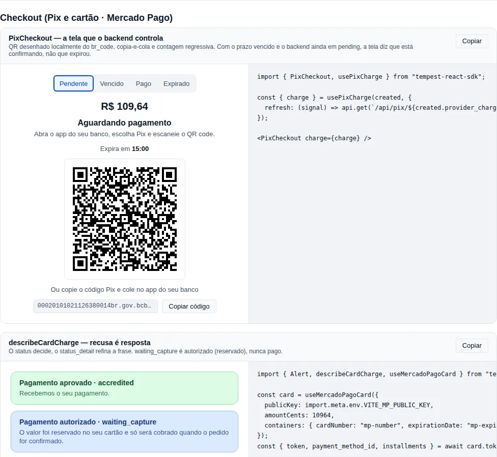

# Payments (Pix and card via Mercado Pago)

The `payments` module is the **frontend** half of the `tempest-fastapi-sdk` checkout: the Pix screen the payer sees, card tokenization in the browser and the text that explains a decline. The other half — creating the charge, deciding it was paid, capturing, refunding — belongs to the backend, and stays there.

!!! info "Why split it this way?"
    Two things the backend **cannot** do: see the card number (that puts the server in PCI DSS scope) and draw the screen. Two things the frontend **must not** do: decide that a Pix was paid and call the Mercado Pago API with the access token. The module exists so each side keeps its part — and so that is guaranteed by code, not by a warning in the docs.

<!-- gallery:payments-checkout -->
[](gallery.md)

*Section `payments-checkout` of the [gallery](gallery.md) — run it locally to interact.*
<!-- /gallery -->

## The contract that comes from the backend

The types in this module are the JSON a service built with `tempest-fastapi-sdk` answers with. They were **not** written from memory: every field comes from the backend's Pydantic schema (`tempest_fastapi_sdk/integrations/payment/base.py`, checked on `origin/main` `ec51a886`):

| Type here | Backend schema | Line |
| --- | --- | --- |
| `PaymentStatus` | `PaymentStatusEnum` | `base.py:31` |
| `PixCharge` | `PixCharge` | `base.py:200` |
| `CardChargeRequest` | `CardChargeRequest` | `base.py:514` |
| `CardCharge` | `CardCharge` | `base.py:561` |
| `PaymentPayer` | `PixPayer` | `base.py:138` |

Names stay in `snake_case` because that is what crosses the wire: the backend's `BaseSchema` has no alias generator. Dates arrive as ISO 8601 strings, and money always in **integer cents** (`amount_cents`), never as a float.

!!! note "`status` decides; the rest refines"
    `status` is the canonical state (`pending`, `authorized`, `paid`, `expired`, `cancelled`, `refunded`, `charged_back`, `in_analysis`, `failed`, `unknown`). `provider_status` and `status_detail` are the provider's raw text — for support and for choosing the right sentence, never for deciding whether it was paid.

## Step 1 — The Pix screen

A complete program: the app creates the charge on the backend, receives a `PixCharge` and shows the screen until the backend says it is over.

```tsx
import { Button, PixCheckout, usePixCharge, type PixCharge } from "tempest-react-sdk";

async function readCharge(id: string, signal: AbortSignal): Promise<PixCharge> {
  const response = await fetch(`/api/pix/${id}`, { signal });
  if (!response.ok) throw new Error(`HTTP ${response.status}`);
  return (await response.json()) as PixCharge;
}

export function PixScreen({ created, onNewPix }: { created: PixCharge; onNewPix: () => void }) {
  const { charge, error } = usePixCharge(created, {
    refresh: (signal) => readCharge(created.provider_charge_id, signal),
    intervalMs: 5000,
  });

  return (
    <>
      <PixCheckout
        charge={charge}
        footer={charge.status === "expired" ? <Button onClick={onNewPix}>New Pix</Button> : undefined}
      />
      {error !== null && <p>No connection to the server — retrying.</p>}
    </>
  );
}
```

Piece by piece:

1. `usePixCharge(created, { refresh })` calls **your** endpoint every `intervalMs` — which re-reads the order at Mercado Pago — and stops on its own once the status is final (`paid`, `expired`, `cancelled`, `refunded`, `charged_back`, `failed`).
2. Reads are **sequential**: the next one starts `intervalMs` after the previous one settled. A slow backend never gets overlapping requests.
3. A failed read keeps the last charge on screen and shows up in `error`. Polling goes on: a lost request is not a payment state.
4. `<PixCheckout>` only **shows** `charge`. It changes nothing, so it has no way to decide anything was paid.

What the screen shows, per state:

| `status` | Screen |
| --- | --- |
| `pending` | Amount, QR, copia-e-cola with a copy button, countdown to `expires_at` |
| `pending` past the deadline | Hides the QR and says it is **confirming** — not "expired" |
| `paid` | "Pagamento confirmado" |
| `expired` / `cancelled` / `failed` | The reason, no QR, and the `footer` (e.g. "New Pix") |
| `unknown` | "Verificando o pagamento" — never paid, never declined |

!!! tip "Why \"confirming\" and not \"expired\" when the clock hits zero?"
    A Pix sent in the last second can still land. Only the backend, re-reading the order, knows. The screen stops offering the QR and waits for the backend to say `expired` (Mercado Pago answers `canceled` / `expired`, which the backend translates).

### Where the QR comes from

- `qr_code_base64` (Mercado Pago sends it) becomes `data:image/png;base64,...` — **only** when it is valid Base64. A strange value never ends up in an image `src`.
- Without Base64 (OpenPix sends a URL), the QR is drawn **locally** from `br_code`, with the SDK's own `<QRCode>`. Fetching the URL would hand the payload to an image host for nothing.

### Push instead of polling

If your backend publishes the charge over SSE or WebSocket, pass `subscribe`. It combines with `refresh`:

```tsx
import { PixCheckout, createEventStream, usePixCharge, type PixCharge } from "tempest-react-sdk";

export function LivePixScreen({ created }: { created: PixCharge }) {
  const { charge } = usePixCharge(created, {
    subscribe: (emit) => {
      const stream = createEventStream<PixCharge>(`/api/pix/${created.provider_charge_id}/events`, {
        onMessage: (message) => emit(message.data),
      });
      return () => stream.close();
    },
  });
  return <PixCheckout charge={charge} />;
}
```

The hook ignores an update for **another** charge and never moves a final state back to a non-final one — when polling and push arrive out of order, a payer who already paid never sees "waiting for payment" flash.

## Step 2 — Tokenize the card

The backend receives `card_token`, `payment_method_id` and `installments` (the `CardChargeRequest`). `useMercadoPagoCard` is what produces them:

```tsx
import { useState, type FormEvent } from "react";
import { Button, Input, Select, useMercadoPagoCard, type CardChargeRequest } from "tempest-react-sdk";

declare const PUBLIC_KEY: string;

export function CardPayment({ amountCents, reference }: { amountCents: number; reference: string }) {
  const card = useMercadoPagoCard({
    publicKey: PUBLIC_KEY,
    amountCents,
    containers: { cardNumber: "mp-number", expirationDate: "mp-expiry", securityCode: "mp-cvv" },
  });
  const [holder, setHolder] = useState("");
  const [cpf, setCpf] = useState("");
  const [email, setEmail] = useState("");
  const [installments, setInstallments] = useState(1);

  async function pay(event: FormEvent) {
    event.preventDefault();
    const result = await card.tokenize({
      cardholderName: holder,
      installments,
      identificationType: "CPF",
      identificationNumber: cpf,
    });
    const body: CardChargeRequest = {
      amount_cents: amountCents,
      reference,
      card_token: result.token,
      payment_method_id: result.payment_method_id,
      installments: result.installments,
      payer: { email },
    };
    await fetch("/api/card-charges", {
      method: "POST",
      headers: { "content-type": "application/json" },
      body: JSON.stringify(body),
    });
  }

  return (
    <form onSubmit={pay}>
      <div id="mp-number" />
      <div id="mp-expiry" />
      <div id="mp-cvv" />
      <Input label="Name on card" value={holder} onChange={(e) => setHolder(e.target.value)} />
      <Input label="CPF" value={cpf} onChange={(e) => setCpf(e.target.value)} />
      <Input label="E-mail" type="email" value={email} onChange={(e) => setEmail(e.target.value)} />
      <Select
        label="Installments"
        value={installments}
        onChange={(e) => setInstallments(Number(e.target.value))}
        options={card.installmentOptions.map((option) => ({
          value: option.installments,
          label: option.recommendedMessage,
        }))}
      />
      <Button type="submit" disabled={card.status !== "ready" || card.paymentMethodId === null}>
        Pay
      </Button>
    </form>
  );
}
```

Piece by piece:

1. The three empty `<div>`s receive Mercado Pago's **Secure Fields**: iframes served by Mercado Pago itself. Number, expiry and CVV are typed **inside** them. They never exist in your page's DOM, in React state, in a callback or in a log.
2. `publicKey` is the application's **Public Key**, not the access token. It can only tokenize; the token alone charges nothing.
3. When the payer types the first digits, Mercado Pago reports the BIN and the hook fetches the installments. `recommendedMessage` is the provider's own text ("2 parcelas de R$ 57,20 (R$ 114,40)") — show it as it came: there is interest from 2x on, and the total has to be the provider's number.
4. `tokenize` returns exactly `{ token, payment_method_id, installments }`. It refuses before calling Mercado Pago when the fields have not loaded, the brand is not identified yet or the installment count is not among the options — each of those would become an opaque `400` on the backend.

!!! info "PCI scope: why Secure Fields and not `<input>`"
    A page that renders its own `<input>` for the number and calls `createCardToken` with it has **handled** cardholder data, however quickly it discards it — and lands in SAQ A-EP. With Secure Fields the number never goes through your JavaScript, which is the condition for SAQ A. That is why the hook does not take the number as a parameter: there is no way to use it wrong.

### Mercado Pago's script

MercadoPago.js is loaded from `https://sdk.mercadopago.com/js/v2` (`MERCADO_PAGO_SCRIPT_URL`) the first time the hook mounts — one tag only, even with several checkouts on the page. It is not an npm dependency: Mercado Pago publishes the script unversioned, and PCI requires the fields to come straight from the processor.

If your page has a Content-Security-Policy, allow:

```text
script-src  https://sdk.mercadopago.com
frame-src   https://secure-fields.mercadopago.com https://api-static.mercadopago.com
connect-src https://api.mercadopago.com https://api.mercadolibre.com
```

The hosts were read from the script itself (`js_version` 2.83.6) on 2026-11-14.

## Step 3 — Explain the card result

The backend returns a `CardCharge`. A decline is **not an error**: Mercado Pago answers HTTP `402`, and the backend reads that as a charge with `status: "failed"` and the reason in `status_detail`. Show it as an answer:

```tsx
import { Alert, describeCardCharge, type CardCharge } from "tempest-react-sdk";

export function CardResult({ charge }: { charge: CardCharge }) {
  const outcome = describeCardCharge(charge);
  return <Alert variant={outcome.tone} title={outcome.title} description={outcome.message} />;
}
```

| `status` / `status_detail` | Title | Text |
| --- | --- | --- |
| `paid` / `accredited` | Pagamento aprovado | Recebemos o seu pagamento. |
| `authorized` / `waiting_capture` | Pagamento autorizado | O valor foi reservado no seu cartão e só será cobrado quando o pedido for confirmado. |
| `failed` / `rejected_by_issuer` | Pagamento recusado | O banco emissor recusou o pagamento. Use outro cartão ou fale com o banco. |
| `failed` / `bad_filled_card_data` | Pagamento recusado | Confira os dados do cartão: número, validade e código de segurança. |
| `failed` / unknown reason | Pagamento recusado | O pagamento não foi aprovado. Tente outro cartão ou outro meio de pagamento. |

`waiting_capture` is a state of **its own**: money reserved, not charged. The text never says "paid".

The whole table is in `CARD_STATUS_DETAIL_MESSAGES` — ported from the "Status da transação" table of Mercado Pago's Orders API documentation, read on 2026-11-14, and rewritten for the payer. `high_risk` does not mention fraud on purpose: telling the payer the anti-fraud system flagged them helps exactly the person it should not. For another language, pass the second argument:

```tsx
import { describeCardCharge, type CardCharge } from "tempest-react-sdk";

export function outcomeInEnglish(charge: CardCharge) {
  return describeCardCharge(charge, { rejected_by_issuer: "Your bank declined the payment." });
}
```

A `status_detail` that contradicts the `status` is ignored (a decline only refines `failed`), so "declined" and "reserved" never show up on the same screen.

## Sandbox

From the sandbox measured on the backend (2026-10-09), with the **test seller** account:

- The test Public Key comes from the same application as the test seller.
- A card that works: Visa `4235 6477 2802 5682`, expiry `11/2030`, CVV `123`.
- Holder `APRO` approves; holder `OTHE` declines with `rejected_by_issuer`.
- The Mastercard test card `5031 4332 1540 6351` answered `422` in the sandbox (cause not isolated) — use the Visa.

## Reference

| Export | What it is |
| --- | --- |
| `PixCheckout` | Pix screen: amount, QR, copia-e-cola, countdown and state. Controlled by `charge`. |
| `usePixCharge` | Follows the charge through `refresh` (polling) and/or `subscribe` (push) until it is final. |
| `formatPixRemaining` | Countdown format: `mm:ss`, or `h:mm:ss` above an hour. |
| `isFinalPaymentStatus` | `true` for `paid`, `expired`, `cancelled`, `refunded`, `charged_back`, `failed`. |
| `useMercadoPagoCard` | Secure Fields + installments by BIN + `tokenize`. |
| `loadMercadoPago` | Loads MercadoPago.js once per document; a failure is not cached. |
| `MERCADO_PAGO_SCRIPT_URL` | `https://sdk.mercadopago.com/js/v2`. |
| `describeCardCharge` | `CardCharge` → `{ status, tone, title, message, canRetry }`. |
| `CARD_STATUS_DETAIL_MESSAGES` | PT-BR text per Orders API `status_detail`. |

Types: `PixCharge`, `CardCharge`, `CardChargeRequest`, `PaymentPayer`, `PaymentStatus`, `PaymentOutcome`, `CardTokenResult`, `CardInstallmentOption`, `UseMercadoPagoCardOptions`, `UsePixChargeOptions`, `PixCheckoutProps`, `PixCheckoutLabels`, `MercadoPagoLike`.

## Recap

- The backend decides it was paid; the screen only shows what it says. 🔒
- The card is typed into Mercado Pago's iframes; your code receives only `{ token, payment_method_id, installments }`. ✅
- Installments show the provider's text, with interest. 💡
- A decline is an answer (`status: "failed"` + `status_detail`), not a network error; `waiting_capture` is "reserved", not "paid". ⚠️
