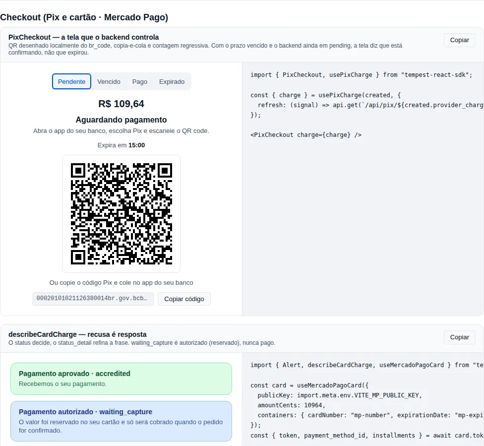

# Pagamentos (Pix e cartão via Mercado Pago)

O módulo `payments` é a metade **frontend** do checkout do `tempest-fastapi-sdk`: a tela do Pix que o pagador vê, a tokenização do cartão no browser e o texto que explica uma recusa. A outra metade — criar a cobrança, decidir que ela foi paga, capturar, estornar — é do backend, e continua lá.

!!! info "Por que dividir assim?"
    Duas coisas o backend **não pode** fazer: ver o número do cartão (isso coloca o servidor no escopo do PCI DSS) e desenhar a tela. Duas coisas o frontend **não deve** fazer: decidir que um Pix foi pago e chamar a API do Mercado Pago com o access token. O módulo existe para cada lado ficar com a sua parte — e para isso ser garantido pelo código, não por um aviso na doc.

<!-- gallery:payments-checkout -->
[](gallery.md)

*Seção `payments-checkout` da [gallery](gallery.md) — rode localmente para interagir.*
<!-- /gallery -->

## O contrato que vem do backend

Os tipos deste módulo são o JSON que um serviço feito com o `tempest-fastapi-sdk` responde. Eles **não** foram escritos de memória: cada campo vem do schema Pydantic do backend (`tempest_fastapi_sdk/integrations/payment/base.py`, conferido na `origin/main` `ec51a886`):

| Tipo aqui | Schema no backend | Linha |
| --- | --- | --- |
| `PaymentStatus` | `PaymentStatusEnum` | `base.py:31` |
| `PixCharge` | `PixCharge` | `base.py:200` |
| `CardChargeRequest` | `CardChargeRequest` | `base.py:514` |
| `CardCharge` | `CardCharge` | `base.py:561` |
| `PaymentPayer` | `PixPayer` | `base.py:138` |

Os nomes ficam em `snake_case` porque é isso que trafega: o `BaseSchema` do backend não tem gerador de alias. Datas chegam como string ISO 8601, e dinheiro sempre em **centavos inteiros** (`amount_cents`), nunca em float.

!!! note "O `status` decide; o resto refina"
    `status` é o estado canônico (`pending`, `authorized`, `paid`, `expired`, `cancelled`, `refunded`, `charged_back`, `in_analysis`, `failed`, `unknown`). `provider_status` e `status_detail` são o texto cru do provedor — servem para suporte e para escolher a frase certa, nunca para decidir se foi pago.

## Passo 1 — A tela do Pix

Programa completo: o app cria a cobrança no backend, recebe um `PixCharge` e mostra a tela até o backend dizer que acabou.

```tsx
import { Button, PixCheckout, usePixCharge, type PixCharge } from "tempest-react-sdk";

async function lerCobranca(id: string, signal: AbortSignal): Promise<PixCharge> {
  const response = await fetch(`/api/pix/${id}`, { signal });
  if (!response.ok) throw new Error(`HTTP ${response.status}`);
  return (await response.json()) as PixCharge;
}

export function TelaDoPix({ criada, onNovoPix }: { criada: PixCharge; onNovoPix: () => void }) {
  const { charge, error } = usePixCharge(criada, {
    refresh: (signal) => lerCobranca(criada.provider_charge_id, signal),
    intervalMs: 5000,
  });

  return (
    <>
      <PixCheckout
        charge={charge}
        footer={
          charge.status === "expired" ? <Button onClick={onNovoPix}>Gerar novo Pix</Button> : undefined
        }
      />
      {error !== null && <p>Sem conexão com o servidor — tentando de novo.</p>}
    </>
  );
}
```

Peça por peça:

1. `usePixCharge(criada, { refresh })` chama o **seu** endpoint a cada `intervalMs` — que relê a order no Mercado Pago — e para sozinho quando o status vira final (`paid`, `expired`, `cancelled`, `refunded`, `charged_back`, `failed`).
2. As leituras são **sequenciais**: a próxima só começa `intervalMs` depois da anterior terminar. Backend lento não recebe requisição sobreposta.
3. Uma leitura que falha mantém a última cobrança na tela e aparece em `error`. O polling continua: requisição perdida não é estado de pagamento.
4. `<PixCheckout>` só **mostra** `charge`. Ele não muda nada, e por isso não tem como decidir que algo foi pago.

O que a tela mostra, por estado:

| `status` | Tela |
| --- | --- |
| `pending` | Valor, QR, copia-e-cola com botão de copiar, contagem regressiva até `expires_at` |
| `pending` com o prazo vencido | Esconde o QR e diz que está **confirmando** — não "expirado" |
| `paid` | "Pagamento confirmado" |
| `expired` / `cancelled` / `failed` | O motivo, sem QR, e o `footer` (ex.: "Gerar novo Pix") |
| `unknown` | "Verificando o pagamento" — nunca pago, nunca recusado |

!!! tip "Por que \"confirmando\" e não \"expirado\" quando o relógio zera?"
    Um Pix enviado no último segundo ainda pode cair. Só o backend, relendo a order, sabe. A tela para de oferecer o QR e espera o backend dizer `expired` (o Mercado Pago responde `canceled` / `expired`, que o backend traduz).

### De onde vem o QR

- `qr_code_base64` (Mercado Pago manda) vira `data:image/png;base64,...` — **só** se for Base64 válido. Um valor estranho não vai parar no `src` de uma imagem.
- Sem Base64 (a OpenPix manda URL), o QR é desenhado **localmente** a partir do `br_code`, com o mesmo `<QRCode>` do SDK. Buscar a URL entregaria o payload a um host de imagem à toa.

### Push em vez de polling

Se o seu backend publica a cobrança por SSE ou WebSocket, passe `subscribe`. Dá para combinar com `refresh`:

```tsx
import { PixCheckout, createEventStream, usePixCharge, type PixCharge } from "tempest-react-sdk";

export function TelaDoPixAoVivo({ criada }: { criada: PixCharge }) {
  const { charge } = usePixCharge(criada, {
    subscribe: (emit) => {
      const stream = createEventStream<PixCharge>(`/api/pix/${criada.provider_charge_id}/events`, {
        onMessage: (message) => emit(message.data),
      });
      return () => stream.close();
    },
  });
  return <PixCheckout charge={charge} />;
}
```

O hook ignora atualização de **outra** cobrança e nunca volta de um estado final para um não-final — quando polling e push chegam fora de ordem, quem já pagou não vê "aguardando pagamento" piscar.

## Passo 2 — Tokenizar o cartão

O backend recebe `card_token`, `payment_method_id` e `installments` (o `CardChargeRequest`). Quem produz isso é o `useMercadoPagoCard`:

```tsx
import { useState, type FormEvent } from "react";
import { Button, Input, Select, useMercadoPagoCard, type CardChargeRequest } from "tempest-react-sdk";

declare const PUBLIC_KEY: string;

export function PagamentoComCartao({ amountCents, reference }: { amountCents: number; reference: string }) {
  const card = useMercadoPagoCard({
    publicKey: PUBLIC_KEY,
    amountCents,
    containers: { cardNumber: "mp-numero", expirationDate: "mp-validade", securityCode: "mp-cvv" },
  });
  const [titular, setTitular] = useState("");
  const [cpf, setCpf] = useState("");
  const [email, setEmail] = useState("");
  const [parcelas, setParcelas] = useState(1);

  async function pagar(event: FormEvent) {
    event.preventDefault();
    const { token, payment_method_id, installments } = await card.tokenize({
      cardholderName: titular,
      installments: parcelas,
      identificationType: "CPF",
      identificationNumber: cpf,
    });
    const body: CardChargeRequest = {
      amount_cents: amountCents,
      reference,
      card_token: token,
      payment_method_id,
      installments,
      payer: { email },
    };
    await fetch("/api/card-charges", {
      method: "POST",
      headers: { "content-type": "application/json" },
      body: JSON.stringify(body),
    });
  }

  return (
    <form onSubmit={pagar}>
      <div id="mp-numero" />
      <div id="mp-validade" />
      <div id="mp-cvv" />
      <Input label="Nome no cartão" value={titular} onChange={(e) => setTitular(e.target.value)} />
      <Input label="CPF" value={cpf} onChange={(e) => setCpf(e.target.value)} />
      <Input label="E-mail" type="email" value={email} onChange={(e) => setEmail(e.target.value)} />
      <Select
        label="Parcelas"
        value={parcelas}
        onChange={(e) => setParcelas(Number(e.target.value))}
        options={card.installmentOptions.map((option) => ({
          value: option.installments,
          label: option.recommendedMessage,
        }))}
      />
      <Button type="submit" disabled={card.status !== "ready" || card.paymentMethodId === null}>
        Pagar
      </Button>
    </form>
  );
}
```

Peça por peça:

1. Os três `<div>` vazios recebem os **Secure Fields** do Mercado Pago: iframes servidos pelo próprio Mercado Pago. Número, validade e CVV são digitados **dentro** deles. Eles nunca existem no DOM da sua página, no estado do React, num callback ou num log.
2. `publicKey` é a **Public Key** da aplicação, não o access token. Ela só serve para tokenizar; o token sozinho não cobra nada.
3. Quando o pagador digita os primeiros dígitos, o Mercado Pago avisa o BIN e o hook busca as parcelas. `recommendedMessage` é o texto do próprio provedor ("2 parcelas de R$ 57,20 (R$ 114,40)") — mostre como veio: há juros a partir de 2x, e o total tem de ser o número do provedor.
4. `tokenize` devolve exatamente `{ token, payment_method_id, installments }`. Ele recusa antes de chamar o Mercado Pago se os campos não carregaram, se a bandeira ainda não foi identificada ou se o número de parcelas não está entre as opções — cada um desses viraria um `400` opaco no backend.

!!! info "Escopo PCI: por que Secure Fields e não `<input>`"
    Uma página que renderiza o próprio `<input>` do número e chama `createCardToken` com ele **manipulou** dado de cartão, por mais rápido que o descarte — e cai no SAQ A-EP. Com os Secure Fields o número nunca passa pelo seu JavaScript, que é a condição do SAQ A. Por isso o hook não aceita o número como parâmetro: não existe um jeito de usá-lo errado.

### O script do Mercado Pago

O MercadoPago.js é carregado de `https://sdk.mercadopago.com/js/v2` (`MERCADO_PAGO_SCRIPT_URL`) na primeira vez que o hook monta — uma tag só, mesmo com vários checkouts na página. Não é dependência npm: o Mercado Pago publica o script sem versão, e o PCI exige que os campos venham direto do processador.

Se a sua página tem Content-Security-Policy, libere:

```text
script-src  https://sdk.mercadopago.com
frame-src   https://secure-fields.mercadopago.com https://api-static.mercadopago.com
connect-src https://api.mercadopago.com https://api.mercadolibre.com
```

Os hosts foram lidos do próprio script (`js_version` 2.83.6) em 14/11/2026.

## Passo 3 — Explicar o resultado do cartão

O backend devolve um `CardCharge`. Uma recusa **não é erro**: o Mercado Pago responde HTTP `402`, e o backend lê isso como uma cobrança com `status: "failed"` e o motivo em `status_detail`. Mostre como resposta:

```tsx
import { Alert, describeCardCharge, type CardCharge } from "tempest-react-sdk";

export function ResultadoDoCartao({ charge }: { charge: CardCharge }) {
  const outcome = describeCardCharge(charge);
  return <Alert variant={outcome.tone} title={outcome.title} description={outcome.message} />;
}
```

| `status` / `status_detail` | Título | Texto |
| --- | --- | --- |
| `paid` / `accredited` | Pagamento aprovado | Recebemos o seu pagamento. |
| `authorized` / `waiting_capture` | Pagamento autorizado | O valor foi reservado no seu cartão e só será cobrado quando o pedido for confirmado. |
| `failed` / `rejected_by_issuer` | Pagamento recusado | O banco emissor recusou o pagamento. Use outro cartão ou fale com o banco. |
| `failed` / `bad_filled_card_data` | Pagamento recusado | Confira os dados do cartão: número, validade e código de segurança. |
| `failed` / motivo desconhecido | Pagamento recusado | O pagamento não foi aprovado. Tente outro cartão ou outro meio de pagamento. |

`waiting_capture` é um estado **próprio**: dinheiro reservado, não cobrado. O texto nunca diz "pago".

A tabela inteira está em `CARD_STATUS_DETAIL_MESSAGES` — portada da tabela "Status da transação" da documentação da API de Orders do Mercado Pago, lida em 14/11/2026, e reescrita para o pagador. `high_risk` não fala em fraude de propósito: dizer ao pagador que o antifraude o marcou ajuda justamente quem não devia. Para outro idioma, passe o segundo argumento:

```tsx
import { describeCardCharge, type CardCharge } from "tempest-react-sdk";

export function outcomeEmIngles(charge: CardCharge) {
  return describeCardCharge(charge, { rejected_by_issuer: "Your bank declined the payment." });
}
```

Um `status_detail` que contradiz o `status` é ignorado (uma recusa só refina `failed`), então "recusado" e "reservado" nunca aparecem na mesma tela.

## Sandbox

Do sandbox medido no backend (09/10/2026), com a conta **vendedora de teste**:

- A Public Key de teste vem da mesma aplicação da vendedora de teste.
- Cartão que funciona: Visa `4235 6477 2802 5682`, validade `11/2030`, CVV `123`.
- Titular `APRO` aprova; titular `OTHE` recusa com `rejected_by_issuer`.
- O Mastercard de teste `5031 4332 1540 6351` respondeu `422` no sandbox (causa não isolada) — use o Visa.

## Referência

| Export | O que é |
| --- | --- |
| `PixCheckout` | Tela do Pix: valor, QR, copia-e-cola, contagem regressiva e estado. Controlada por `charge`. |
| `usePixCharge` | Segue a cobrança via `refresh` (polling) e/ou `subscribe` (push) até ela ser final. |
| `formatPixRemaining` | Formato da contagem: `mm:ss`, ou `h:mm:ss` acima de uma hora. |
| `isFinalPaymentStatus` | `true` para `paid`, `expired`, `cancelled`, `refunded`, `charged_back`, `failed`. |
| `useMercadoPagoCard` | Secure Fields + parcelas pelo BIN + `tokenize`. |
| `loadMercadoPago` | Carrega o MercadoPago.js uma vez por documento; uma falha não fica em cache. |
| `MERCADO_PAGO_SCRIPT_URL` | `https://sdk.mercadopago.com/js/v2`. |
| `describeCardCharge` | `CardCharge` → `{ status, tone, title, message, canRetry }`. |
| `CARD_STATUS_DETAIL_MESSAGES` | Texto PT-BR por `status_detail` da API de Orders. |

Tipos: `PixCharge`, `CardCharge`, `CardChargeRequest`, `PaymentPayer`, `PaymentStatus`, `PaymentOutcome`, `CardTokenResult`, `CardInstallmentOption`, `UseMercadoPagoCardOptions`, `UsePixChargeOptions`, `PixCheckoutProps`, `PixCheckoutLabels`, `MercadoPagoLike`.

## Recap

- O backend decide que foi pago; a tela só mostra o que ele diz. 🔒
- O cartão é digitado nos iframes do Mercado Pago; o seu código recebe só `{ token, payment_method_id, installments }`. ✅
- Parcelas mostram o texto do provedor, com juros. 💡
- Recusa é resposta (`status: "failed"` + `status_detail`), não erro de rede; `waiting_capture` é "reservado", não "pago". ⚠️
