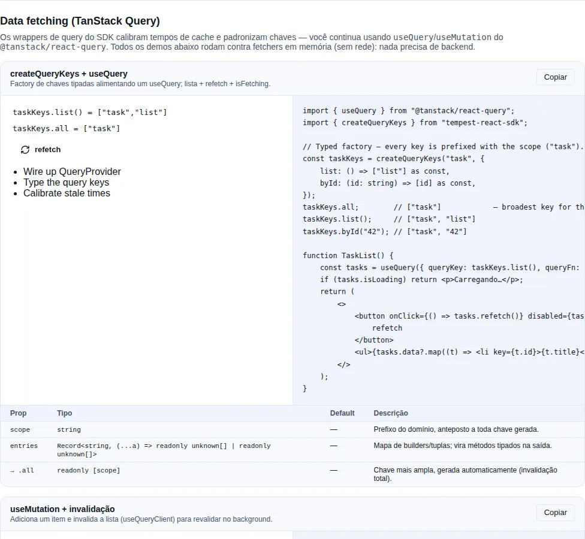

# Query (TanStack Query)

Thin wrappers to standardize cache times, query keys, and the `QueryClient`. You keep using `@tanstack/react-query` as usual — the SDK only ships well-calibrated defaults and a typed key factory.

!!! info "Why do these wrappers exist?"
    Without standardization, every screen guesses a `staleTime` and every domain hand-writes `queryKey: ["user", id]`. That leads to invalidations that miss (a key built differently in two places) and overly aggressive refetching. The SDK centralizes both: named presets plus a factory that guarantees the same key everywhere.

<!-- gallery:recipe-query -->
[](gallery.md)

*Section `recipe-query` of the [gallery](gallery.md) — run it locally to interact.*
<!-- /gallery -->

## Provider

Wrap the app tree once, usually in `main.tsx` (or inside `<AppProviders>`):

```tsx
import { StrictMode } from "react";
import { createRoot } from "react-dom/client";
import { QueryProvider } from "tempest-react-sdk";
import "tempest-react-sdk/styles.css";
import { App } from "./App";

createRoot(document.getElementById("root")!).render(
  <StrictMode>
    <QueryProvider>
      <App />
    </QueryProvider>
  </StrictMode>,
);
```

Defaults applied when you do **not** pass a `client`:

- `staleTime`: 5 min (`STALE_TIME.DEFAULT`)
- `gcTime`: 30 min (`CACHE_TIME.DEFAULT`)
- `retry`: `shouldRetryQuery` (queries) / 0 (mutations)
- `refetchOnWindowFocus`: false

!!! danger "4xx is **not** retried — and this changed"
    The default used to be a flat `retry: 1`, which replayed a 403 on an admin-only listing and a 404 for a deleted record. The server refused on purpose in both cases: the second attempt returns the same answer, doubles the network log and holds the spinner for another round trip.

    `shouldRetryQuery` retries once only what can change on its own: a network failure (`status === 0`), `5xx`, `408`, `425` and `429` (a refusal whose literal meaning is "later"), and an error of unknown shape — which may be a transport failure. Every other 4xx fails on the first try.

    The classification comes from `isRetriableStatus`, the same one `createApiClient({ retry: true })` and the `retry()` helper use. Through v0.44.0 this was a local copy **missing `425`** — so the same `425 Too Early` was replayed by the client and not by the query.

    If your app relied on retrying 4xx, the override is the usual one: `defaultOptions={{ queries: { retry: 1 } }}`.

To override, pass `defaultOptions` (merged on top of the defaults) or a ready-made `client` (ignores the SDK defaults):

```tsx
import { QueryClient } from "@tanstack/react-query";
import { QueryProvider, STALE_TIME } from "tempest-react-sdk";

// Option A — tweak only some defaults
<QueryProvider defaultOptions={{ queries: { staleTime: STALE_TIME.LONG } }}>
  <App />
</QueryProvider>;

// Option B — bring your own client (share across roots, plug devtools, etc.)
const client = new QueryClient();
<QueryProvider client={client}>
  <App />
</QueryProvider>;
```

!!! warning "One `QueryClient` per app"
    Do not nest two `QueryProvider`s without passing the same `client`. Each provider creates an isolated cache, and queries from different subtrees stop sharing data. For multiple roots, create the `QueryClient` once and pass it via the `client` prop.

!!! danger "\"No QueryClient set\" with the provider mounted = two copies of react-query"
    The `client` you pass is the one place the app's copy and the SDK's copy touch. If `npm` nested a second copy of `@tanstack/react-query` under the SDK, `QueryClientProvider` publishes your client on **that** copy's context — and every `useQuery` in the app reads the other copy's, finds nothing, and throws:

    ```text
    No QueryClient set, use QueryClientProvider to set one
    ```

    With the provider plainly mounted three lines up. Nothing in that message points at the duplicate, which is why it costs an afternoon.

    From v0.52.1 the SDK detects it and warns in development: a client from the other copy duck-types perfectly while failing `instanceof`, which is exactly the right discriminator. The fix is `npm dedupe`, and `npx tempest doctor` lists every duplicated dependency.

## Time presets

```ts
import { useQuery } from "@tanstack/react-query";
import { STALE_TIME, CACHE_TIME, REFETCH_TIME } from "tempest-react-sdk";

useQuery({
  queryKey: ["dashboard"],
  queryFn: fetchDashboard,
  staleTime: STALE_TIME.LONG, // 30 min — data rarely changes
  gcTime: CACHE_TIME.LONG, // 1 h
  refetchInterval: REFETCH_TIME.FAST, // 30 s — status polling
});
```

- `STALE_TIME`: `SHORT` 30s, `DEFAULT` 5min, `LONG` 30min, `INFINITE` ∞
- `CACHE_TIME`: `SHORT` 5min, `DEFAULT` 30min, `LONG` 1h
- `REFETCH_TIME`: `REALTIME` 5s, `FAST` 30s, `DEFAULT` 60s, `SLOW` 5min

!!! tip "When to use `INFINITE`"
    `STALE_TIME.INFINITE` marks data as never stale — TanStack only refetches on manual invalidation. Ideal for static lists (categories, cities) that change per deploy, not per use.

## Typed query keys

`createQueryKeys` takes a `scope` (the domain prefix) and a map of builders. Every output already carries the scope up front, so the same key is built identically across the whole codebase:

```ts
import { createQueryKeys } from "tempest-react-sdk";

export const userKeys = createQueryKeys("user", {
  me: () => ["me"] as const,
  byId: (id: string) => [id] as const,
  list: (filters: { page: number; size: number }) => ["list", filters] as const,
});

userKeys.all; // ["user"]
userKeys.me(); // ["user", "me"]
userKeys.byId("42"); // ["user", "42"]
userKeys.list({ page: 1, size: 20 }); // ["user", "list", { page: 1, size: 20 }]
```

Note the `all`: it is generated automatically and is the broadest key of the domain — invalidating it tears down every `user/*` query at once.

## Full example — query + mutation + invalidation

This component reads the profile with `useQuery`, updates it with `useMutation`, and invalidates only the affected keys on success:

```tsx
import { useQuery, useMutation, useQueryClient } from "@tanstack/react-query";
import { createApiClient, createQueryKeys } from "tempest-react-sdk";

interface User {
  id: string;
  name: string;
}

const api = createApiClient({ baseURL: import.meta.env.VITE_API_URL });

export const userKeys = createQueryKeys("user", {
  me: () => ["me"] as const,
  byId: (id: string) => [id] as const,
});

export function ProfileCard() {
  const queryClient = useQueryClient();

  const { data: user, isLoading } = useQuery({
    queryKey: userKeys.me(),
    queryFn: () => api.get<User>("/users/me"),
  });

  const rename = useMutation({
    mutationFn: (name: string) => api.patch<User>("/users/me", { body: { name } }),
    onSuccess: (updated) => {
      // Update the local cache without a new fetch...
      queryClient.setQueryData(userKeys.me(), updated);
      // ...and invalidate the by-id record, in case another screen uses it.
      queryClient.invalidateQueries({ queryKey: userKeys.byId(updated.id) });
    },
  });

  if (isLoading) return <p>Loading…</p>;

  return (
    <div>
      <h2>{user?.name}</h2>
      <button disabled={rename.isPending} onClick={() => rename.mutate("New name")}>
        Rename
      </button>
    </div>
  );
}
```

!!! note "Why `setQueryData` + `invalidateQueries`?"
    `setQueryData` applies the mutation response to the cache immediately (no UI flicker), while `invalidateQueries` marks _related_ queries as stale to revalidate in the background. Using a key factory guarantees the invalidated key is exactly the one the query consulted.

Organization pattern: each domain in `src/constants/query-keys/<domain>.ts`, grouped in a barrel.

## `useOfflineMutation`

When the app is offline-first, a mutation should not hit the network directly — it writes to the [`createOfflineSync`](./offline-sync.md) **outbox** and syncs later. `useOfflineMutation` bridges the sync engine and TanStack Query: on `mutate` it enqueues the entry, **optimistically patches the query cache**, kicks a **flush**, and **rolls back** the cache if the enqueue fails.

```tsx
import { useOfflineMutation } from "tempest-react-sdk";
import { notesSync } from "@/sync/engine";
import type { Note } from "@/sync/types";

function useAddNote() {
  return useOfflineMutation<Note, Note[], Note>({
    sync: notesSync,
    queryKey: ["notes"],
    toEntry: (note) => ({ op: "create", recordId: note.id, payload: note }),
    applyOptimistic: (current = [], note) => [...current, note],
  });
}

// const addNote = useAddNote();
// addNote.mutate({ id: crypto.randomUUID(), text: "offline!" });
```

- `toEntry` maps the variables to the outbox `{ op, recordId, payload }`.
- `applyOptimistic` produces the next cache value; the previous one is restored if the enqueue throws.
- `flush` (default `true` → `"after-mutation"`) triggers sync; `false` leaves it to `useOfflineSync`.
- `invalidate` (default `false`) revalidates the `queryKey` in `onSettled`.

!!! tip "List-cache helpers"
    For the common case (the cache is a list), use `upsertById()` / `removeById()` instead of hand-writing the spread:

    ```ts
    import { upsertById, removeById } from "tempest-react-sdk";

    applyOptimistic: upsertById(); // insert or merge by `id`
    applyOptimistic: removeById(); // remove by `id` (op "delete")
    // custom field: upsertById("uuid")
    ```

!!! tip "Server delivery happens on flush"
    `mutate` resolves with the **outbox entry id**, not the server response — actual delivery runs inside the engine's flush loop, so the UI updates instantly and survives reloads and offline periods.

## `persistQueryClientOffline`

Persists the `QueryClient` cache to IndexedDB and restores it on boot — a reload or a cold offline start shows the last-known data instead of empty screens. Self-contained: uses `dehydrate`/`hydrate` from `@tanstack/react-query` directly, with no `@tanstack/react-query-persist-client` dependency.

```ts
import { persistQueryClientOffline } from "tempest-react-sdk";
import { queryClient } from "@/lib/query";

const persistence = persistQueryClientOffline({ queryClient });
await persistence.restore(); // before the first render

export async function logout(): Promise<void> {
    await persistence.clear({ resetClient: true });
}

// on teardown:
persistence.unsubscribe();
```

Writes are throttled (`throttleMs`, default 1s) and subscribe to the cache. `flush()` writes immediately; `unsubscribe()` stops persisting; `clear()` ends the persisted session.

### Logout: `clear()` is terminal

`clear()` cancels the pending write, stops listening to the cache, waits for any write already in flight and only then deletes the snapshot. After it, `restore()` and `flush()` on that handle do nothing. That is what keeps the previous user's cache from coming back: before 0.77.0, `clear()` only deleted the row, and both a write pending in the last throttle window and the first cache event after logout (the next user's first query) re-wrote the signed-out user's authenticated responses — which the next boot's `restore()` hydrated for whoever was using the browser.

- **Call `persistence.clear()` in your logout flow** (or in your auth's session-end hook). It is idempotent and can be called more than once, concurrently included.
- **`clear({ resetClient: true })` is the one-call logout**: after stopping persistence and deleting the snapshot, it also runs `queryClient.clear()`, so nothing from the previous user is left on disk or in memory.
- **Without the option (default `false`), the in-memory `QueryClient` is left alone** — the app owns it and may want to keep public queries (a catalog, feature flags) and drop only the user-scoped keys with `removeQueries`. Since persistence has already stopped, the order of `persistence.clear()` and your manual cleanup does not matter. With `auth`, the client left behind still holds the ended session's responses, so it is marked as ended: no handle on it writes — not the new one created at login, nor one on another `key` — until the client is reset (see below).
- **To persist the next session, create a new handle on login**: the old handle never writes again. In a dev build, the first `restore()`, `flush()` or new query on an ended handle logs **one** `console.warn` saying so.
- **Handles from different sessions don't trample each other.** While a `clear()` is running, a new handle's `restore()` and writes on the same `databaseName` + `key` wait for it to finish — even when the logout was not awaited.
- If the IndexedDB delete fails, `resetClient` still clears the `QueryClient`, and the error reaches the caller.
- **A session that ends without `clear()`** (expired token, crash, tab closed while signed in) never goes through logout. For it, pass `getPrincipal: () => userId`: every write stamps the snapshot with a fingerprint of whoever is signed in, and `restore()` only hydrates a snapshot of the **same** owner. Another person's is skipped, not deleted — a cookie app that learns the user only after `/me` does not lose its own cache — and the next write replaces it. A snapshot written before the option carries no stamp and is not restored: one cold start, once.
- **The handle is bound to the first signed-in owner** it sees — on a cache change, a write or a restore. The cache change is what pins the owner of the data: writes are throttled, and without it a session that expired (or another account that signed in) inside the first window got the previous user's responses, stamped as anonymous or as its own (#580). From then on, a write under another owner — nobody, because the token expired without `clear()`, or another account signing in on the same tab — **deletes** the snapshot instead of stamping the previous user's responses with the new owner (#563); if the same user comes back, the handle writes again. Writes before anyone signs in stay anonymous and are restored while nobody is signed in, so an app that persists visitor data keeps working. An anonymous snapshot written by 0.82.0 is not restored (it may hold an expired session's cache): one cold start, once. For the next session to persist, end the handle with `clear({ resetClient: true })` and create a new one on login: the in-memory `QueryClient` still holds the previous user's responses, and a new handle on it would stamp them with the new owner. With `auth`, the library does not reset the client for you, but it guarantees that a new handle on a client that still holds an ended session **deletes** instead of writing until the client is reset (see below); with `getPrincipal` alone, resetting the client is up to the app.
- **Principal not known yet: `isPrincipalKnown`.** For `getPrincipal`, `null` and `undefined` mean **nobody is signed in** — the same contract as the rest of the SDK, so `() => user?.id` keeps working. "I don't know yet" is a different state: a cookie-session app only learns the user after `/me`, and a write that ran before that stamped A's responses as anonymous; if the tab closed before the next write, the next logged-out boot hydrated them (#590). Pass `isPrincipalKnown: () => false` until the `/me` answer arrives, whatever it is. While it is `false`, nothing is written (the write is re-armed for the next window), a cache change does not bind the owner and `restore()` hydrates nothing — call it again once the principal is known. An `isPrincipalKnown` that throws counts as unknown. Without `getPrincipal`, the option is ignored.
- **A handle that hydrated an anonymous snapshot does not re-stamp it** when someone signs in on it: the anonymous row may belong to an account whose principal was not known yet when it was written, and re-stamping it handed A's responses to B (#590). The write deletes the row, as on an account switch (#563), and a dev build logs **one** `console.warn`. A visitor app that later signs in loses persistence for that session; to keep persisting, call `clear({ resetClient: true })` on it and create a new handle — without resetting the client, the new handle would stamp the hydrated anonymous row with the account that signed in.

```ts
import { persistQueryClientOffline } from "tempest-react-sdk";
import { QueryClient } from "@tanstack/react-query";

const queryClient = new QueryClient();
let me: { id: string } | null = null;
let meResolved = false;

const persistence = persistQueryClientOffline({
    queryClient,
    getPrincipal: () => me?.id,
    isPrincipalKnown: () => meResolved,
});

export async function boot(): Promise<void> {
    const response = await fetch("/api/me", { credentials: "include" });
    me = response.ok ? ((await response.json()) as { id: string }) : null;
    meResolved = true;
    await persistence.restore();
}
```

### With `createTempestAuth`: pass `auth`

An app on `createTempestAuth` does not need to wire `getPrincipal` or `isPrincipalKnown` by hand: pass the preset itself as `auth` (#596).

```ts
import { createTempestAuth, persistQueryClientOffline } from "tempest-react-sdk";
import { QueryClient } from "@tanstack/react-query";

interface User {
    id: string;
}

const auth = createTempestAuth<User>({
    baseURL: "https://api.example.com",
    withCredentials: true,
    logoutPath: "/api/auth/logout",
    mePath: "/api/auth/me",
});
const queryClient = new QueryClient();
const persistence = persistQueryClientOffline({ queryClient, auth });

export async function boot(): Promise<void> {
    await auth.refresh().catch(() => undefined);
    await persistence.restore();
}
```

- **The cache belongs to the session**: the principal is `auth.sessionKey()`, which survives reloads and token rotations and changes on every sign-in. A new sign-in of the same account starts with a cold cache — it is a cache, and no account inherits another's.
- **"Not known yet" comes from the preset**: `auth.isSessionKnown()` is `false` while a `login()`, a `restore()` or an account switch is in flight, and while the boot `refresh()` is still restoring the session from the cookie. In that window nothing is written, nothing binds the owner and `restore()` hydrates nothing. A `sessionKey()` that throws also reads as not known.
- **Every session installed while the cache lives counts**, not only the one a cache change saw. The preset notifies each install, and the handle records the session on the `QueryClient`. Once a second session, or nobody after one, was installed — a `logout()` in another tab, a `logout()` in this one without `clear()`, another `login()` on top —, every write deletes the row and `restore()` hydrates nothing, because the cache may hold responses of the session that ended. That includes the request that left **with no token** and that the api client replayed with the token of a `login()` or boot `refresh()` in flight: if that session ended before the response landed, nobody was signed in either when it left or when it landed, and before this fix A's response was stamped `p:anonymous` for the next signed-out boot (security audit run-12, C1). Nobody followed by a session is not an end (visitor data belongs to no account), and a token rotation keeps the key.
- **The record belongs to the `QueryClient`, not to the handle.** A new handle on the same client keeps deleting until the client is reset, and only two things reset it: `clear({ resetClient: true })` of the previous handle (the record goes after `queryClient.clear()`, when nothing of the ended session stays in memory — **as long as nobody is signed in** at that moment) or a handle created on an empty client (`queryClient.clear()` or `removeQueries()` of everything first). `clear()` **without** `resetClient` does not reset it: the client still holds the session's responses, so the record is marked ended, and that also holds for a handle on another `key` on the same client. Before 0.85.0, that `clear()` deleted the record, and the new handle created at login stamped A's responses with B's fingerprint — which B's next boot `restore()` hydrated (security audit run-13, C1). Without it, following the "create a new handle after login" advice stamped A's responses, still in memory, as B's. The cost is deliberate: after a session that ends without `clear()` — including a saved session that expired at boot —, the next one does not persist in that page load until the client is reset or the page reloads. To avoid paying it, call `clear({ resetClient: true })` at the end of every session and create the handle again.
- **The reset goes in `onSessionEnd` or after `logout()`**, not before. A `clear({ resetClient: true })` while A's session is still installed does not drop the record: the ended handle no longer observes the session, and an A query landing in between (a refetch, an interval, a focus, a prefetch) reached B's handle as anonymous data and was written with B's fingerprint — B's next boot hydrated A's responses (security audit run-14, C1, #609). Now the record stays marked ended until a handle is created on an empty client; when nothing of A came in meanwhile, the handle of B's login persists as usual.
- **A response of a session that ended does not reach the cache.** `auth.api` refuses, with `SessionSupersededError`, the response to a request sent with the token of a session that ended before it landed — including a `mutation` started before `logout()`, whose `onSuccess` called `setQueryData` with A's data already inside B's session (on screen and in the snapshot). See [Auth → Refresh in flight and account switching](./auth.en.md#refresh-in-flight-and-account-switching-sessionsupersedederror). A `fetch` of your own, outside `auth.api`, stays the app's responsibility.
- **A `setQueryData` made signed out after a session does not reach the snapshot** (#653). An app promise started in A's session — an `onSuccess` that awaits something of its own, then calls `setQueryData` — can write A's data **after** `logout()` and `clear({ resetClient: true })`, when no handle observes the client: A's has ended, B's does not exist yet. Before, the handle created at B's login started a new record on that client and wrote A's data with B's fingerprint (measured on 0.90.0: the row came out with B's owner and `a-late: ["private-of-A"]`; with the new handle created right after logout, the anonymous snapshot of the gap already carried it). Now the whole client is observed from the first handle with `auth` or `getPrincipal`, and a query written by `setQueryData` while nobody is signed in, after someone was, is kept **out of every snapshot** until a fetch replaces its data. Only that query: the rest of the cache and B's persistence carry on. A query fetched in the gap — the public catalog of the login screen — is written as usual, and so is a visitor's `setQueryData` before any sign-in on the tab. The cost: a legitimate visitor `setQueryData` after a logout (an anonymous cart, a public draft) does not persist until the query is fetched again; on screen and in memory nothing changes. Reproduced in `src/query/offline-persistence.signed-out-write.test.ts` (`npx vitest run src/query/offline-persistence.signed-out-write.test.ts`).
- **What is left out**: with a session object of your own in `auth` (not the preset), there is no install notice — the session is only read on cache changes, writes and restores, and a session installed and ended between two of them goes unseen. A handle only records sessions while it observes them: after `unsubscribe()`, `flush()` writes nothing, and a handle created on a client that **already** holds responses cannot know which session fetched them — create the handle at boot, before the first query. And a backend that authenticates by cookie with no bearer (`withCredentials`) installs no session in the SDK: what it answers is written as anonymous, as in any app without sign-in.
- **Want the user id as owner?** Pass `getPrincipal` along with `auth`. Then the principal must be loaded too: with a session installed and `getPrincipal` answering nobody (the profile has not arrived yet), it counts as unknown — not as anonymous.
- Call `restore()` **after** the boot `refresh()`. Before it, the session does not exist yet, and `restore()` only hydrates what belongs to nobody.

Before, the only guard was the sentence in the `isPrincipalKnown` item above: without it, a tab closed before `/me` left A's responses stamped anonymous, and the next signed-out boot hydrated them. Reproduced in `src/query/offline-persistence.auth.test.ts` (`npx vitest run src/query/offline-persistence.auth.test.ts`); the sessions installed mid-request and the new handle on the same client, in `src/query/offline-persistence.lifetime.test.ts`.

!!! warning "Changed in 0.77.0: the handle ends at `clear()`"
    Before, the same handle kept writing after `clear()`. If your app keeps `persistence` at module scope and reuses it after login, it **stops persisting** from 0.77.0 on. Create the handle inside the session:

```ts
import { persistQueryClientOffline, type OfflineQueryPersistence } from "tempest-react-sdk";
import { QueryClient } from "@tanstack/react-query";

const queryClient = new QueryClient();
let persistence: OfflineQueryPersistence | null = null;

export async function startSession(): Promise<void> {
    persistence = persistQueryClientOffline({ queryClient });
    await persistence.restore();
}

export async function endSession(): Promise<void> {
    await persistence?.clear({ resetClient: true });
    persistence = null;
}
```

Call `startSession()` on boot with a signed-in user and after every login; `endSession()` on logout.

Dexie is a peer dependency of the offline store — install it (`npm i dexie`).

## Recap

- `<QueryProvider>` at the root — one per app — ships calibrated defaults; override via `defaultOptions` or `client`.
- `STALE_TIME` / `CACHE_TIME` / `REFETCH_TIME` replace magic numbers with named presets.
- `createQueryKeys(scope, builders)` generates typed, consistent keys, with an automatic `all` for broad invalidation.
- Combine `setQueryData` (immediate response) with `invalidateQueries` (revalidation) using the same key factory.
- `useOfflineMutation` bridges the offline engine to the cache: enqueue + optimistic update + flush + rollback.

## See also

- [HTTP](./http.md) — the `createApiClient` that powers your `queryFn`s
- [Offline](./offline.md) — combine with `initialData` for an offline fallback
- [PWA & Offline-First](./pwa.md) — service worker, background sync, status UI
