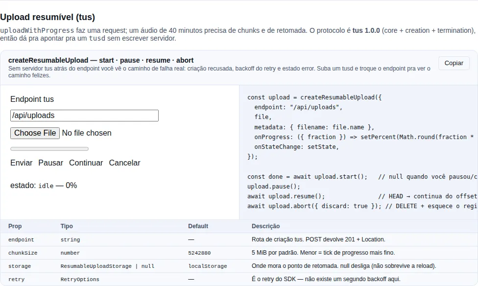

# Resumable upload (tus)

`uploadWithProgress` makes **one** request. That works until the file gets big: a 40-minute recording from `useAudioRecorder`, a video, a dump. Then a 4G connection that wobbles for three seconds throws away the 300 MB already sent, and reloading the page throws it away again.

`createResumableUpload` splits the file into chunks, remembers where it stopped, and carries on — after a network drop **or** a reload.

!!! info "Protocol: tus 1.0.0, not something we invented"
    The client speaks [tus](https://tus.io) (core plus the *creation* and *termination* extensions). That is deliberate: a resumable client with a private wire format means the backend is ours forever. With tus you can point it at `tusd`, `tus-node-server` or `py-tus` without writing a server at all — and the [What your backend must implement](#what-your-backend-must-implement) section fits in one table.

<!-- gallery:recipe-resumable-upload -->
[](gallery.md)

*Section `recipe-resumable-upload` of the [gallery](gallery.md) — run it locally to interact.*
<!-- /gallery -->

## The minimal example

```tsx
import { createResumableUpload, type ResumableUpload } from "tempest-react-sdk";
import { useRef, useState } from "react";

export function SendRecording({ file }: { file: File }) {
  const upload = useRef<ResumableUpload | null>(null);
  const [percent, setPercent] = useState(0);
  const [state, setState] = useState("idle");

  async function start() {
    upload.current ??= createResumableUpload({
      endpoint: "/api/uploads",
      file,
      metadata: { filename: file.name },
      onProgress: ({ fraction }) => setPercent(Math.round(fraction * 100)),
      onStateChange: setState,
    });

    const done = await upload.current.start();
    if (done) await fetch(`/api/recordings?url=${encodeURIComponent(done.url)}`, { method: "POST" });
  }

  return (
    <>
      <progress value={percent} max={100} />
      <button type="button" onClick={() => void start()}>Send</button>
      <button type="button" onClick={() => upload.current?.pause()}>Pause</button>
      <button type="button" onClick={() => void upload.current?.resume()}>Resume</button>
      <button type="button" onClick={() => void upload.current?.abort({ discard: true })}>
        Cancel
      </button>
      <p>{state}</p>
    </>
  );
}
```

What happens: a `POST` creates the upload, a series of `PATCH`es pushes 5 MiB at a time, `onProgress` gets every byte tick, and at the end `start()` resolves with `{ url, size }` — the tus URL, which you store next to the record.

!!! tip "`start()` resolves `null` when you paused or cancelled"
    Only a **failure** rejects. `pause()` and `abort()` are not failures, so the promise resolves `null` and you do not need a `try/catch` around a pause button.

## States

`upload.state` (and `onStateChange`) walks through:

| State | Meaning |
| --- | --- |
| `idle` | Nothing started |
| `creating` | The creation `POST` is in flight |
| `uploading` | Chunks are going out |
| `paused` | `pause()` — the resume point is **kept** |
| `done` | Finished; the persisted record was deleted |
| `error` | The retries ran out; `start()` rejected |
| `aborted` | `abort()` — with `discard: true`, the record was deleted |

## Resuming after a reload

That is the reason it exists. The client stores `{ url, offset, size, idempotencyKey }` (plus `owner`, with `getPrincipal`) under a **resume key** and, on the next `start()`, re-attaches to the upload:

```ts
const upload = createResumableUpload({ endpoint: "/api/uploads", file });
// Page reloaded, the user picked the same file, called start() again:
// → HEAD on the old upload, the offset comes back as 312 MB, the PATCHes carry on from there.
```

The default key is a fingerprint of `endpoint + name + size + type + lastModified` — the same criterion the reference tus clients use. Cheap (it does not hash 400 MB) and it changes whenever the file does, which is the property that matters: resuming into the wrong file would corrupt both.

!!! warning "A nameless `Blob` has a weak fingerprint"
    `Blob` has no `name` and no `lastModified`, so two blobs of the same size and type collide. Pass an explicit `key` when what you upload is not a `File`.

### Where the state lives

By default, `localStorage`, through `createLocalUploadStorage()`. **Not** IndexedDB, and that is a choice: the record is four fields and a URL, the requirement is only to survive a reload, and pulling Dexie in for that would put IndexedDB in the bundle of every app that uploads a file.

If your app already has a Dexie database open, plug yours in:

```ts
import {
  createOfflineStore,
  createResumableUpload,
  type ResumableUploadRecord,
} from "tempest-react-sdk";

const store = createOfflineStore<{ id: string; record: ResumableUploadRecord }, string>({
  databaseName: "Uploads",
  version: 1,
  tableName: "resume",
  indexes: "&id",
});

createResumableUpload({
  endpoint: "/api/uploads",
  file,
  storage: {
    get: async (key) => (await store.get(key))?.record ?? null,
    set: async (key, record) => {
      await store.put({ id: key, record });
    },
    delete: async (key) => {
      await store.delete(key);
    },
  },
});
```

`storage: null` turns persistence off: resuming then survives a network drop, but not a reload.

### One record per user — `getPrincipal` and `clear()`

The record survives a reload — and, for that very reason, a logout. The default key carries no user at all: if A signs out leaving an upload half-done and B picks a file with the same fingerprint, B's client would send `HEAD` and `PATCH` to A's upload URL with B's token and, if the server refused, send the creation `POST` with A's `Idempotency-Key` (#479).

Two pieces close this:

```ts
import { createLocalUploadStorage, createResumableUpload } from "tempest-react-sdk";

declare const file: File;
declare const auth: { getToken: () => string | null };
declare const session: { userId: string | null };

const upload = createResumableUpload({
  endpoint: "/api/uploads",
  file,
  getToken: () => auth.getToken(),
  getPrincipal: () => session.userId,
});

await upload.start();

export function onSessionEnd(): void {
  createLocalUploadStorage().clear();
}
```

- **`getPrincipal`** — the same getter the error reporter and `provideBackgroundSyncCredentials` take. The record gets a one-way fingerprint of the user (`owner`, never the raw id), and a record with another owner — another user, nobody, or no owner, written before 0.78.0 — is **deleted** instead of resumed: its URL gets no request, and its `Idempotency-Key` is never reused.
- **`clear()`** — removes every record under `createLocalUploadStorage()`'s `tempest-upload:` prefix. Call it from `onSessionEnd` (see [Auth → Ending the session](./auth.en.md#ending-the-session-createtempestauth-and-onsessionend)). A custom `storage` implements the equivalent on its side.

And if the account switch happens **while the upload runs**? `getPrincipal` is read again before every chunk and every record write: once it names someone else, the run stops with `ResumableUploadSupersededError` (`reason: "principal"`), before the new account's token reaches the previous one's upload URL. A `clear()` mid-run does the same (`reason: "cleared"`) instead of the record being written back. It is not a pause — the run cannot go on as the new account: the state moves to `"error"`.

```ts
import { ResumableUploadSupersededError, createResumableUpload } from "tempest-react-sdk";

declare const file: File;
declare const session: { userId: string | null };

export async function send(): Promise<string | null> {
  const upload = createResumableUpload({
    endpoint: "/api/uploads",
    file,
    getPrincipal: () => session.userId,
  });
  try {
    return (await upload.start())?.url ?? null;
  } catch (error) {
    if (error instanceof ResumableUploadSupersededError) return null;
    throw error;
  }
}
```

`clear()` only removes values shaped like an upload record: a prefix with no delimiter (`"app"`) does not take the app's own keys (`"appSettings"`) with it.

!!! warning "Without `getPrincipal`, the behavior is the old one"
    Without `getPrincipal`, any record under the same key is still resumed, whoever wrote it, and a run in progress does not notice the account switch. That is fine for a one-account-per-browser app; with more than one, pass the getter and clear at session end — and, without the getter, call `abort()` on the uploads in progress from `onSessionEnd`.

## The failure that actually happens

It is not the chunk that gets lost. It is the chunk the **server stored and whose response never came back**. The client cannot tell that from a lost chunk, and re-sending it blindly would duplicate bytes.

Two things prevent that:

**1. Writes are addressed, not appended.** Every `PATCH` states the offset it writes at (`Upload-Offset`). If the response was lost and the client repeats it, it is asking to write bytes the server already has — and gets `409`. On **any** retry the client re-reads the truth with `HEAD` before writing and continues from where the server really is.

**2. Creation carries an `Idempotency-Key`.** tus has no idempotent creation; without this, a lost `201` would leave an orphan upload on the server and the client would create a second one. The key (from `generateIdempotencyKey`) is stored **before** the first attempt and reused on retry. A backend that honours the header returns the same `Location`; one that ignores it works just the same, it only keeps the orphan.

!!! tip "The backoff is the SDK's `retry`"
    There is no second backoff here: every chunk runs inside [`retry`](./http.md#retry-exponential-backoff) — exponential, honouring `Retry-After`. Tune it with `retry: { retries, initialDelay, shouldRetry }`.

!!! check "What the chunk loop retries, and what it does not"
    Two of these decisions are **specific to the resume protocol** and do not
    follow the SDK's general policy:

    | Answer | Retried? | Why |
    | --- | --- | --- |
    | network failure, `408`, `425`, `429`, `5xx` | **yes** | the standard policy: it can change on its own |
    | `409`, `412` | **yes** | the offset-divergence signal — the replay *is* the fix, and the resync `HEAD` performs it |
    | `404`, `410` | **no** | the upload is gone from the server. Recreating one only happens at attach, never inside the loop |
    | `400`, `403`, `413`, `415`, `422` | **no** | a deliberate refusal; the 5th attempt gets the same answer |

    `409` is the interesting case: the SDK's general policy refuses 4xx, and it is
    right to — but here it means "your offset is wrong", which is exactly what the
    retry fixes.

    `404` is the inverse. A resource that vanished *looks* transient, but the
    resync `HEAD` hits the same `404`, so retrying meant probing a dead resource
    five times before reporting "the upload expired" — with the backoff stacked on
    top. Start a fresh upload for that one.

    Your own `shouldRetry` **replaces** this policy entirely, in both directions.

## What your backend must implement

Every request carries `Tus-Resumable: 1.0.0`.

| Step | Request | Expected response |
| --- | --- | --- |
| Create | `POST {endpoint}` + `Upload-Length`, `Upload-Metadata`, `Idempotency-Key` | `201` + `Location` (the upload URL, absolute or relative) |
| Probe | `HEAD {uploadUrl}` | `200`/`204` + `Upload-Offset` |
| Write | `PATCH {uploadUrl}` + `Upload-Offset`, `Content-Type: application/offset+octet-stream`, body = chunk | `204` + the new `Upload-Offset`; `409` when the offset does not match |
| Discard | `DELETE {uploadUrl}` | `204` |

Details that tend to bite:

- **`Location` may be relative.** The client resolves it against the page, so `/api/uploads/abc` is fine.
- **`Upload-Metadata`** is comma-separated `key base64(value)`, with the value encoded as **UTF-8 before** base64 — that is how `note-ação.webm` survives an HTTP header.
- **`HEAD` answering `404`/`410`** is read as "the server forgot this upload": the client recreates it from scratch instead of getting stuck.
- **A missing `Upload-Offset` on a successful `PATCH`** is tolerated — the client assumes the end of the chunk — but sending it is better.
- Keep a table of `Idempotency-Key`s if you want to avoid orphans.

!!! info "Off-the-shelf servers"
    `tusd` (Go), `tus-node-server` (Node) and `tuspy`/`py-tus` (Python) already implement the table. In a FastAPI app of your own it is four routes.

## Progress and pausing, precisely

```ts
const upload = createResumableUpload({
  endpoint: "/api/uploads",
  file,
  chunkSize: 1024 * 1024, // 1 MiB: finer ticks, more round-trips
  // the default is DEFAULT_CHUNK_SIZE (5 MiB), exported so a settings UI can show it
  getToken: () => auth.getToken(),
  withCredentials: true,
  retry: { retries: 8, initialDelay: 500 },
  onProgress: ({ loaded, total, fraction, resumedFrom }) => {
    console.log(`${loaded}/${total} (${Math.round(fraction * 100)}%), resumed at ${resumedFrom}`);
  },
});
```

- `onProgress` reports **bytes of the whole file**, not of the chunk. `resumedFrom` says how many were already on the server when this run started — useful so you do not announce "0%" for an upload that resumed at 80%.
- `pause()` drops the in-flight chunk; the persisted offset stays at the last **confirmed** chunk. `resume()` does a `HEAD` first, so partial bytes the server accepted are not lost.
- `abort({ discard: true })` sends `DELETE` and clears the record; without `discard`, the resume point stays.

!!! warning "The token does not follow `Location` off your origin"
    tus answers creation with a `Location` **the server chooses**, and the spec allows an absolute URL on another host — handing the upload to object storage is ordinary operation, not an attack. Up to 0.65.0 the bearer token followed that header wherever it pointed, along with the file bytes.

    Since **0.66.0** the credential is bound to the `endpoint`'s origin. When `Location` points elsewhere, the creation `POST` still carries the token — that one went to your backend — and the following `HEAD`/`PATCH`/`DELETE` go without it. The upload completes normally, which is what a presigned storage URL expects anyway.

    When the storage host genuinely needs your API's token, declare it:

    ```ts
    createResumableUpload({
      endpoint: "/api/uploads",
      file,
      getToken: () => auth.getToken(),
      trustedOrigins: ["https://storage.example.com"],
    });
    ```

    The same applies to the persisted record: a `url` in `localStorage` pointing off-origin does not get the token back on resume.

    The `csrf` option follows the same rule: the CSRF token goes on the creation `POST`, every `PATCH` and the discarding `DELETE` — never on the offset `HEAD` — and only to the `endpoint`'s origin and the `trustedOrigins`. See [CSRF](./http.md#csrf-a-session-cookie-needs-its-pair).

!!! warning "`XMLHttpRequest`, not `fetch`"
    As in `uploadWithProgress`: `fetch` still cannot report **upload** progress in any browser. There is a second reason here — tus returns the new offset in a **response header**, and `uploadWithProgress` only hands back a parsed body, so it could not be reused.

## Recap

- **`createResumableUpload({ endpoint, file })`** — 5 MiB chunks, resume across network drops and reloads, tus 1.0.0 on the wire.
- **`start()` / `pause()` / `resume()` / `abort({ discard })`**; `start()` resolves `null` when you stopped on purpose.
- The resume point lives in `localStorage` by default; swap it with `storage`, disable it with `null`.
- **`getPrincipal`** binds the record to the user; **`createLocalUploadStorage().clear()`** in `onSessionEnd` removes what is left.
- A lost response is handled by **addressed offsets + a `HEAD` before every retry**, and creation by an **`Idempotency-Key`**.
- The backoff is the SDK's `retry` — there is no second one.

### See also

- [HTTP](./http.md) — `uploadWithProgress` (single request), `retry`, `generateIdempotencyKey`
- [Audio](./audio.md) — `useAudioRecorder`, which produces the long files that motivated this
- [Offline](./offline.md) — `createOfflineStore`, if you would rather keep resume state in IndexedDB
