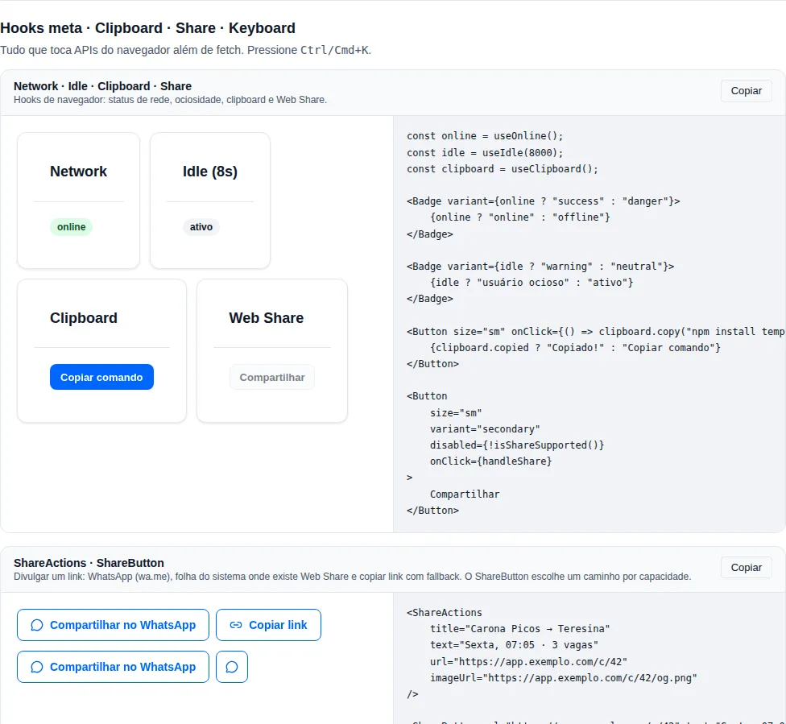

# Web Share

`share()` is a wrapper over the Web Share API (`navigator.share`) that returns a **uniform result** instead of throwing. You decide what to do in each case — including a custom fallback (copy link, social buttons) when the browser does not support it.

!!! info "Why wrap `navigator.share`?"
    The native API rejects the promise both when the user cancels the dialog and on real errors, and not every browser exposes it. Handling that by hand turns into a `try/catch` full of checks at every call site. `share()` collapses it all into a `ShareResult` object with clear booleans (`shared` / `unsupported` / `cancelled`), so your code becomes a simple `if`.

<!-- gallery:meta -->
[](gallery.md)

*Section `meta` of the [gallery](gallery.md) — run it locally to interact.*
<!-- /gallery -->

## Usage

```ts
import { share } from "tempest-react-sdk";

async function shareEvent() {
  const result = await share({
    title: "Tempest",
    text: "Check out this event",
    url: window.location.href,
  });

  if (result.unsupported) {
    copyLinkInstead(); // fallback: copy the link
  } else if (result.cancelled) {
    // user closed the sheet — silent, do nothing
  } else if (result.shared) {
    toast.success("Shared");
  } else if (result.error) {
    reportError(result.error); // a real error — send to telemetry
  }
}

declare function copyLinkInstead(): void;
declare function reportError(error: unknown): void;
declare const toast: { success: (message: string) => void };
```

### The payload (`SharePayload`)

All fields are optional — pass the ones that make sense:

| Field   | Type     | Description                                    |
| ------- | -------- | ---------------------------------------------- |
| `title` | `string` | Content title                                  |
| `text`  | `string` | Text/description                               |
| `url`   | `string` | URL to share                                   |
| `files` | `File[]` | Files (supported only on a subset of browsers) |

### The result (`ShareResult`)

| Field         | Type      | Meaning                                            |
| ------------- | --------- | -------------------------------------------------- |
| `shared`      | `boolean` | `navigator.share` resolved OK                      |
| `unsupported` | `boolean` | API missing, or the payload (files) is unsupported |
| `cancelled`   | `boolean` | User closed the sheet (`AbortError`)               |
| `error`       | `unknown` | Another error — capture for telemetry              |

!!! tip "`cancelled` is not an error"
    When the user closes the share sheet, it comes back as `cancelled: true`, **not** in `error`. Treat it as a silent no-op — showing an error toast here annoys the user.

## Detecting support upfront

Use `isShareSupported()` to decide whether to show the "Share" button or go straight to the fallback, without waiting for the click:

```tsx
import { isShareSupported, share } from "tempest-react-sdk";

export function ShareButton({ url }: { url: string }) {
  if (!isShareSupported()) {
    return <CopyLinkButton url={url} />;
  }

  return <button onClick={() => share({ title: "Tempest", url })}>Share</button>;
}

declare function CopyLinkButton(props: { url: string }): JSX.Element;
```

## Sharing files

Pass `files` to share images, PDFs, etc. `share()` calls `navigator.canShare({ files })` **before** trying — if the browser does not allow files (old iOS, Firefox desktop), you get `unsupported: true` instead of an exception:

```ts
import { share } from "tempest-react-sdk";

async function shareImage(imageFile: File) {
  const result = await share({ title: "Image", files: [imageFile] });
  if (result.unsupported) {
    // this browser does not share files — offer a download
    downloadFile(imageFile);
  }
}

declare function downloadFile(file: File): void;
```

!!! warning "Web Share API requires HTTPS and a user gesture"
    `navigator.share` only works in a secure context (HTTPS or `localhost`) and must be called inside a user-gesture handler (e.g. `onClick`). Calling it outside a click makes the browser reject — which lands in `error`, not `unsupported`.

## Export a file — `shareOrDownloadBlob`

The most common use of `files` is "I generated an artifact, now hand it to the user": on mobile it opens the native share sheet, and on desktop (or wherever file sharing is unsupported) it falls back to a plain download. `shareOrDownloadBlob(blob, fileName, options?)` wraps exactly that flow — a companion to `share()` built on top of it:

```ts
import { shareOrDownloadBlob } from "tempest-react-sdk";

async function exportReport(bytes: Uint8Array<ArrayBuffer>) {
  const zip = new Blob([bytes], { type: "application/zip" });
  await shareOrDownloadBlob(zip, "report.zip");
}
```

Under the hood it calls `share({ title, files: [file] })`. If the user **shared** or **cancelled** the sheet, the function returns and nothing else happens. Otherwise (browser without file-share support) it creates an `<a download>`, clicks it, and revokes the object URL — the classic download.

| Parameter       | Type     | Description                                          |
| --------------- | -------- | ---------------------------------------------------- |
| `blob`          | `Blob`   | The binary payload to share/download                 |
| `fileName`      | `string` | The file name presented to the user                  |
| `options.title` | `string` | Title for the share sheet (defaults to the file name)|
| `options.text` | `string` | Text sent in the same sheet as the file |
| `options.textOnlyFallback` | `boolean` | Share the text alone when the file is not shareable (defaults to `true` when `text` is set) |

### Text alongside the file

Pass `text` to send a caption with the file — an analysis result next to the photo, for example:

```ts
import { shareOrDownloadBlob } from "tempest-react-sdk";

async function shareResult(photo: Blob, score: number) {
  await shareOrDownloadBlob(photo, "result.webp", {
    title: "Analysis result",
    text: `FAMACHA grade ${score}`,
  });
}
```

The order is **file + text → text only → download**:

1. The browser shares files: it opens **one** sheet with the file and the text. Shared or cancelled, done.
2. The browser has Web Share but `canShare({ files })` refuses the file: it opens a sheet **with the text only** and then **downloads the file** — whatever the outcome of that sheet.
3. The browser has no Web Share: it downloads the file, as before.

!!! info "Why does the download still happen after the text?"
    Whoever calls `shareOrDownloadBlob` asked for a **file** to reach the user. In that browser the file was always downloaded; the text sheet is an addition on top of that behavior, not a replacement. If it replaced the download, a user picking "Mail" would get the caption and lose the photo, with no warning. That is why the `textOnlyFallback: true` default is safe: the only change is that the text arrives too. Want the download alone, as before? Pass `textOnlyFallback: false`.

!!! note "A real error skips the text sheet"
    If sharing the file fails with an error that is neither a cancellation nor missing support (a `NotAllowedError`, for example), the function goes straight to the download: the failed call usually consumed the user gesture, so a second sheet would be rejected too. `text: ""` counts as no text.

!!! tip "Pairs with `writeXlsx` / ZIP generation"
    Generate the spreadsheet with [`writeXlsx`](./utilities.en.md#spreadsheets-xlsx-writexlsx), wrap it in a `Blob`, and hand it to `shareOrDownloadBlob` — a full data export, from bytes to native sheet, with no extra dependency.
    With photos alongside, [`createZip`](./utilities.en.md#zip-archives-createzip) returns the `.zip` `Blob` directly, with progress.

## `useShare` — sharing with an image and a fallback

`share()` settles `navigator.share`. What every app wrote **around** it — downloading the preview image only when the device accepts files, not letting that download outlive the click's gesture, handling a cancel, copying the link — is `useShare()`:

```tsx
import { Button, useShare } from "tempest-react-sdk";

export function ShareRide({ url }: { url: string }) {
  const { canShare, share, copyLink, prefetchImage } = useShare();
  const imageUrl = `${url}/og.png`;

  async function handleClick(): Promise<void> {
    const outcome = await share({ title: "Ride Picos → Teresina", text: "Friday, 07:05", url, imageUrl });
    if (outcome === "unsupported") await copyLink(url);
  }

  return (
    <Button onPointerEnter={() => prefetchImage(imageUrl)} onClick={handleClick}>
      {canShare ? "Share" : "Copy link"}
    </Button>
  );
}
```

| Returns         | Type                                             | What it is                                                 |
| --------------- | ------------------------------------------------ | ---------------------------------------------------------- |
| `canShare`      | `boolean`                                        | `navigator.share` exists                                   |
| `canShareFiles` | `boolean`                                        | `navigator.canShare({ files })` accepts an image           |
| `share`         | `(content: ShareContent) => Promise<ShareOutcome>` | opens the system sheet; **never rejects**                |
| `copyLink`      | `(url: string) => Promise<boolean>`              | Clipboard API → `execCommand("copy")`                      |
| `prefetchImage` | `(imageUrl: string) => void`                     | starts the image download before the click                 |

`ShareContent` is `{ title?, text?, url?, imageUrl?, imageFileName? }`. `ShareOutcome`:

| Value           | When                                                                    | What to do                        |
| --------------- | ----------------------------------------------------------------------- | --------------------------------- |
| `"shared"`      | the sheet closed with a target picked                                   | nothing, or a toast               |
| `"cancelled"`   | the person closed the sheet (`AbortError`)                              | **nothing** — not an error        |
| `"unsupported"` | the browser has no Web Share                                            | `wa.me` or "copy link"            |
| `"failed"`      | the browser refused for another reason (expired gesture: `NotAllowedError`) | telemetry — the error goes to `onError` |

!!! note "Four outcomes, not three"
    The issue that asked for the hook (#800) listed `shared | cancelled | unsupported`. A `NotAllowedError` is none of them: the browser **has** Web Share and the person did not cancel. Calling it `unsupported` would make the app hide the button in a browser that shares; rejecting the promise would force a `try/catch` into every `onClick`. Hence `"failed"`, with the error in `useShare({ onError })`.

### The image: only when it goes, and never blocking

1. **Downloaded only when it can be sent.** `canShareFiles` asks `canShare` with an empty PNG — it judges a file by type and extension, not bytes — so where the device takes no files no request is made.
2. **With an image, the link goes inside the text.** Most targets keep a file's caption and drop the separate `url`; the hook joins `text` + `url` (without repeating a link the text already carries).
3. **Any failure shares without the image**: network, non-2xx status, CORS, a type the device refuses in `canShare` for the real file, or a download slower than `imageTimeoutMs` (default 3000 ms).
4. **The file name has an extension.** Chromium decides by it whether a file is shareable: the default is the last path segment (`og.png`) or `preview.<ext>` from the `Content-Type`. `imageFileName` overrides it.

!!! warning "The click's gesture expires — hence `prefetchImage`"
    `navigator.share` only runs while the click's **transient activation** is alive. Measured in Playwright's headless Chromium 159 (23/11/2026), reading `navigator.userActivation.isActive` after an `await fetch` of controlled duration: alive after 4.5 s, **gone after 5.5 s** — the same on desktop and with Pixel 7 emulation. WebKit is stricter (not measured here). Hence the 3 s ceiling on the image, and `prefetchImage`: call it on `pointerenter`, `focus` or `pointerdown`, and the click finds the image ready. `ShareActions` and `ShareButton` already do.

    To reproduce: open a page with a button whose `onclick` runs `await (await fetch("/slow?ms=5500")).blob()` and reads `navigator.userActivation.isActive`.

### Capability, not user agent

`canShare` is `navigator.share` existing — not the user agent saying "mobile". Desktop Chrome on Windows and macOS has the system sheet; desktop Firefox and Chrome on Linux do not; a phone browser without the API does not either. The ready buttons — [`ShareActions`](./components/actions.md#shareactions) and [`ShareButton`](./components/actions.md#sharebutton) — decide on that: with Web Share, the sheet; without it, the [`wa.me`](./br-pagamentos.md#spreading-without-a-recipient-whatsappshareurl) link.

!!! info "`copyLink` and the third step"
    `copyLink` tries the Clipboard API and, when it is missing **or rejects** (an in-app browser without the permission), `execCommand("copy")` on an off-screen `<textarea>`. It is the same chain as `useClipboard` and `InstallCopyLink`. When both are refused it resolves `false`: the third step — the link in a read-only field, already selected, for the person to press and hold — is UI, and `ShareActions` renders it.

## Recap

- `share(payload)` wraps `navigator.share` and returns `ShareResult` instead of throwing.
- `shareOrDownloadBlob(blob, fileName)` shares the file when it can, otherwise downloads it via `<a download>`.
- With `text`, the order is file + text → text only → download, and the download is never traded for the text.
- Check in order: `unsupported` → fallback, `cancelled` → silence, `shared` → success, `error` → telemetry.
- `SharePayload` accepts `title`, `text`, `url`, `files` (all optional).
- `isShareSupported()` decides upfront between the native button and the fallback.
- `files` is validated via `canShare` before trying; unsupported browsers return `unsupported: true`.
- `useShare()` wraps the flow: the image only where the device takes files and never blocking, `"cancelled"` without an error, `copyLink` with its fallback; `ShareActions` / `ShareButton` are the ready buttons.
- Requires HTTPS and a user gesture (call it from an `onClick`).

## See also

- [Hooks](./hooks.md) — `useClipboard` for the "copy link" fallback
