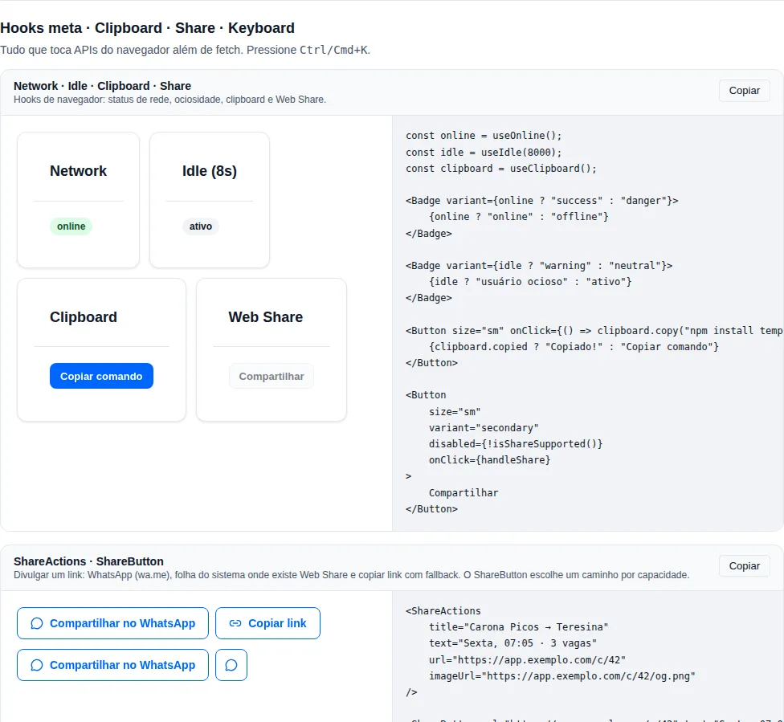

# Web Share

`share()` é um wrapper sobre a Web Share API (`navigator.share`) que devolve um **resultado uniforme** em vez de lançar exceções. Você decide o que fazer em cada caso — incluindo um fallback custom (copiar link, botões sociais) quando o browser não suporta.

!!! info "Por que envolver `navigator.share`?"
    A API nativa rejeita a promise tanto quando o usuário cancela o diálogo quanto em erros reais, e nem todo browser a expõe. Tratar isso manualmente vira um `try/catch` cheio de checagens em cada call site. `share()` colapsa tudo num objeto `ShareResult` com booleanos claros (`shared` / `unsupported` / `cancelled`), então o seu código vira um `if` simples.

<!-- gallery:meta -->
[](gallery.md)

*Seção `meta` da [gallery](gallery.md) — rode localmente para interagir.*
<!-- /gallery -->

## Uso

```ts
import { share } from "tempest-react-sdk";

async function shareEvent() {
  const result = await share({
    title: "Tempest",
    text: "Confira esse evento",
    url: window.location.href,
  });

  if (result.unsupported) {
    copyLinkInstead(); // fallback: copiar o link
  } else if (result.cancelled) {
    // usuário fechou o sheet — silencioso, não faça nada
  } else if (result.shared) {
    toast.success("Compartilhado");
  } else if (result.error) {
    reportError(result.error); // erro real — mande pra telemetria
  }
}

declare function copyLinkInstead(): void;
declare function reportError(error: unknown): void;
declare const toast: { success: (message: string) => void };
```

### O payload (`SharePayload`)

Todos os campos são opcionais — passe os que fizerem sentido:

| Campo   | Tipo     | Descrição                                           |
| ------- | -------- | --------------------------------------------------- |
| `title` | `string` | Título do conteúdo                                  |
| `text`  | `string` | Texto/descrição                                     |
| `url`   | `string` | URL a compartilhar                                  |
| `files` | `File[]` | Arquivos (suportado só num subconjunto de browsers) |

### O resultado (`ShareResult`)

| Campo         | Tipo      | Significado                                          |
| ------------- | --------- | ---------------------------------------------------- |
| `shared`      | `boolean` | `navigator.share` resolveu OK                        |
| `unsupported` | `boolean` | API ausente, ou o payload (arquivos) não é suportado |
| `cancelled`   | `boolean` | Usuário fechou o sheet (`AbortError`)                |
| `error`       | `unknown` | Outro erro — capture para telemetria                 |

!!! tip "`cancelled` não é erro"
    Quando o usuário fecha o sheet de compartilhamento, isso vem como `cancelled: true`, **não** em `error`. Trate como um no-op silencioso — mostrar um toast de erro aqui irrita o usuário.

## Detectando suporte antecipadamente

Use `isShareSupported()` para decidir se mostra o botão "Compartilhar" ou já parte para o fallback, sem esperar o clique:

```tsx
import { isShareSupported, share } from "tempest-react-sdk";

export function ShareButton({ url }: { url: string }) {
  if (!isShareSupported()) {
    return <CopyLinkButton url={url} />;
  }

  return <button onClick={() => share({ title: "Tempest", url })}>Compartilhar</button>;
}

declare function CopyLinkButton(props: { url: string }): JSX.Element;
```

## Compartilhando arquivos

Passe `files` para compartilhar imagens, PDFs, etc. `share()` chama `navigator.canShare({ files })` **antes** de tentar — se o browser não permite arquivos (iOS antigo, Firefox desktop), você recebe `unsupported: true` em vez de uma exceção:

```ts
import { share } from "tempest-react-sdk";

async function shareImage(imageFile: File) {
  const result = await share({ title: "Imagem", files: [imageFile] });
  if (result.unsupported) {
    // este browser não compartilha arquivos — ofereça download
    downloadFile(imageFile);
  }
}

declare function downloadFile(file: File): void;
```

!!! warning "Web Share API exige HTTPS e gesto do usuário"
    `navigator.share` só funciona em contexto seguro (HTTPS ou `localhost`) e precisa ser chamado dentro de um handler de gesto do usuário (ex.: `onClick`). Chamar fora de um clique faz o browser rejeitar — o que cai em `error`, não em `unsupported`.

## Exportar um arquivo — `shareOrDownloadBlob`

O caso mais comum de `files` é "gerei um artefato, agora entrega pro usuário": no celular abre a sheet nativa de compartilhamento, e no desktop (ou onde arquivos não são suportados) cai num download simples. `shareOrDownloadBlob(blob, fileName, options?)` encapsula exatamente esse fluxo — é um companheiro do `share()` construído em cima dele:

```ts
import { shareOrDownloadBlob } from "tempest-react-sdk";

async function exportReport(bytes: Uint8Array<ArrayBuffer>) {
  const zip = new Blob([bytes], { type: "application/zip" });
  await shareOrDownloadBlob(zip, "relatorio.zip");
}
```

Por baixo ele chama `share({ title, files: [file] })`. Se o usuário **compartilhou** ou **cancelou** a sheet, a função retorna e nada mais acontece. Caso contrário (browser sem suporte a compartilhar arquivos), ela cria um `<a download>`, dispara o clique e revoga o object URL — o download clássico.

| Parâmetro       | Tipo     | Descrição                                            |
| --------------- | -------- | ---------------------------------------------------- |
| `blob`          | `Blob`   | O conteúdo binário a compartilhar/baixar             |
| `fileName`      | `string` | Nome do arquivo apresentado ao usuário               |
| `options.title` | `string` | Título da sheet de compartilhamento (padrão: o nome) |
| `options.text` | `string` | Texto enviado na mesma sheet do arquivo |
| `options.textOnlyFallback` | `boolean` | Compartilhar só o texto quando o arquivo não é suportado (padrão: `true` quando há `text`) |

### Texto junto do arquivo

Passe `text` para mandar uma legenda junto do arquivo — o resultado de uma análise ao lado da foto, por exemplo:

```ts
import { shareOrDownloadBlob } from "tempest-react-sdk";

async function shareResult(photo: Blob, score: number) {
  await shareOrDownloadBlob(photo, "resultado.webp", {
    title: "Resultado da análise",
    text: `Grau FAMACHA ${score}`,
  });
}
```

A ordem é **arquivo + texto → só texto → download**:

1. O browser compartilha arquivos: abre **uma** sheet com o arquivo e o texto. Compartilhou ou cancelou, acabou.
2. O browser tem Web Share mas `canShare({ files })` recusa o arquivo: abre uma sheet **só com o texto** e, em seguida, **baixa o arquivo** — seja qual for o desfecho dessa sheet.
3. O browser não tem Web Share: baixa o arquivo, como antes.

!!! info "Por que o download acontece mesmo depois do texto?"
    Quem chama `shareOrDownloadBlob` pediu que um **arquivo** chegue ao usuário. Nesse browser o arquivo sempre foi baixado; a sheet de texto é um acréscimo sobre esse comportamento, não um substituto. Se ela substituísse o download, o usuário que escolhe "Mail" receberia a legenda e perderia a foto, sem aviso. Por isso o padrão `textOnlyFallback: true` é seguro: o que muda é só que o texto também chega. Quer só o download, como antes? Passe `textOnlyFallback: false`.

!!! note "Erro real pula a sheet de texto"
    Se o compartilhamento do arquivo falha com um erro que não é cancelamento nem falta de suporte (um `NotAllowedError`, por exemplo), a função vai direto para o download: a chamada que falhou costuma ter consumido o gesto do usuário, e uma segunda sheet seria rejeitada também. `text: ""` conta como sem texto.

!!! tip "Combina com `writeXlsx` / geração de ZIP"
    Gere a planilha com [`writeXlsx`](./utilities.md#planilhas-xlsx-writexlsx), embrulhe num `Blob` e passe pro `shareOrDownloadBlob` — exportação de dados completa, do byte à sheet nativa, sem dependência extra.
    Com fotos junto, [`createZip`](./utilities.md#arquivos-zip-createzip) já devolve o `Blob` do `.zip`, com progresso.

## `useShare` — compartilhar com imagem e fallback

`share()` resolve o `navigator.share`. O que cada app escrevia **em volta** dele — baixar a imagem da prévia só quando o aparelho aceita arquivo, não deixar o download estourar o gesto do clique, tratar cancelamento, copiar o link — é o `useShare()`:

```tsx
import { Button, useShare } from "tempest-react-sdk";

export function ShareRide({ url }: { url: string }) {
  const { canShare, share, copyLink, prefetchImage } = useShare();
  const imageUrl = `${url}/og.png`;

  async function handleClick(): Promise<void> {
    const outcome = await share({ title: "Carona Picos → Teresina", text: "Sexta, 07:05", url, imageUrl });
    if (outcome === "unsupported") await copyLink(url);
  }

  return (
    <Button onPointerEnter={() => prefetchImage(imageUrl)} onClick={handleClick}>
      {canShare ? "Compartilhar" : "Copiar link"}
    </Button>
  );
}
```

| Retorno         | Tipo                                             | O que é                                                    |
| --------------- | ------------------------------------------------ | ---------------------------------------------------------- |
| `canShare`      | `boolean`                                        | existe `navigator.share`                                   |
| `canShareFiles` | `boolean`                                        | `navigator.canShare({ files })` aceita uma imagem          |
| `share`         | `(content: ShareContent) => Promise<ShareOutcome>` | abre a folha do sistema; **nunca rejeita**               |
| `copyLink`      | `(url: string) => Promise<boolean>`              | Clipboard API → `execCommand("copy")`                      |
| `prefetchImage` | `(imageUrl: string) => void`                     | começa o download da imagem antes do clique                |

`ShareContent` é `{ title?, text?, url?, imageUrl?, imageFileName? }`. `ShareOutcome`:

| Valor           | Quando                                                                 | O que fazer                       |
| --------------- | ---------------------------------------------------------------------- | --------------------------------- |
| `"shared"`      | a folha fechou com um destino escolhido                                | nada, ou um toast                 |
| `"cancelled"`   | a pessoa fechou a folha (`AbortError`)                                 | **nada** — não é erro             |
| `"unsupported"` | o navegador não tem Web Share                                          | `wa.me` ou "copiar link"          |
| `"failed"`      | o navegador recusou por outro motivo (gesto expirado: `NotAllowedError`) | telemetria — o erro vai para `onError` |

!!! note "Quatro desfechos, não três"
    A issue que pediu o hook (#800) listava `shared | cancelled | unsupported`. Um `NotAllowedError` não é nenhum dos três: o navegador **tem** Web Share e a pessoa não cancelou. Chamá-lo de `unsupported` mandaria o app esconder o botão num navegador que compartilha; rejeitar a promise obrigaria todo `onClick` a ter `try/catch`. Por isso `"failed"`, com o erro em `useShare({ onError })`.

### A imagem: só quando vai, e nunca bloqueando

1. **Só baixa quando pode mandar.** `canShareFiles` pergunta ao `canShare` com um PNG vazio — ele julga o arquivo por tipo e extensão, não pelos bytes —, então onde o aparelho não aceita arquivo nenhuma requisição é feita.
2. **Com imagem, o link vai dentro do texto.** A maioria dos destinos guarda a legenda do arquivo e descarta o `url` separado; o hook junta `text` + `url` (sem repetir um link que o texto já traz).
3. **Qualquer falha compartilha sem a imagem**: rede, status não-2xx, CORS, tipo que o aparelho recusa no `canShare` do arquivo de verdade, ou download mais lento que `imageTimeoutMs` (padrão 3000 ms).
4. **O nome do arquivo tem extensão.** O Chromium decide por ela se o arquivo é compartilhável: o default é o último segmento do caminho (`og.png`) ou `preview.<ext>` pelo `Content-Type`. `imageFileName` sobrescreve.

!!! warning "O gesto do clique expira — por isso o `prefetchImage`"
    `navigator.share` só roda enquanto a **ativação transitória** do clique está viva. Medido no Chromium 159 headless do Playwright (23/11/2026), com `navigator.userActivation.isActive` lido depois de um `await fetch` de duração controlada: viva após 4,5 s, **morta após 5,5 s** — o mesmo em desktop e com emulação de Pixel 7. O WebKit é mais estrito (não medido aqui). Daí o teto de 3 s para a imagem, e o `prefetchImage`: chame no `pointerenter`, `focus` ou `pointerdown`, e o clique encontra a imagem pronta. `ShareActions` e `ShareButton` já fazem isso.

    Reproduzir: abra uma página com um botão cujo `onclick` faz `await (await fetch("/lento?ms=5500")).blob()` e lê `navigator.userActivation.isActive`.

### Capacidade, não user agent

`canShare` é `navigator.share` existir — não o user agent dizer "mobile". O Chrome desktop no Windows e no macOS tem a folha do sistema; o Firefox desktop e o Chrome no Linux não têm; um navegador de celular sem a API também não. Os botões prontos — [`ShareActions`](./components/actions.md#shareactions) e [`ShareButton`](./components/actions.md#sharebutton) — decidem por aí: com Web Share, a folha; sem, o link [`wa.me`](./br-pagamentos.md#divulgar-sem-destinatario-whatsappshareurl).

!!! info "`copyLink` e o terceiro passo"
    `copyLink` tenta a Clipboard API e, quando ela falta **ou rejeita** (navegador interno sem permissão), `execCommand("copy")` num `<textarea>` fora da tela. É a mesma cadeia do `useClipboard` e do `InstallCopyLink`. Quando as duas são recusadas, resolve `false`: o terceiro passo — o link num campo somente-leitura, já selecionado, para a pessoa tocar e segurar — é UI, e o `ShareActions` o renderiza.

## Recap

- `share(payload)` envolve `navigator.share` e devolve `ShareResult` em vez de lançar.
- `shareOrDownloadBlob(blob, fileName)` compartilha o arquivo quando dá, senão baixa via `<a download>`.
- Com `text`, a ordem é arquivo + texto → só texto → download, e o download nunca é trocado pelo texto.
- Cheque na ordem: `unsupported` → fallback, `cancelled` → silêncio, `shared` → sucesso, `error` → telemetria.
- `SharePayload` aceita `title`, `text`, `url`, `files` (todos opcionais).
- `isShareSupported()` decide antecipadamente entre o botão nativo e o fallback.
- `files` é validado via `canShare` antes de tentar; browsers sem suporte devolvem `unsupported: true`.
- `useShare()` junta o fluxo: imagem só onde o aparelho aceita arquivo e nunca bloqueando, `"cancelled"` sem erro, `copyLink` com o fallback; `ShareActions` / `ShareButton` são os botões prontos.
- Requer HTTPS e um gesto do usuário (chame de um `onClick`).

## Veja também

- [Hooks](./hooks.md) — `useClipboard` para o fallback "copiar link"
