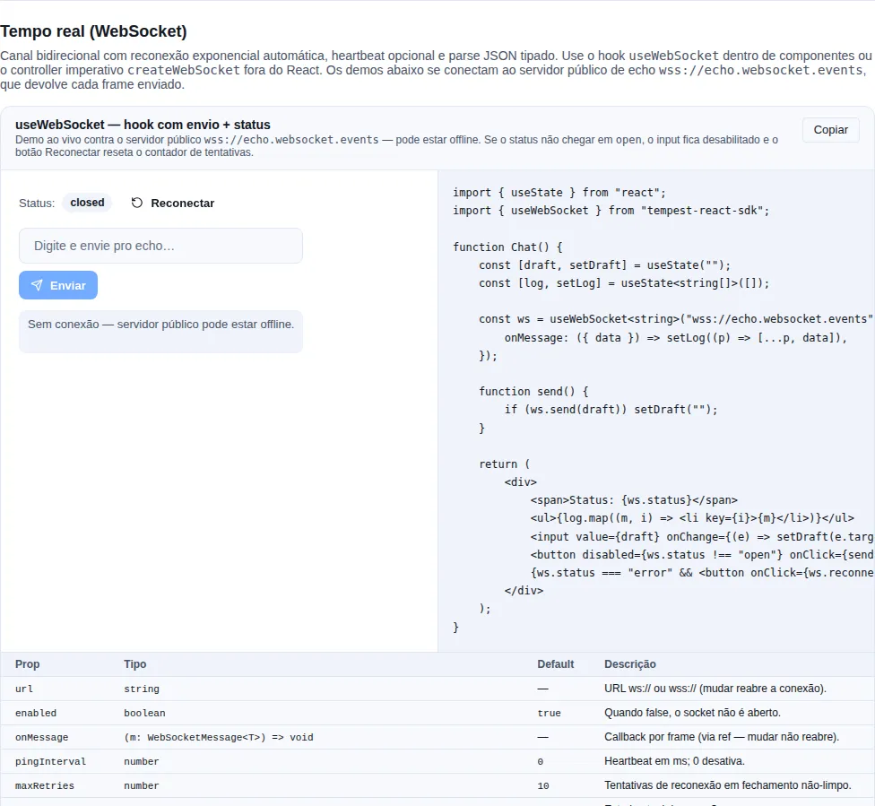

# Server-Sent Events

A wrapper over `EventSource` with exponential reconnect, opt-in heartbeat, and JSON parsing. Original use case: the notifications stream (`NEW-ALO`, `PAYMENT-SUCCESS`, etc.) from alofans-frontend.

!!! info "SSE vs WebSocket — which one?"
    SSE is one-way (server → client), runs over plain HTTP, reconnects on its own, and authenticates via cookies with no ceremony. If the client **does not need to send** messages, SSE is simpler and cheaper. For bidirectional traffic (chat, collaboration), use [WebSocket](./websocket.md).

<!-- gallery:recipe-realtime -->
[](gallery.md)

*Section `recipe-realtime` of the [gallery](gallery.md) — run it locally to interact.*
<!-- /gallery -->

## When to use

- One-way server → client push, with no need for the client to send.
- Cheap automatic reconnection.
- Cookie-based authentication (`withCredentials: true`) against a backend that reads the cookie on the stream itself.

!!! warning "`tempest-fastapi-sdk` >= 0.331.0 backend: the stream does not read cookies"
    The backend's ready-made SSE router opens the stream only with `?ticket=` (or `Authorization: Bearer`, which `EventSource` cannot send). The session cookie counts on the ticket request, not on the stream. For that backend, use [`useTicketEventStream`](#ticket-authentication-useticketeventstream) — with a header **or** a cookie session.

## Imperative API — `createEventStream`

Use it outside React (services, bootstrap) when you manage the lifecycle yourself:

```ts
import { createEventStream } from "tempest-react-sdk";

interface StreamEvent {
  type: "NOTIFY" | "PAYMENT-SUCCESS";
  message: string;
}

const stream = createEventStream<StreamEvent>(
  `${import.meta.env.VITE_API_URL}/notifications/stream`,
  {
    withCredentials: true,
    namedEvents: ["notification", "payment"],
    heartbeatEvents: ["ping"],
    maxRetries: 10,
    onOpen: () => console.log("SSE open"),
    onMessage: ({ event, data, id }) => {
      if (event === "payment") handlePayment(data);
      else addNotification(data);
    },
    onStatusChange: (status) => console.log("SSE", status),
    onError: (err) => console.error(err),
  },
);

// Later, on unmount / logout:
stream.close();

// Force an immediate reconnect (resets the retry counter):
stream.reconnect();

// Read the current status:
console.log(stream.status);
```

Each `onMessage` receives `{ event, data, id, raw }`: `event` is the SSE event name (default `"message"`), `data` is already JSON-parsed (with raw-string fallback), `id` is the server's `lastEventId`, and `raw` is the original `MessageEvent`.

### Reconnection and heartbeat

```text
Backoff: 1s → 2s → 4s → 8s → ... (capped at 30s), up to maxRetries (default 10)
```

- On every error the stream closes, schedules a reconnect with exponential backoff, and emits status `"closed"`. On a successful reopen the counter resets.
- Once `maxRetries` is exhausted, the status becomes `"error"` and the stream stops trying.
- Events listed in `heartbeatEvents` (default `["ping"]`) do **not** fire `onMessage` — they only keep the socket alive.

!!! tip "Match `heartbeatEvents` to your backend"
    If the server sends keep-alives under a different event name (e.g. `"keepalive"`), list it in `heartbeatEvents` so it doesn't pollute `onMessage` with pings.

## Hook — `useEventStream`

Inside components, the hook ties the stream's lifecycle to the component — opens on mount, closes on unmount:

```tsx
import { useEventStream } from "tempest-react-sdk";

interface Notification {
  id: string;
  message: string;
}

export function NotificationListener({ user }: { user: { id: string } | null }) {
  const { status, lastMessage, reconnect } = useEventStream<Notification>(
    `${import.meta.env.VITE_API_URL}/notifications/stream`,
    {
      enabled: !!user, // only connects once the user exists
      withCredentials: true,
      onMessage: ({ data }) => addToInbox(data),
    },
  );

  return (
    <div>
      <span>Stream: {status}</span>
      {status === "error" && <button onClick={reconnect}>Reconnect</button>}
      {lastMessage && <p>Latest: {lastMessage.data.message}</p>}
    </div>
  );
}
```

- `enabled: false` disconnects the stream (use it while waiting for `user` to load).
- Changing the URL re-opens the connection; changing `onMessage` does **not** (callback held in an internal ref — no pointless reconnects).
- `lastMessage` holds the last received message (heartbeats don't count).
- Automatic cleanup on unmount.

!!! warning "`error` means it exhausted its attempts"
    When the status reaches `"error"`, the stream gave up on its own. Offer a button calling `reconnect()` (which resets the counter) instead of waiting for an automatic reconnect that won't come.

## Ticket authentication — `useTicketEventStream`

`EventSource` cannot send headers. For a long time the way to authenticate the
stream was to put the access token in the URL (`?access_token=…`), which ends up
in the log of every proxy along the way. `tempest-fastapi-sdk` **0.331.0**
replaced that with a **ticket**: a normal authenticated call asks for a
short-lived JWT, and only that goes in the stream URL.

| Backend route | What it does |
| --- | --- |
| `POST /sse/ticket` | authenticated (header or cookie). Responds `{ "ticket": "<jwt>", "expires_in": 60 }` |
| `GET /sse/stream?ticket=<jwt>` | opens the stream; the channel comes from inside the ticket. Accepts `?ticket=` or `Authorization: Bearer` — **does not read cookies** |

The helper makes both calls for you — and repeats them on every reconnect:

```tsx
import { createApiClient, useTicketEventStream } from "tempest-react-sdk";
import { z } from "zod";

const api = createApiClient({
    baseURL: "https://api.example.com",
    prefix: "/api",
    getToken: () => localStorage.getItem("token"),
});

const notificationSchema = z.object({ id: z.string(), message: z.string() });

type Notification = z.infer<typeof notificationSchema>;

export function Notifications({ signedIn }: { signedIn: boolean }) {
    const { status, lastMessage, reconnect } = useTicketEventStream<Notification>({
        client: api,
        enabled: signedIn,
        schema: notificationSchema,
        onUrlError: (error) => console.warn("ticket refused:", error),
    });

    return (
        <div>
            <span>Stream: {status}</span>
            {status === "error" && <button onClick={reconnect}>Reconnect</button>}
            {lastMessage && <p>{lastMessage.data.message}</p>}
        </div>
    );
}
```

1. The ticket is requested through **`api`**: it carries `Authorization` (or the
   session cookie and `X-CSRF-Token`), and a `401` goes through the client's
   refresh before it reaches this code.
2. The stream URL is built with `api.url("/sse/stream", { ticket })` — same
   `baseURL`, same `prefix`. The access token **never** enters it.
3. **Every reconnect requests a new ticket.** A ticket only opens streams for
   `expires_in` seconds; reconnecting with the old one after that is a `401`.

What goes over the network, from the first stream to a drop after the ticket expired:

```text
POST https://api.example.com/api/sse/ticket                   200  {"ticket":"eyJ…A","expires_in":60}
GET  https://api.example.com/api/sse/stream?ticket=eyJ…A      200  text/event-stream
     … 3 min later the network drops; 1 s backoff …
POST https://api.example.com/api/sse/ticket                   200  {"ticket":"eyJ…B","expires_in":60}
GET  https://api.example.com/api/sse/stream?ticket=eyJ…B      200  text/event-stream
```

An open stream does **not** drop when the ticket expires — the ticket only counts
for opening. The reconnect is what needs a new one, and it asks for it.

!!! warning "Why `useEventStream` with a fixed URL does not work here"
    With `` useEventStream(`${API}/sse/stream?ticket=${ticket}`) `` the first stream
    opens, but the reconnect reuses the same string. If the network drops after
    60 s, the backend answers `401` to every attempt, the stream spends its
    `maxRetries` on that and ends in `"error"` — with the user still signed in.

### Cookie session

If sign-in keeps the session in a cookie (`AUTH_TOKEN_DELIVERY="cookie"` on the
backend), the ticket comes out the same way — only the client changes. `POST
/ticket` is a write, so the cookie needs its CSRF pair:

```tsx
import { createApiClient, useTicketEventStream } from "tempest-react-sdk";

const api = createApiClient({
    baseURL: "https://api.example.com",
    prefix: "/api",
    withCredentials: true,
    csrf: true,
});

export function Orders({ signedIn }: { signedIn: boolean }) {
    const { status } = useTicketEventStream<{ id: string; status: string }>({
        client: api,
        enabled: signedIn,
        onMessage: ({ data }) => console.log("order", data.id, data.status),
    });

    return <span>Stream: {status}</span>;
}
```

The cookie goes on `POST /ticket` (with `X-CSRF-Token`, echoed from the
`csrf_token` cookie); `GET /stream` carries only the ticket. `csrf` details in
[HTTP → CSRF](./http.md#csrf-a-session-cookie-needs-its-pair).

With an order changing status on the backend, the console shows:

```text
order 8f2c paid
order 8f2c shipped
```

### When the ticket is refused

A ticket denied with a status no amount of waiting fixes is **not retried**: the
stream goes straight to `status: "error"` and `onUrlError` receives the
`TempestApiError`.

| Ticket request failure | What happens |
| --- | --- |
| network, timeout, `429`, `5xx` | retried with the usual backoff |
| `401` (after the client's refresh) | stops at `"error"` — the session is over |
| `403 ACCOUNT_INACTIVE` | stops at `"error"` — account disabled |
| response without `ticket` | stops at `"error"` — contract differs from expected |

The policy is `isRetriableTicketError`; pass `shouldRetryUrl` to replace it.

A disabled account, for instance, ends like this — a single request, no stream and no retry:

```text
POST https://api.example.com/api/sse/ticket   403  {"detail":"…","code":"ACCOUNT_INACTIVE"}
status: "connecting" → "error"
onUrlError(error)  →  error.status === 403, error.code === "ACCOUNT_INACTIVE"
```

!!! tip "Prefix and parameter name"
    The defaults match the backend's `make_sse_router`: `prefix: "/sse"` and
    `ticketParam: "ticket"`. If the router is mounted elsewhere, pass both.
    Outside React, `createTicketEventStream({ client: api, ... })` does the same
    and returns the controller with `close`/`reconnect`/`status`.

### URL resolved per connection

The helper rests on a `createEventStream`/`useEventStream` feature you can use
directly: **`url` can be a function**, called before every connection — the
first one and each reconnect. It may be `async`. Useful for any short-lived
credential in the URL:

```ts
import { createEventStream } from "tempest-react-sdk";

const stream = createEventStream(
    async () => {
        const response = await fetch("/api/stream-url", { method: "POST" });
        const { url } = (await response.json()) as { url: string };
        return url;
    },
    {
        shouldRetryUrl: (error) => !(error instanceof TypeError),
        onUrlError: (error) => console.error("could not build the URL:", error),
    },
);

stream.close();
```

Every connection calls the function again — reconnects included:

```text
POST /api/stream-url   200  {"url":"https://events.example.com/s?sig=A"}
GET  https://events.example.com/s?sig=A           (open; the network drops)
POST /api/stream-url   200  {"url":"https://events.example.com/s?sig=B"}
GET  https://events.example.com/s?sig=B           (open)
```

- If the function throws or rejects, `onUrlError` is called and the stream
  retries with backoff — unless `shouldRetryUrl` returns `false`, which goes
  straight to `"error"`. These failures count against `maxRetries`.
- A resolution that settles after `close()` or `reconnect()` is discarded.
- In the hook, a function created inline does **not** reconnect on every render:
  the latest one is used on the next connection. Call `reconnect()` to apply it
  now. A `string` URL still reopens when it changes.

### Migrating to `tempest-fastapi-sdk` >= 0.331.0

Upgrading the backend replaces the stream route. Find your row:

| How your front end opens the stream today | What happens after upgrading the backend | What to do |
| --- | --- | --- |
| `` useEventStream(`${API}/sse/stream?access_token=${token}`) `` | `401` — `allow_access_token_query` is `False` by default | switch to `useTicketEventStream({ client: api })` |
| `useEventStream(url, { withCredentials: true })` with a cookie session | `401` — the stream does not read cookies | switch to `useTicketEventStream` with the client in `withCredentials` + `csrf` ([above](#cookie-session)) |
| `createEventStream(url, ...)` outside React | same as the rows above | `createTicketEventStream({ client: api, ... })` |
| your own SSE endpoint, not the backend's ready-made router | nothing changes | nothing — `useEventStream` stays the same |

The options (`schema`, `namedEvents`, `onMessage`, `enabled`, …) are the same;
only the URL goes, which the helper builds from the client's `baseURL` and `prefix`.

!!! tip "Migrate without a breaking window"
    Upgrade the backend with `sse_router(..., allow_access_token_query=True)`: it
    accepts the ticket **and** the old `?access_token=`. Ship the front end with
    the helper, wait for old clients to go away, then turn the option off. Server
    side: [`tempest-fastapi-sdk` SSE recipe](https://mauriciobenjamin700.github.io/tempest-fastapi-sdk/en/recipes/sse/) ("Authentication" section).

## A frame that is not JSON

Both transports `JSON.parse` the frame by default. When that fails — the server
returned an error page, a plain-text `ping` arrived, a proxy injected something —
the SDK delivers the **raw string announced as your type**. That is the historical
behaviour and it stays, because changing it would break whoever relies on it; what
changed is that it stopped being silent.

```tsx
import { createEventStream } from "tempest-react-sdk";

interface Event {
    id: string;
    kind: string;
}

const socket = createEventStream<Event>("https://api.example.com/events", {
    onParseError: (error, raw) => {
        console.error("unreadable frame, dropped:", raw.slice(0, 120), error);
    },
    onMessage: ({ data }) => {
        console.log(data.id);
    },
});
```

With `onParseError` registered, the broken frame **does not reach** `onMessage` — a
caller who asked to hear about failures did not ask to also receive the frame.
Without it, the frame is delivered as before and a development build warns **once**
per transport in the console.

!!! warning "Why the old default is a trap"
    `data` typed as `Event` while actually being a `string` does not blow up at the
    parse — it blows up at the first `data.id`, far away, with nothing pointing at
    the frame that caused it. The warning and `onParseError` exist so the error
    shows up where it happens.

!!! tip "`parser` still wins"
    Passing `parser` switches all of this off: its result is delivered, because
    decoding text, base64 binary or a protocol of your own is exactly what the
    option is for. `onParseError` only applies when there is no `parser`. The one
    thing that still looks at what `parser` returned is
    [`schema`](#validating-the-frame-with-schema), when you pass both.

## Validating the frame with `schema`

The type argument (`createEventStream<Event>`) is a **promise about the server
that TypeScript cannot keep**: it is erased at runtime. A frame missing its
`message` field reaches `onMessage` announced as `Event`, with
`message: undefined`, and the app writes that to IndexedDB and renders an empty
notification — with no error anywhere along the way.

Pass `schema` and validating stops being the app's job:

```tsx
import { useEventStream } from "tempest-react-sdk";
import { z } from "zod";

const notificationSchema = z.object({
    id: z.string(),
    message: z.string(),
});

type Notification = z.infer<typeof notificationSchema>;

export function Notifications() {
    const { status } = useEventStream<Notification>("https://api.example.com/notifications/stream", {
        namedEvents: ["notification"],
        schema: notificationSchema,
        onValidationError: (issues, raw) => {
            console.warn("frame off contract, dropped:", issues, raw.slice(0, 120));
        },
        onMessage: ({ data }) => {
            console.log(data.message);
        },
    });

    return <p>Stream: {status}</p>;
}
```

What the option guarantees:

- **without `schema`, nothing changes** — today's path stays exactly as it is, fallback and warning included;
- **a frame that does not match is not delivered**, the same rule `onParseError` already follows, and `onValidationError` receives the `issues` (dotted `path` + `message`) plus the raw text;
- **the delivered value is the schema's output**, so `z.coerce`, `.default()` and `.transform()` all count;
- **`parser` decodes first**, and `schema` validates what it returned;
- **an empty frame is an invalid frame**: `JSON.parse("")` throws, and with `schema` the raw text goes to the schema, which refuses it — instead of arriving as an empty string announced as your type.

!!! tip "zod, valibot, arktype — and the SDK depends on none of them"
    `schema` accepts anything exposing [Standard Schema](https://standardschema.dev)
    (`~standard`, which zod >= 3.24, valibot and arktype all implement) or
    `.safeParse` — the signature every zod user already knows, and the one that
    covers zod 3.23, which predates `~standard`. None of those libraries becomes
    a dependency: validation is called through the interface.

!!! warning "Validation must be synchronous"
    The frame is decoded inside the `message` handler and delivered from it, so
    there is nowhere to `await`: an async schema would deliver frames in whatever
    order their validations settled. That case is **reported** through
    `onValidationError` rather than awaited. Use `z.object(...)`, not
    `.refine(async ...)`.

!!! info "Declare the schema outside the component"
    `schema` is read when the stream opens. A schema built inline is a new object
    on every render — declare it at module level (or memoize it), and the one in
    force is whichever existed at the last open.

!!! check "A signal that exists in production, not only in dev"
    The one-time warning is dev-only (it goes through `isDevBuild()`, which answers
    correctly on its own under Vite, webpack, Rspack and Parcel — measured) and it
    lives in the console of whoever has DevTools open. `onValidationError` is the
    app's own: it fires in **every** build, and it is where a "the backend changed
    the contract" metric comes from — the one that reaches your logger in
    production, where nobody is watching a console.

## Status

`"idle" | "connecting" | "open" | "closed" | "error"`:

- `idle` — not connected yet (or `enabled: false`).
- `connecting` — handshake in progress.
- `open` — connected and receiving.
- `closed` — closed, possibly waiting to reconnect.
- `error` — exhausted `maxRetries`, no longer trying.

## Recap

- `createEventStream(url, options)` opens an SSE with exponential reconnect; the controller exposes `close`, `reconnect`, and `status`.
- `url` can be a function called on every connection; `useTicketEventStream({ client })` uses that to request a fresh ticket on every reconnect, with no token in the URL.
- `useEventStream(url, options)` is the React wrapper: ties the lifecycle to the component, exposes `status`/`lastMessage`/`reconnect`, and respects `enabled`.
- Heartbeats (default `["ping"]`) keep the socket alive without firing `onMessage`.
- `schema` validates each frame before delivering it: what does not match never reaches `onMessage`, and `onValidationError` says why.
- Status `"error"` = attempts exhausted; offer the user a `reconnect()`.

## See also

- [WebSocket](./websocket.md) — when the client also needs to send
- [Offline](./offline.md) — persist the history received over SSE
- [Audio](./audio.md) — play a sound when certain events arrive
- [HTTP](./http.md)
